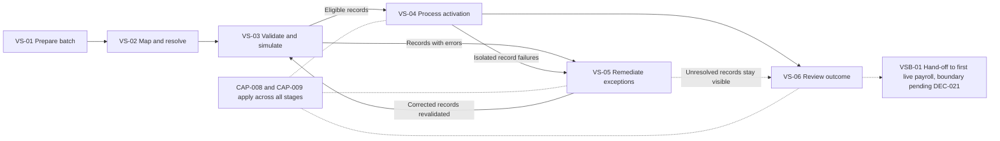

# ARC-002: Guided Activation Value Stream

Artifact: ARC-002
Status: DRAFT
Task: Task 02, Business Architecture and Capability Modelling
Sources: `Business Model Canvas to Business Architecture Blueprint.md` section 3 value stream, `requirements-document-map.md`, epic-01 to epic-06 acceptance criteria, BIZ-006, ARC-001, ARC-003

## 1. Purpose

This artifact defines the guided activation value stream end to end: how value is created for the client and the payroll provider from batch initiation to reviewed results. It is business architecture. It names stages, entry and exit criteria, the value each stage creates, and the capabilities each stage draws on. It does not describe the operational workflow, state model or decision tables, which belong to the next task.

The six stages follow the six value-stream steps in the blueprint section 3 one to one, and each stage groups the journey stages JS-01 to JS-13 from BIZ-006. Entry and exit criteria are taken from the epic acceptance criteria; none introduces a threshold, rule or obligation that the baseline does not state.

## 2. Value stream stages

| ID | Stage | Entry criteria | Exit criteria | Value created | Stakeholders | Capabilities | Journey stages | Epic |
| :-- | :-- | :-- | :-- | :-- | :-- | :-- | :-- | :-- |
| VS-01 | Prepare batch | An administrator has employee data and the activation context needed to start a batch | The batch is identified and its input is structurally usable; input problems are reported with a specific reason | A known, inspectable batch; input problems separated from record-level problems | STK-001, STK-002, STK-003, STK-004, STK-007 | CAP-001, CAP-010, CAP-011, CAP-012 | JS-01, JS-02 | EPIC-01 |
| VS-02 | Map and resolve | Structurally usable batch input | Every field, pay code and context assignment is mapped or visibly flagged for review; user-approved corrections are available to validation | Reconciled data with ambiguity visible rather than guessed | STK-001, STK-002, STK-003, STK-004 | CAP-002, CAP-003, CAP-013, CAP-014, CAP-015, CAP-016, CAP-017, CAP-018 | JS-03, JS-04, JS-05 | EPIC-02 |
| VS-03 | Validate and simulate | Mapped records, or corrected records returning from VS-05 | Each record has a validation and dry-run outcome available to the activation decision; failed checks cannot be silently bypassed | Issues found before commit, with no live payroll effects | STK-001, STK-003, STK-004, STK-009, STK-011 | CAP-004, CAP-019, CAP-020, CAP-021, CAP-035, CAP-036, CAP-037, CAP-038 | JS-06, JS-07 | EPIC-03 |
| VS-04 | Process activation | Records that passed the required checks, subject to approval under the authorization model | Every record in the batch has an outcome and remains associated with its batch | Valid records activate without being blocked by unrelated failures | STK-001, STK-003, STK-004, STK-005 | CAP-005, CAP-008, CAP-022, CAP-023, CAP-024, CAP-031 | JS-08, JS-09 | EPIC-04 |
| VS-05 | Remediate exceptions | Records with errors from VS-03, or records isolated in VS-04 | Corrected records return to VS-03; unresolved records stay distinct from activated records | Correction without restarting the batch | STK-001, STK-002, STK-003, STK-004, STK-011 | CAP-006, CAP-008, CAP-025, CAP-026, CAP-027, CAP-032 | JS-10, JS-11 | EPIC-05 |
| VS-06 | Review outcome | Batch processing has finished, or records still need attention | Users can distinguish activated, failed and pending records and trace each outcome | Transparent, explainable results for users and reviewers | STK-001, STK-002, STK-003, STK-004, STK-006, STK-008, STK-010, STK-011, STK-012 | CAP-007, CAP-009, CAP-028, CAP-029, CAP-030, CAP-033, CAP-034 | JS-12 | EPIC-06 |
| VSB-01 | Hand-off to the first live payroll, boundary | Reviewed outcome | Not defined; DEC-021 | Not assessed until DEC-021 | Not assigned | None | JS-13 | None |

## 3. Exception path and revalidation

Records with errors leave VS-03 for VS-05. Records whose processing fails in VS-04 are isolated and also go to VS-05, as the epic-04 scope requires. Corrected records return from VS-05 to VS-03 and are revalidated on their own; the batch is not restarted. Records that remain unresolved stay distinct from activated records and stay visible in VS-06. This follows the dependency flow in `requirements-document-map.md`.

Which issues send a record to VS-05, which only require review, and which conditions pause or stop a whole batch, is not decided (DEC-006). The value stream therefore shows the exception path without classifying the issues that trigger it.

## 4. Boundary: hand-off to the first live payroll

VSB-01 marks the hand-off from activation to the first live payroll run (JS-13). It is a boundary, not an in-scope stage, because whether the hand-off belongs to this capability is open (DEC-021). No capability is assigned to it. The first live payroll itself is performed by the payroll engine, which is out of scope (OOS-002).

## 5. Cross-cutting capabilities

Two capabilities apply across stages rather than within one. CAP-008, activation authorization and approval, governs the approval of activation in VS-04 and of sensitive corrections and bulk fixes in VS-05. CAP-009, activation data protection, governs who can see activation detail and how long it is kept, chiefly in VS-06 and in every stage that handles employee identity, compensation, tax, benefits or banking data. Both are proposed additions to the blueprint (PCR-010).

## 6. Alignment

| Blueprint value-stream step | Stage | Journey stages | Epic |
| :-- | :-- | :-- | :-- |
| Prepare batch | VS-01 | JS-01, JS-02 | EPIC-01 |
| Map and resolve | VS-02 | JS-03, JS-04, JS-05 | EPIC-02 |
| Validate and simulate | VS-03 | JS-06, JS-07 | EPIC-03 |
| Process activation | VS-04 | JS-08, JS-09 | EPIC-04 |
| Remediate exceptions | VS-05 | JS-10, JS-11 | EPIC-05 |
| Review outcome | VS-06 | JS-12 | EPIC-06 |
| None, boundary | VSB-01 | JS-13 | None |

## 7. Diagram

Source file: `docs/diagrams/arc-002-value-stream.mmd`

## 8. Open items

| Item | Effect on the value stream |
| :-- | :-- |
| DEC-006 | Defines which issues route a record to VS-05 and when a batch stops |
| DEC-007 | Defines who approves activation in VS-04 and sensitive corrections in VS-05 |
| DEC-010 | Defines the activation context required to leave VS-01 |
| DEC-016 | Defines what the dry run in VS-03 reproduces |
| DEC-021 | Decides whether VSB-01 becomes an in-scope stage |
| DEC-023 | Decides whether outcome measurement in VS-06 is in scope |
