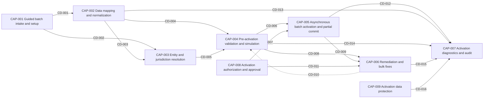

# ARC-006: Business Architecture Blueprint

Artifact: ARC-006
Status: DRAFT
Task: Task 02, Business Architecture and Capability Modelling
Sources: ARC-001 to ARC-005, BIZ-001 to BIZ-008, `Business Model Canvas to Business Architecture Blueprint.md`, `product-backlog.md`, epic-01 to epic-06

## 1. Summary

The guided activation business architecture has 38 business capabilities: 9 at Level 1, 25 at Level 2 and 4 at Level 3. Seven Level 1 capabilities are the ones in the existing blueprint, CAP-001 to CAP-007, with their meaning unchanged. Two are proposed cross-cutting additions: authorization and approval (CAP-008), and data protection (CAP-009). The capabilities serve a six-stage value stream, VS-01 to VS-06, with a revalidation loop and an open boundary at the first live payroll.

Every objective BO-001 to BO-008, every epic and every story PA-01 to PA-16 is supported by at least one capability. Two gaps remain. CAP-009 supports no Task 01 objective and rests on a constraint (CON-004). Activation context capture (CAP-012), activation approval (CAP-031) and outcome measurement (CAP-030) have no backlog story. All ownership assignments are proposals for confirmation. Nothing here is approved.

## 2. Business intent

The intent is stated in the blueprint section 1 and adopted unchanged in BIZ-001 section 11: prepare, check, simulate, activate and remediate large employee batches with less manual effort and fewer errors, without compromising payroll accuracy or statutory compliance. This blueprint structures how the business delivers that intent. It does not restate it.

## 3. Value stream

ARC-002 defines six stages that follow the blueprint value stream one to one: VS-01 prepare batch, VS-02 map and resolve, VS-03 validate and simulate, VS-04 process activation, VS-05 remediate exceptions and VS-06 review outcome. Records with errors loop from VS-05 back to VS-03 for revalidation. VSB-01, the hand-off to the first live payroll, is a boundary pending DEC-021.

## 4. Capability map

The canonical definitions are in ARC-001. Traceability is in ARC-003.

| Level 1 capability | Type | Level 2 and Level 3 capabilities | Epics | Objectives |
| :-- | :-- | :-- | :-- | :-- |
| CAP-001 Guided batch intake and setup | Core | CAP-010, CAP-011, CAP-012 | EPIC-01 | BO-001, BO-008 |
| CAP-002 Data mapping and normalization | Core | CAP-013, CAP-014, CAP-015 | EPIC-02 | BO-002, BO-003 |
| CAP-003 Entity and jurisdiction resolution | Core | CAP-016, CAP-017, CAP-018 | EPIC-02 | BO-003, BO-006 |
| CAP-004 Pre-activation validation and simulation | Core | CAP-019, CAP-035, CAP-036, CAP-037, CAP-038, CAP-020, CAP-021 | EPIC-03 | BO-003, BO-004, BO-006 |
| CAP-005 Asynchronous batch activation and partial commit | Core | CAP-022, CAP-023, CAP-024 | EPIC-04 | BO-001, BO-005, BO-006 |
| CAP-006 Remediation and bulk fixes | Core | CAP-025, CAP-026, CAP-027 | EPIC-05 | BO-002, BO-005, BO-007 |
| CAP-007 Activation diagnostics and audit | Core | CAP-028, CAP-029, CAP-030 | EPIC-06 | BO-007, BO-008 |
| CAP-008 Activation authorization and approval | Cross-cutting, proposed | CAP-031, CAP-032 | EPIC-04, EPIC-05 | BO-006 |
| CAP-009 Activation data protection | Cross-cutting, proposed | CAP-033, CAP-034 | EPIC-06 | None; constraint CON-004 |

Source file: `docs/diagrams/arc-001-capability-map.mmd`

```mermaid
flowchart TB
    %% ARC-001 capability map. DRAFT. Level 1 as groups, Level 2 inside, Level 3 linked to its parent.
    %% CAP-008 and CAP-009 are proposed cross-cutting additions (PCR-010).
    subgraph G001["CAP-001 Guided batch intake and setup"]
        CAP010["CAP-010 Batch identification and lifecycle tracking"]
        CAP011["CAP-011 Batch input acceptance and structural inspection"]
        CAP012["CAP-012 Activation context capture"]
    end
    subgraph G002["CAP-002 Data mapping and normalization"]
        CAP013["CAP-013 Source-to-payroll field mapping"]
        CAP014["CAP-014 Custom pay-code mapping"]
        CAP015["CAP-015 Mapping review and approval"]
    end
    subgraph G003["CAP-003 Entity and jurisdiction resolution"]
        CAP016["CAP-016 Entity hierarchy resolution and inheritance"]
        CAP017["CAP-017 Jurisdiction context assignment"]
        CAP018["CAP-018 Ambiguity surfacing and resolution"]
    end
    subgraph G004["CAP-004 Pre-activation validation and simulation"]
        CAP019["CAP-019 Pre-activation data and configuration validation"]
        CAP035["CAP-035 Compensation framework validation"]
        CAP036["CAP-036 Tax jurisdiction and withholding validation"]
        CAP037["CAP-037 Benefit plan assignment validation"]
        CAP038["CAP-038 Direct-deposit banking detail validation"]
        CAP020["CAP-020 Issue severity classification"]
        CAP021["CAP-021 Activation dry-run simulation"]
    end
    subgraph G005["CAP-005 Asynchronous batch activation and partial commit"]
        CAP022["CAP-022 Asynchronous batch processing and progress visibility"]
        CAP023["CAP-023 Eligible-record activation and record isolation"]
        CAP024["CAP-024 Processing recovery without duplicate effects"]
    end
    subgraph G006["CAP-006 Remediation and bulk fixes"]
        CAP025["CAP-025 Record- and field-level error diagnosis"]
        CAP026["CAP-026 Record correction and revalidation"]
        CAP027["CAP-027 Reviewed bulk correction"]
    end
    subgraph G007["CAP-007 Activation diagnostics and audit"]
        CAP028["CAP-028 Batch and record outcome reporting"]
        CAP029["CAP-029 Activation history recording"]
        CAP030["CAP-030 Activation outcome measurement"]
    end
    subgraph G008["CAP-008 Activation authorization and approval"]
        CAP031["CAP-031 Activation approval"]
        CAP032["CAP-032 Sensitive change authorization"]
    end
    subgraph G009["CAP-009 Activation data protection"]
        CAP033["CAP-033 Role-based access to activation detail"]
        CAP034["CAP-034 Activation data retention control"]
    end
    CAP019 --> CAP035
    CAP019 --> CAP036
    CAP019 --> CAP037
    CAP019 --> CAP038
```

## 5. Keeping the concepts separate

A business capability is what the organization must be able to do, regardless of how. An operational process is how the work flows, which belongs to the next task. A solution capability is a function of the proposed application. A technical component is an implementation element and is out of scope for business architecture. The examples below show where one capability ends and the next concept begins. Where a solution capability involves AI, it is bound by AIB-002: AI only suggests, people approve, and deterministic rules decide validity.

| Business capability | Operational process, next task | Solution capability, illustrative | Technical component |
| :-- | :-- | :-- | :-- |
| CAP-014 Custom pay-code mapping | The administrator reviews each unmatched client pay code during mapping | Optional pay-code match suggestion, AI-002, under AIB-002 and AIB-009 | Out of scope |
| CAP-021 Activation dry-run simulation | The administrator runs a dry run after validation and reviews conflicts | A non-committing simulation run against the statutory engines | Out of scope |
| CAP-023 Eligible-record activation and record isolation | Eligible records proceed while failing records move to remediation | Per-record commit with isolation of failures | Out of scope |
| CAP-025 Record- and field-level error diagnosis | The administrator opens a failing record and reads the field-level reason | Error coordinates with an optional plain-language explanation, AI-003, under AIB-002 | Out of scope |

The technical stack in `tech-stack.md` is a proposal, not a constraint (DEC-022, recorded in PCR-006). No capability, stage, ownership assignment or dependency in Task 02 depends on it.

## 6. Stakeholders, ownership and accountability

ARC-004 assigns an owning role, an accountable role, consulted roles and, where useful, a performing role to every capability, using BIZ-003 role names only. Every assignment is an assumption for confirmation. Assignments that rely on the four inferred roles, STK-010 to STK-013, are doubly provisional, because the roles themselves are unconfirmed.

| Role | Owns | Accountable for |
| :-- | :-- | :-- |
| STK-001 | 0 | 3 |
| STK-003 | 15 | 20 |
| STK-004 | 20 | 10 |
| STK-006 | 0 | 1 |
| STK-010 | 0 | 1 |
| STK-011 | 3 | 3 |

The pattern follows the blueprint section 3. The product or engineering owner delivers and operates the capability, so owns most of it. The payroll or compliance owner confirms validation rules and blocking conditions, so owns or is accountable for the rule-bearing capabilities. The payroll administrator performs most capabilities and is accountable for the corrections they make.

## 7. Business rules and decision points

These rules restate the business rules in the blueprint section 3 and the acceptance criteria of the epics, with IDs for traceability. Each is a proposed business rule, not a legal or regulatory requirement, and each awaits confirmation by the payroll or compliance owner (STK-003). Detailed decision modelling belongs to the next task.

| ID | Rule | Source | Capabilities | Control tier |
| :-- | :-- | :-- | :-- | :-- |
| BR-001 | A record with an activation-blocking issue must not be activated | Blueprint section 3 | CAP-020, CAP-023 | Proposed business rule |
| BR-002 | An invalid record must not erase or hide the status of other records in its batch | Blueprint section 3 | CAP-023, CAP-028 | Proposed business rule |
| BR-003 | Partial commit must preserve every required validation and compliance control | Blueprint section 3 | CAP-019, CAP-023 | Proposed business rule |
| BR-004 | Ambiguous mappings or entity assignments must be made visible for resolution, never silently guessed | Blueprint section 3; epic-02 acceptance criteria | CAP-015, CAP-018 | Proposed business rule |
| BR-005 | Corrections must be checked again before the affected record proceeds | Blueprint section 3; epic-05 acceptance criteria | CAP-026 | Proposed business rule |
| BR-006 | A dry run must not activate profiles or create live payroll effects | epic-03 acceptance criteria | CAP-021 | Proposed business rule |
| BR-007 | A bulk fix must make its affected records and fields clear before it is applied | epic-05 acceptance criteria | CAP-027 | Proposed business rule |
| BR-008 | A failed or retried operation must not create duplicate activation effects | epic-04 acceptance criteria | CAP-024 | Proposed business rule |
| BR-009 | Sensitive details must not be exposed to users who are not authorized to see them | epic-06 acceptance criteria | CAP-033 | Proposed business rule |

| Decision point | What is undecided | Capabilities affected |
| :-- | :-- | :-- |
| DEC-006 | Which issues block, require review or are informational; when a batch stops | CAP-020, CAP-023 |
| DEC-007 | Who approves activation, corrections and bulk fixes | CAP-031, CAP-032 |
| DEC-010 | Which activation context is required before mapping | CAP-012 |
| DEC-013 | Which settings inherit from a parent entity | CAP-016 |
| DEC-016 | What the dry run reproduces | CAP-021 |
| DEC-019 | Which fields and error classes allow bulk remediation | CAP-027 |
| DEC-021 | Whether the hand-off to the first live payroll is in scope | VSB-01 |
| DEC-023 | Whether outcome measurement against the targets is in scope | CAP-030 |

## 8. Information handled

The capabilities handle employee identity, compensation, tax withholding, banking, benefit, pay-code and organizational entity data, as listed in the blueprint section 3. CAP-009 holds the business responsibility for limiting access and retention to what activation needs (CON-004). The specific access, retention and export obligations are not decided (DEC-008), and no regulation or jurisdiction is assumed (DEC-001).

## 9. Governance

Every Task 02 artifact is DRAFT. Approval states are DRAFT, UNDER_REVIEW, VALIDATED, APPROVED and PENDING_EXTERNAL_CONFIRMATION, as defined in `docs/business/README.md`; only a person can set APPROVED. Changes to baseline documents or Task 01 artifacts are recorded as proposed changes in ARC-007 and are not applied by this task.

## 10. AI boundary rules applied

AI is optional. It may only suggest or explain, under AIB-001 to AIB-012 in BIZ-007, which this task treats as binding. AIB-005 and AIB-006, data protection and masking, are shown as PENDING_EXTERNAL_CONFIRMATION until security confirms them (PCR-013). The table lists every capability where an AI opportunity or a rejected AI use applies.

| Capability | AI opportunity | Rejected AI use | Boundary rules |
| :-- | :-- | :-- | :-- |
| CAP-013 Source-to-payroll field mapping | AI-001 | None | AIB-001, AIB-002, AIB-003, AIB-005, AIB-006, AIB-009, AIB-010, AIB-012 |
| CAP-014 Custom pay-code mapping | AI-002 | None | AIB-001, AIB-002, AIB-003, AIB-005, AIB-009, AIB-010, AIB-012 |
| CAP-017 Jurisdiction context assignment | None | AI-005 | AIB-002, AIB-009 |
| CAP-019 Pre-activation data and configuration validation | None | AI-006 | AIB-002, AIB-004 |
| CAP-021 Activation dry-run simulation | None | AI-007 | AIB-004, AIB-011 |
| CAP-023 Eligible-record activation and record isolation | None | AI-008 | AIB-002, AIB-007, AIB-008 |
| CAP-025 Record- and field-level error diagnosis | AI-003 | None | AIB-001, AIB-002, AIB-003, AIB-004, AIB-006, AIB-010, AIB-012 |
| CAP-026 Record correction and revalidation | AI-004 | None | AIB-001, AIB-002, AIB-004, AIB-006, AIB-007, AIB-008, AIB-010 |
| CAP-027 Reviewed bulk correction | None | AI-009 | AIB-002, AIB-007, AIB-008 |
| CAP-031 Activation approval | None | AI-008 | AIB-002, AIB-007, AIB-008 |

## 11. Capability dependencies

ARC-005 records 21 dependencies and 5 shared capabilities. The diagram shows the Level 1 dependencies; an arrow runs from the capability that provides an output to the capability that depends on it. The dashed arrow is the revalidation loop, which is intentional.

Source file: `docs/diagrams/arc-005-capability-dependencies.mmd`

## 12. Comparison with the existing blueprint

The existing blueprint is not edited. The differences are proposed changes in ARC-007.

| Difference | Proposed change |
| :-- | :-- |
| The blueprint lists seven capabilities in prose without IDs or hierarchy; ARC-001 keeps them as CAP-001 to CAP-007 and adds Levels 2 and 3 | PCR-007 makes ARC-001 the single definition and turns the BIZ-008 entries into references |
| Authorization and data protection appear in the blueprint as governance and information-handling concerns, not as capabilities | PCR-010 adds CAP-008 and CAP-009 to the blueprint capability list |
| No Task 01 objective covers data protection | PCR-009 proposes an objective, or confirms that CAP-009 is driven by a constraint |
| The blueprint value stream ends at review outcome and is silent on the first live payroll | Covered by the open boundary VSB-01 and the existing PCR-004 |
| Three capabilities have no backlog story | PCR-011 and PCR-012 for context capture and activation approval; CAP-030 depends on DEC-023 |

## 13. Identifiers introduced by Task 02

| Prefix | Meaning | Defined in | Range |
| :-- | :-- | :-- | :-- |
| CAP | Business capability; CAP-001 to CAP-007 keep their Task 01 meaning | ARC-001 | CAP-001 to CAP-038 |
| VS | Value stream stage | ARC-002 | VS-01 to VS-06 |
| VSB | Value stream boundary | ARC-002 | VSB-01 |
| CD | Capability dependency | ARC-005 | CD-001 to CD-021 |
| BR | Business rule, restated from the baseline | ARC-006 | BR-001 to BR-009 |
| PCR | Proposed change to a baseline or Task 01 artifact | ARC-007 | PCR-001 to PCR-013 |

CAP-001 to CAP-007 are still also defined in BIZ-008 until PCR-007 is accepted. That double definition is temporary and recorded; every other ID is defined exactly once.

## 14. Open items carried over

All Task 01 decisions and questions stay open except DEC-022, which the Task 02 authorisation decided and which is recorded as a proposed status update in PCR-006. The full list, with who must confirm each item, is in `validation/task-02-completion-record.md`.
