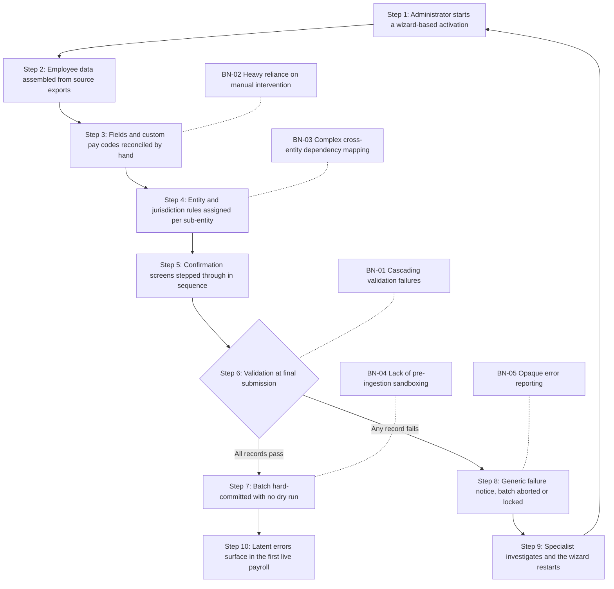
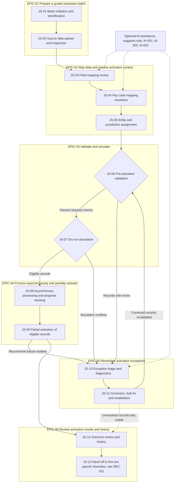

# BIZ-006: Activation Journey

Artifact: BIZ-006
Status: DRAFT
Task: Task 01, Business Problem, Intent and Value Model
Sources: `Problem statement.md` sections 2 and 3, `Business Model Canvas to Business Architecture Blueprint.md` section 3 value stream, `requirements-document-map.md`, `epic-01` to `epic-06`, `product-backlog.md`

## 1. Purpose and limits

This artifact models the activation journey at a high level for two roles: the client payroll administrator (STK-001) and the implementation specialist (STK-002). It shows where each bottleneck occurs and which epic owns each stage.

It deliberately stops at stage level. Detailed workflows, state models and decision tables belong to a later task. The blueprint states that the exact ordering and the ability to revisit steps must be confirmed during workflow design; this journey does not settle that.

## 2. Journey stages

| ID | Stage | Epic | Stories | Bottlenecks | Payroll administrator | Implementation specialist | AI role |
| :-- | :-- | :-- | :-- | :-- | :-- | :-- | :-- |
| JS-01 | Batch initiation and identification | EPIC-01 | PA-01 | None | Starts and names the batch; sees its state | Not involved by default | None |
| JS-02 | Source data upload and inspection | EPIC-01 | PA-02 | BN-05 | Provides data; receives a specific reason if input is unreadable | Not involved by default | None |
| JS-03 | Field mapping review | EPIC-02 | PA-03, PA-06 | BN-02 | Reviews and corrects source-to-payroll mappings | Supports unusual schemas | AI-001, optional suggestion only |
| JS-04 | Pay code mapping resolution | EPIC-02 | PA-04 | BN-02 | Reviews and resolves custom pay-code mappings | Supports uncatalogued codes | AI-002, optional suggestion only |
| JS-05 | Entity and jurisdiction assignment | EPIC-02 | PA-05 | BN-02, BN-03 | Reviews assignments; resolves surfaced ambiguity | Supports complex hierarchies | None; AI-005 rejected |
| JS-06 | Pre-activation validation | EPIC-03 | PA-07 | BN-01, BN-04 | Runs validation and reviews results | Not involved by default | None; AI-006 rejected |
| JS-07 | Dry-run simulation | EPIC-03 | PA-08 | BN-04 | Runs a dry run; sees its limitations | Not involved by default | None; AI-007 rejected |
| JS-08 | Asynchronous processing and progress tracking | EPIC-04 | PA-09, PA-11 | BN-01 | Starts processing; tracks queued, processing, completed or needs attention | Not involved by default | None |
| JS-09 | Partial activation of eligible records | EPIC-04 | PA-10 | BN-01 | Sees eligible records activate while failing records are isolated | Not involved by default | None; AI-008 rejected |
| JS-10 | Exception triage and diagnostics | EPIC-05 | PA-12 | BN-05 | Inspects record- and field-level errors with explanations | Handles complex exceptions | AI-003, optional explanation only |
| JS-11 | Correction, bulk fix and revalidation | EPIC-05 | PA-13, PA-14 | BN-01, BN-05 | Corrects records or applies a reviewed bulk fix; corrected records revalidate | Advises on complex corrections | AI-004 deferred; AI-009 rejected |
| JS-12 | Outcome review and history | EPIC-06 | PA-15, PA-16 | BN-05 | Reviews batch and per-record outcomes and relevant history | Investigates outcomes when asked | None |
| JS-13 | Hand-off to the first live payroll run | EPIC-06 | None | BN-04 | Confirms the cohort is ready for the first live payroll | Supports go-live | None |

JS-13 is mapped to EPIC-06 as the journey boundary, but no epic or story covers the hand-off itself. Whether it is in scope is recorded as DEC-021.

## 3. Bottlenecks by stage

| Bottleneck | Stages where it occurs |
| :-- | :-- |
| Cascading validation failures (BN-01) | JS-06, JS-08, JS-09, JS-11 |
| Heavy reliance on manual intervention (BN-02) | JS-03, JS-04, JS-05 |
| Complex cross-entity dependency mapping (BN-03) | JS-05 |
| Lack of pre-ingestion sandboxing (BN-04) | JS-06, JS-07, JS-13 |
| Opaque error reporting (BN-05) | JS-02, JS-10, JS-11, JS-12 |

## 4. Current-state journey

PROVISIONAL and ILLUSTRATIVE. This model describes the pattern reported in `Problem statement.md` sections 2 and 3. It is not an observed workflow at any client and must be confirmed through product walkthroughs (ASM-014, OQ-003).

In the current state, the administrator steps through a wizard in sequence; the implementation specialist is pulled in repeatedly for reconciliation, entity assignment and failure investigation; validation happens at the end; and one failing record sends the whole batch back to the start.

Source file: `docs/diagrams/current-state-journey.mmd`

## 5. Proposed future-state journey

DRAFT. Eligible records flow from validation and simulation to processing. Records with errors flow to remediation and return to validation, so a single bad record does not force a restart of the batch. This follows the dependency flow in `requirements-document-map.md`. The path from JS-09 to JS-10 follows the epic-04 scope, which isolates records that cannot proceed.

Optional AI assistance touches only JS-03, JS-04 and JS-10, and only to suggest or explain. It never validates, approves or activates (BIZ-007).

Source file: `docs/diagrams/proposed-future-state-journey.mmd`

## 6. Role comparison

| Role | Current state | Proposed future state |
| :-- | :-- | :-- |
| Payroll administrator | Steps through screens in sequence; learns of failures only at the end; restarts the wizard | Reviews mappings and context; sees errors before commit; corrects only affected records |
| Implementation specialist | Reconciles data and entity rules by hand; investigates generic failures; supports every restart | Handles genuine exceptions and complex structures; routine reconciliation is reduced |

## 7. Value stream alignment

| Value stream step, blueprint section 3 | Stages |
| :-- | :-- |
| Prepare batch | JS-01, JS-02 |
| Map and resolve | JS-03, JS-04, JS-05 |
| Validate and simulate | JS-06, JS-07 |
| Process activation | JS-08, JS-09 |
| Remediate exceptions | JS-10, JS-11 |
| Review outcome | JS-12, JS-13 |
