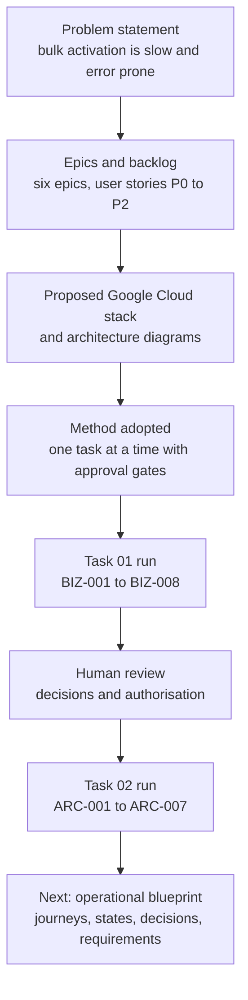
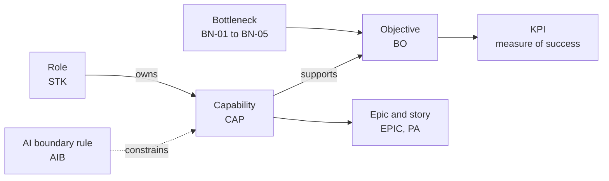
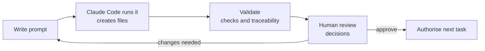

# Project Recap: From the First Prompt to the Task 02 Output

A plain-language summary of what was done, in order, and why. Written for readers who were not in the conversation.

## The short version

We started with a problem statement and used AI prompts to build a structured picture of the solution. First came epics and a backlog. Then came a proposed Google Cloud stack and architecture diagrams. Then we adopted a disciplined method: one controlled task at a time, each with a prompt, a validation step and a human approval gate. Task 01 turned the prose documents into structured, traceable business artifacts. Task 02 used those to define what the business must be able to do. Everything is still a draft that people need to review.

## 1. The journey so far

## 2. What each step was for

- Problem statement and epics: agree what hurts and break the work into six parts (prepare batch, map data, validate and simulate, activate, remediate, review).
- Tech stack and diagrams: show how the solution could be built on Google Cloud, so architects and sponsors can react to something concrete. It is a proposal, not a decision (DEC-022).
- CLAUDE.md and README: keep AI tools and people consistent about the rules of the repository.
- Task prompts: control the AI. Each prompt names the inputs, the files to produce, the checks to run, and says stop and wait for approval.
- Task 01: turn loose documents into structured records with IDs, so every claim can be traced and every assumption is visible.
- Task 02: define the business capabilities, who owns them, and how work flows through them, still without choosing technology.

## 3. How Task 01 led to Task 02

```mermaid
flowchart LR
    subgraph IN["Existing documents (baseline)"]
        P1["Problem statement"]
        P2["Blueprint and canvas"]
        P3["Backlog and epics"]
    end
    subgraph T1["Task 01: the business why"]
        B1["Problem and value<br/>BIZ-001, BIZ-002"]
        B2["Stakeholders and KPIs<br/>BIZ-003, BIZ-004"]
        B3["Assumptions and risks<br/>BIZ-005"]
        B4["Journey<br/>BIZ-006"]
        B5["AI rules and scope<br/>BIZ-007, BIZ-008"]
    end
    G1{{"Human review<br/>approve working baseline"}}
    subgraph T2["Task 02: the business what and who"]
        A1["Capability map<br/>38 capabilities"]
        A2["Value stream<br/>six stages"]
        A3["Traceability and ownership"]
        A4["Dependencies and blueprint"]
        A5["Proposed changes<br/>13 items"]
    end
    IN --> T1 --> G1 --> T2
```

## 4. How the pieces connect (traceability)

This is the main benefit of the structure: anything can be followed back to the problem it solves.

## 5. The control loop used for every task

## 6. What Task 01 and Task 02 produced

Task 01 (documents in docs/business and validation):

- BIZ-001 to BIZ-008: problem, business case, stakeholders, objectives and KPIs, assumptions and risks, journey, AI assessment, scope.
- 13 stakeholders, 8 objectives, 22 KPIs, 12 AI boundary rules, 23 open decisions and 12 open questions.

Task 02 (documents in docs/architecture and validation):

- ARC-001 to ARC-007: capability map, value stream, traceability matrix, ownership, dependencies, business architecture blueprint, proposed changes.
- 38 capabilities, a six-stage value stream, 21 dependencies, and 13 proposed changes to the baseline.

## 7. Terms and IDs

- BN: a bottleneck from the problem statement.
- BP: a business problem. BO: a business objective. KPI: a measure of success.
- STK: a stakeholder role. CAP: a business capability.
- AI and AIB: an AI opportunity and the binding rules that limit it.
- RSK, ASM, DEC, OQ: a risk, an assumption, an open decision, an open question.
- PCR: a proposed change to a baseline document, left for people to accept or reject.
- BIZ and ARC: the file series for Task 01 and Task 02.
- DRAFT: nothing here is approved yet.

## 8. Where we are now

- Done as drafts: Task 01 and Task 02.
- Still open: the blocking decisions (jurisdiction, KPI baselines, blocking and approval policy, sponsor) and the unvalidated assumptions.
- Known gaps: the data protection capability supports no objective yet, and the validation tools could not render the diagrams.
- Next: review the Task 02 output, then run the operational blueprint task (detailed journeys, state models, decision tables and requirements).
