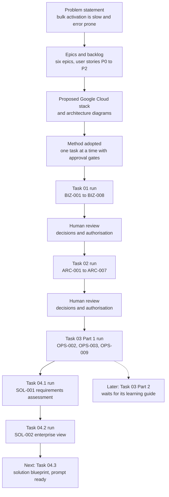
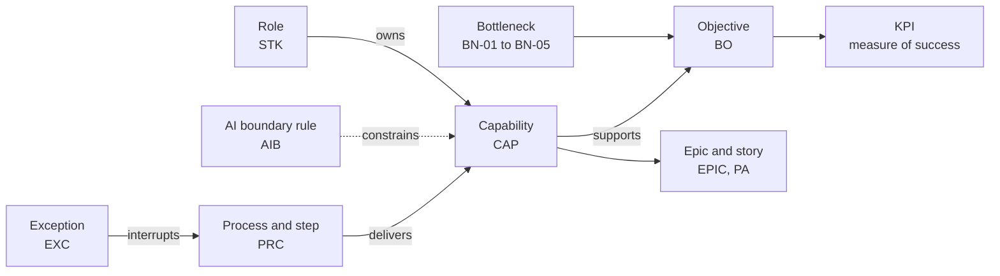
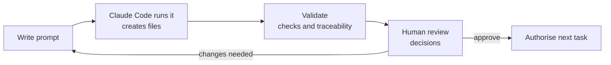
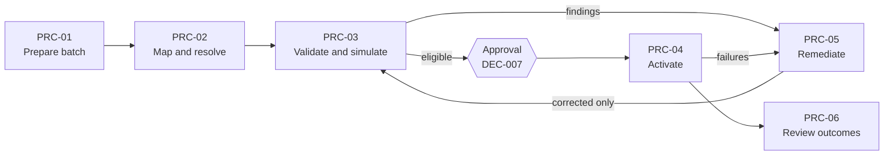

# Project Recap: From the First Prompt to Task 04

A plain-language summary of what was done, in order, and why. Written for readers who were not in the conversation.

## The short version

We started with a problem statement and used AI prompts to build a structured picture of the solution. First came epics and a backlog. Then came a proposed Google Cloud stack and architecture diagrams. Then we adopted a disciplined method: one controlled task at a time, each with a prompt, a validation step and a human approval gate. Task 01 turned the prose documents into structured, traceable business artifacts. Task 02 used those to define what the business must be able to do. Task 03 Part 1 described how the work is actually carried out: the processes, who does each step, and what happens when something goes wrong. Task 04 then moved from the business to the solution: first the architecture requirements (SOL-001), then how the solution fits into the enterprise (SOL-002), with the logical solution blueprint prompt ready to run next. Each task prompt is adapted from a course learning guide in docs/learning. Everything is still a draft that people need to review.

## 1. The journey so far

## 2. What each step was for

- Problem statement and epics: agree what hurts and break the work into six parts (prepare batch, map data, validate and simulate, activate, remediate, review).
- Tech stack and diagrams: show how the solution could be built on Google Cloud, so architects and sponsors can react to something concrete. It is a proposal, not a decision (DEC-022).
- CLAUDE.md and README: keep AI tools and people consistent about the rules of the repository.
- Task prompts: control the AI. Each prompt names the inputs, the files to produce, the checks to run, and says stop and wait for approval.
- Task 01: turn loose documents into structured records with IDs, so every claim can be traced and every assumption is visible.
- Task 02: define the business capabilities, who owns them, and how work flows through them, still without choosing technology.
- Task 03 Part 1: describe the operation step by step, so people can check it against how they really work, and make every exception and every human decision visible before rules and requirements are written.
- Task 04.1, architecture requirements: list what the solution architecture must satisfy and, just as important, what is still unknown about the systems it must work with.
- Task 04.2, enterprise view: show how the solution fits among the payroll provider's and client's systems, without naming products, and keep the big structural choices open.
- Task 04.3, solution blueprint (prompt ready, not yet run): organise the solution into logical building blocks and show how they work together, still without choosing technology.

## 3. How each task led to the next

```mermaid
flowchart LR
    subgraph IN["Existing documents (baseline)"]
        P1["Problem statement"]
        P2["Blueprint and canvas"]
        P3["Backlog and epics"]
    end
    subgraph T1["Task 01: the business why"]
        B1["Problem and value<br/>BIZ-001, BIZ-002"]
        B2["Stakeholders and KPIs<br/>BIZ-003, BIZ-004"]
        B3["Assumptions and risks<br/>BIZ-005"]
        B4["Journey<br/>BIZ-006"]
        B5["AI rules and scope<br/>BIZ-007, BIZ-008"]
    end
    G1{{"Human review<br/>approve working baseline"}}
    subgraph T2["Task 02: the business what and who"]
        A1["Capability map<br/>38 capabilities"]
        A2["Value stream<br/>six stages"]
        A3["Traceability and ownership"]
        A4["Dependencies and blueprint"]
        A5["Proposed changes<br/>13 items"]
    end
    G2{{"Human review<br/>approve working baseline"}}
    subgraph T3["Task 03 Part 1: the business how"]
        O1["Register<br/>OPS-009"]
        O2["Processes<br/>OPS-002, 6 processes"]
        O3["Exceptions and human review<br/>OPS-003, 23 pathways"]
    end
    subgraph T4["Task 04: the solution architecture"]
        S1["Requirements assessment<br/>SOL-001"]
        S2["Enterprise view<br/>SOL-002"]
        S3["Solution blueprint<br/>SOL-003, not yet run"]
    end
    IN --> T1 --> G1 --> T2 --> G2 --> T3 --> T4
```

## 4. How the pieces connect (traceability)

This is the main benefit of the structure: anything can be followed back to the problem it solves.

## 5. The control loop used for every task

## 6. What Task 01 and Task 02 produced

Task 01 (documents in docs/business and validation):

- BIZ-001 to BIZ-008: problem, business case, stakeholders, objectives and KPIs, assumptions and risks, journey, AI assessment, scope.
- 13 stakeholders, 8 objectives, 22 KPIs, 12 AI boundary rules, 23 open decisions and 12 open questions.

Task 02 (documents in docs/architecture and validation):

- ARC-001 to ARC-007: capability map, value stream, traceability matrix, ownership, dependencies, business architecture blueprint, proposed changes.
- 38 capabilities, a six-stage value stream, 21 dependencies, and 13 proposed changes to the baseline.

Task 03 Part 1 (documents in docs/operations and validation):

- OPS-009 register, OPS-002 process model and OPS-003 exception and human-review pathways, plus a process overview diagram at docs/diagrams/ops-002-process-overview.mmd.
- 6 processes, one per value-stream stage, with every step marked as rule-based, AI-supported, human review, or a decision reserved for an authorized person.
- 23 exceptions (17 taken from existing documents, 6 proposed, including a suspected fraud indicator and a stakeholder dispute), each linked to its capability; 10 new open questions and 3 new proposed changes.
- A capability operations view: for each of the 38 capabilities, a plain description of how it works in practice, with its steps, roles, decisions, exceptions and rules. Every Level 2 and Level 3 capability has steps of its own.
- Approval authority (DEC-007) and the blocking policy (DEC-006) are left open; the processes show options instead of choosing.

Task 04.1 and 04.2 (documents in docs/solution):

- SOL-001, architecture requirements assessment: what the architecture must support, the systems the solution must integrate with (I-1 to I-9), 17 information gaps (G-01 to G-17) and three new architecture decisions (AD-01 to AD-03). Its main finding is that the business side is well defined, but no existing system, interface, performance target or data residency rule is known yet.
- SOL-002, enterprise architecture view: the six architecture views (business, application, data, technology, integration, security and governance), 11 solution responsibilities (AR-01 to AR-11), 11 modelled external systems (XC-P01 to XC-P11), 16 information concepts, 12 security and governance principles, a relationship matrix and registers of constraints, decisions and gaps.
- The three structural decisions stay open: whether the solution extends the existing activation wizard or runs alongside it (AD-01), which system holds the batch working state and the activated profiles (AD-02), and whether any part of the proposed stack is adopted (AD-03).
- Every statement carries an evidence label: C confirmed, W working baseline, A assumption, G gap, D decision needed.

## 6a. What the operation looks like

The six processes in a simple line. Corrected records go back to validation on their own, and the two approval gates wait on DEC-007.

## 6b. Learning guides, prompts and outputs

Each task follows the same pattern: a course learning guide in docs/learning supplies a sample prompt, we adapt it to payroll activation in docs/prompts, Claude Code runs it, and the output is reviewed.

| Task | Learning guide | Prompt | Output | State |
| :-- | :-- | :-- | :-- | :-- |
| Task 01 | Task_01 guide | task-01-business-foundation-prompt.md | docs/business | Done, draft |
| Task 02 | Task_01 guide, section 47 | task-02-business-architecture-prompt.md | docs/architecture | Done, draft |
| Task 03 Part 1 | Task_3 operational model guide | task-03-operational-blueprint-prompt.md | docs/operations | Done, draft, rerun with capability view |
| Task 04.1 | Task4 part 4 guide, Prompt 4.1 | No separate prompt file | docs/solution/SOL-001 | Done, draft |
| Task 04.2 | Task4 part 5 guide | task-04-2-enterprise-architecture-view-prompt.md | docs/solution/SOL-002 | Done, draft |
| Task 04.3 | Task_4 part 6 guide, section 10 | task-04-3-solution-architecture-blueprint-prompt.md | docs/solution/SOL-003 | Prompt ready, not yet run |
| Task 03 Part 2 | Not yet available | Not written | docs/operations | Waiting |

## 7. Terms and IDs

- BN: a bottleneck from the problem statement.
- BP: a business problem. BO: a business objective. KPI: a measure of success.
- STK: a stakeholder role. CAP: a business capability.
- AI and AIB: an AI opportunity and the binding rules that limit it.
- RSK, ASM, DEC, OQ: a risk, an assumption, an open decision, an open question.
- PCR: a proposed change to a baseline document, left for people to accept or reject.
- BIZ, ARC and OPS: the file series for Task 01, Task 02 and Task 03.
- PRC and EXC: a process and an exception. Steps (S1, S2) and decisions (D1, D2) are numbered inside each process.
- Q and A: an open question and an assumption raised in Task 03, kept in OPS-009.
- SOL: the file series for Task 04.
- AR, XC-P, IC, I and IX, SG, AD, G: in SOL-001 and SOL-002, a solution responsibility, a modelled external system, an information concept, an integration relationship, a security and governance principle, an architecture decision, and an information gap. These are local to those documents, not repository IDs.
- C, W, A, G, D: evidence labels meaning confirmed, working baseline, assumption, gap, and decision needed.
- DRAFT: nothing here is approved yet.

## 8. Where we are now

- Done as drafts: Task 01, Task 02, Task 03 Part 1, Task 04.1 (SOL-001) and Task 04.2 (SOL-002).
- Ready to run: the Task 04.3 solution blueprint prompt, which will create SOL-003.
- Still open: the blocking decisions (jurisdiction, KPI baselines, blocking and approval policy, sponsor) and the unvalidated assumptions.
- Known gaps: the data protection capability supports no objective yet, and three capabilities have no backlog story.
- Fixed in Task 03: every YAML file now passes a standard parser, and all diagrams render.
- Still open for Task 04: AD-01 to AD-03 and the 17 information gaps, mostly about the existing payroll systems and the statutory engines.
- Next, in order:
  1. Review SOL-001 and SOL-002, since the blueprint builds on them.
  2. Run the Task 04.3 prompt to produce SOL-003.
  3. Review the Task 03 Part 1 output and decide or leave open DEC-006 and DEC-007.
  4. Write and run the Task 03 Part 2 prompt once its learning guide is available.
