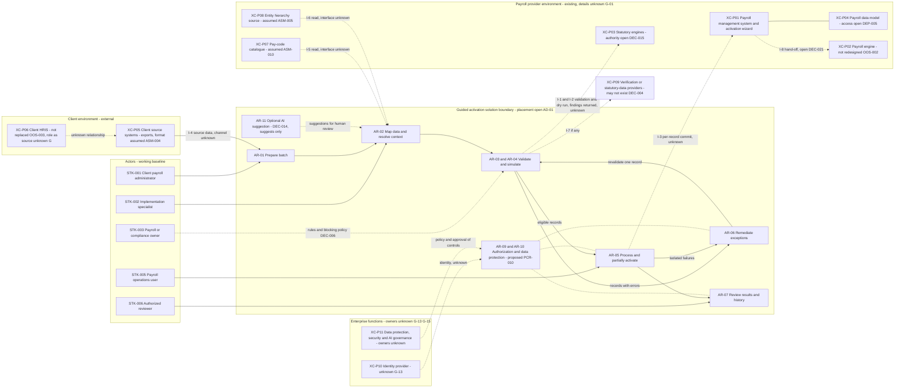

# Task 04.2, Enterprise Architecture View: Working Analysis

## Document control

- Artifact: SOL-002
- Task: Task 04, activity 4.2 (Enterprise Architecture View)
- Version: 0.1
- Status: DRAFT. Working analysis. Ready for human review. Nothing has been approved.
- Approval record: None.
- Date: 2026-11-26
- Author: AI-generated draft (Claude Code) for review by the architecture team.
- Inputs: SOL-001 (draft), BIZ-001 to BIZ-008 and ARC-001 to ARC-007 (working baselines), OPS-002, OPS-003 and OPS-009 (draft, review pending), `Problem statement.md`, the blueprint, `product-backlog.md`, epic-01 to epic-06, and `tech-stack.md` with `docs/solution-architecture.svg` (proposal only, DEC-022).

## Summary

The guided activation solution sits between client source data and the existing payroll management system, and its business, data and governance architecture is well defined by the working baseline. Its application, integration and technology architecture is not: every external system is known only by role, so this view models them as external capabilities and leaves the three structural decisions (AD-01 solution placement, AD-02 system of record and working state, AD-03 stack adoption) open for accountable owners.

## 1. Executive Architecture Overview

### 1.1 Purpose and position

The solution improves bulk guided activation of employee profiles during enterprise onboarding, tenant provisioning or organisational restructuring (`Problem statement.md` section 1). It turns the current semi-manual, step-by-step activation wizard in the payroll management system (XC-P01) into a batch-oriented flow with six stages: prepare batch, map data and resolve context, validate and simulate, process asynchronously and partially activate, remediate exceptions, and review results and history (VS-01 to VS-06, EPIC-01 to EPIC-06). [W]

The solution does not calculate payroll, decide statutory rules, replace the client HR information system or migrate historical payroll data (OOS-001, OOS-002, OOS-003, CON-007). It hands activated profiles to a payroll environment that remains authoritative for payroll results. Whether the hand-off to the first live payroll is in scope remains open (VSB-01, DEC-021). [C for exclusions, D for VSB-01]

### 1.2 Evidence status labels

Each significant statement carries one label. The labels follow section 9 of the prompt.

| Label | Meaning |
| :-- | :-- |
| C | Confirmed: a recorded human decision or binding constraint, such as DEC-022 as decided or an explicit scope exclusion (OOS, CON). |
| W | Working baseline: content in Task 01 to Task 03 Part 1 artifacts or SOL-001. Accepted for progression, not approved. |
| A | Assumption: unvalidated (ASM-001 to ASM-014, A-01 to A-07). |
| G | Information gap: no supporting information in the baseline (G-01 to G-17 from SOL-001). |
| D | Decision requiring approval: DEC items, Q-01 to Q-10, AD-01 to AD-03. |

Binding AI boundary rules (AIB-001 to AIB-012) are working-baseline rules that become binding on approval. This view shows them as "W, binding on approval".

### 1.3 Assessment-local references

This document introduces local references to keep its tables traceable. They are assessment-local and are not repository IDs. They must not be copied into a register without review.

| Prefix | Meaning | Range |
| :-- | :-- | :-- |
| XC-P | Modelled external capability, from SOL-001 sections 5 and 7 | XC-P01 to XC-P11 |
| AR | Solution-level application responsibility | AR-01 to AR-11 |
| IC | Business information concept | IC-01 to IC-16 |
| TC | Technology and infrastructure consideration | TC-01 to TC-10 |
| IX | Integration relationship not numbered in SOL-001 | IX-01 to IX-03 |
| SG | Security and governance principle | SG-01 to SG-12 |
| EAR | Enterprise architecture risk raised here | EAR-01 to EAR-08 |
| EPC | Proposed baseline change raised here, recorded in this document only | EPC-01 to EPC-05 |

### 1.4 Enterprise context diagram

The diagram is at enterprise level. Solid boxes inside the solution boundary are logical responsibilities, not components or services. Every external capability and interface is labelled with its evidence status. No product, vendor, protocol or interface is implied. Names follow the six stages used in `tech-stack.md` and `docs/solution-architecture.svg`, which remain proposals.

Rendering note: the Mermaid CLI is not installed in this environment, and installing it is not permitted for this task. The diagram was checked by reading against Mermaid 8.8.0 syntax only (see section 16).

## 2. Business Architecture View

### 2.1 Purpose

Business architecture states what the enterprise must be able to do to activate profiles in bulk, who is accountable, and where people, rules and AI each act. It is the justification layer for every other domain in this view.

### 2.2 Capabilities supported

The capability baseline is ARC-001 (CAP-001 to CAP-038). [W]

| Level 1 capability | Level 2 and 3 | Stage | Epic | Objectives | Status |
| :-- | :-- | :-- | :-- | :-- | :-- |
| CAP-001 Guided batch intake and setup | CAP-010, CAP-011, CAP-012 | VS-01 | EPIC-01 | BO-001, BO-008 | W. CAP-012 has no story (PCR-011, DEC-010) |
| CAP-002 Data mapping and normalization | CAP-013, CAP-014, CAP-015 | VS-02 | EPIC-02 | BO-002, BO-003 | W |
| CAP-003 Entity and jurisdiction resolution | CAP-016, CAP-017, CAP-018 | VS-02 | EPIC-02 | BO-003, BO-006 | W |
| CAP-004 Pre-activation validation and simulation | CAP-019 (CAP-035 to CAP-038), CAP-020, CAP-021 | VS-03 | EPIC-03 | BO-003, BO-004, BO-006 | W |
| CAP-005 Asynchronous batch activation and partial commit | CAP-022, CAP-023, CAP-024 | VS-04 | EPIC-04 | BO-001, BO-005, BO-006 | W |
| CAP-006 Remediation and bulk fixes | CAP-025, CAP-026, CAP-027 | VS-05 | EPIC-05 | BO-002, BO-005, BO-007 | W |
| CAP-007 Activation diagnostics and audit | CAP-028, CAP-029, CAP-030 | VS-06 | EPIC-06 | BO-007, BO-008 | W. CAP-030 pending DEC-023 |
| CAP-008 Activation authorization and approval | CAP-031, CAP-032 | VS-04, VS-05 | EPIC-04, EPIC-05 | BO-006 | Proposed, pending PCR-010. CAP-031 has no story (PCR-012) |
| CAP-009 Activation data protection | CAP-033, CAP-034 | All, chiefly VS-06 | EPIC-06 | None (PCR-009) | Proposed, pending PCR-010 |

This view creates no new capability.

### 2.3 Value stream and processes

The six stages map one to one to the six operational processes in OPS-002 and to the six epics. [W]

| Stage | Process (OPS-002) | Stories | Value created |
| :-- | :-- | :-- | :-- |
| VS-01 Prepare batch | PRC-01 Prepare and inspect an activation batch | PA-01, PA-02 | A known, inspectable batch with input problems separated from record problems |
| VS-02 Map and resolve | PRC-02 Map data and resolve activation context | PA-03 to PA-06 | Reconciled data with ambiguity visible, not guessed |
| VS-03 Validate and simulate | PRC-03 Validate and simulate before activation | PA-07, PA-08 | Issues found before commit, with no live effects |
| VS-04 Process activation | PRC-04 Approve and process activation with partial commit | PA-09 to PA-11 | Valid records activate without being blocked by unrelated failures |
| VS-05 Remediate exceptions | PRC-05 Remediate exceptions and revalidate corrected records | PA-12 to PA-14 | Correction without restarting the batch |
| VS-06 Review outcome | PRC-06 Review outcomes and activation history | PA-15, PA-16 | Transparent, traceable results |
| VSB-01 Hand-off, boundary | None | None | Not assessed until DEC-021 [D] |

The exception path is part of the architecture, not an add-on. Records with errors leave VS-03 for VS-05; records isolated in VS-04 also go to VS-05; corrected records return to VS-03 and are revalidated on their own (ARC-002 section 3, BR-005). OPS-003 defines 23 exception types (EXC-01 to EXC-23), 17 sourced and 6 proposed, each routed to a human-review pathway. Which issues block, which require review and when a batch stops is not decided (DEC-006, CON-008). [W, D]

### 2.4 Actors and stakeholder groups

From BIZ-003. [W unless stated]

- Primary users: STK-001 client payroll administrator, STK-002 implementation specialist, STK-005 payroll operations user.
- Governance: STK-003 payroll or compliance owner, STK-006 authorized payroll or compliance reviewer.
- Delivery: STK-004 product or engineering owner.
- External and affected: STK-007 client organization, STK-008 payroll provider, STK-009 employees whose profiles are activated.
- Inferred roles, shown as assumptions [A]: STK-010 business sponsor, STK-011 data protection or privacy owner, STK-012 information security owner, STK-013 customer success or account owner. None is named (OQ-001, OQ-007).

### 2.5 Capability relationships

ARC-005 records 21 named dependencies (CD-001 to CD-021). Three patterns matter at enterprise level. [W]

1. A linear flow: CAP-001 feeds CAP-002 and CAP-003, which feed CAP-004, which feeds CAP-005 (CD-001 to CD-006).
2. A feedback loop: CAP-006 receives records from CAP-004 and CAP-005 and returns corrected records to CAP-004 (CD-008 to CD-010, CD-019).
3. Governance overlays: CAP-005 and CAP-006 are governed by CAP-008 (CD-007, CD-011, CD-020); CAP-007 is governed by CAP-009 (CD-016). CAP-007 consumes outputs from every stage (CD-012 to CD-015).

### 2.6 Ownership and accountability

ARC-004 proposes ownership for every capability, all with basis ASSUMPTION for confirmation by STK-004. [A]

| Capability | Owning role | Accountable role | Note |
| :-- | :-- | :-- | :-- |
| CAP-001, CAP-005 | STK-004 | STK-004 | Delivery and operation |
| CAP-002 | STK-004 | STK-003 | Required fields and pay-code mappings (DEC-012) |
| CAP-003, CAP-004 | STK-003 | STK-003 | Rules, inheritance and blocking conditions |
| CAP-006 | STK-004 | STK-001 | Client corrects its own data |
| CAP-007 | STK-004 | STK-004 | Relies on an inferred role |
| CAP-008 | STK-003 | STK-003 | Relies on an inferred role; model undefined (DEC-007) |
| CAP-009 | STK-011 | STK-011 | Inferred role only; no named owner (G-15) |

Architectural implication: the two cross-cutting capabilities, CAP-008 and CAP-009, are the ones whose accountability rests on inferred roles. They are also the ones the security and governance domain depends on most.

### 2.7 Boundaries between deterministic, AI-supported and human-controlled activity

| Activity type | What it covers | Authority | Source |
| :-- | :-- | :-- | :-- |
| Deterministic | Structural inspection, validation rules, severity classification, statutory checks via XC-P03, record isolation, idempotent commit, revalidation | Business rules BR-001 to BR-009 and the statutory engines decide validity | AIB-002, BR-001 to BR-009 [W] |
| AI-supported (optional) | Field mapping suggestions (AI-001), pay-code mapping suggestions (AI-002), plain-language explanation of messages (AI-003), drafted corrective suggestions (AI-004) | AI suggests only; a person accepts, rejects or edits | BIZ-007, AIB-002, AIB-007 [W]; adoption open (DEC-014) [D] |
| Rejected AI uses | Entity or jurisdiction determination (AI-005), validity or blocking decisions (AI-006), payroll simulation or calculation (AI-007), approval or activation (AI-008), autonomous bulk fixes (AI-009) | Not permitted | BIZ-007 [W] |
| Human-controlled | Mapping approval (CAP-015), ambiguity resolution (CAP-018), activation approval (CAP-031), sensitive change authorization (CAP-032), bulk-fix review (CAP-027, BR-007), exception review (OPS-003) | Named people under an authorization model that is not yet defined | DEC-007, Q-01, AIB-008 [D] |

## 3. Application Architecture View

### 3.1 Purpose

Application architecture identifies which application responsibilities the solution needs, which existing applications may already fulfil them, and where boundaries sit. It does not define components or services. That belongs to Task 04.3.

### 3.2 Existing and external application capabilities

All are modelled external capabilities. None has a confirmed product, vendor, owner, hosting or interface. [W for role, G for details]

| Ref | Capability | Known role | Status | Constraint |
| :-- | :-- | :-- | :-- | :-- |
| XC-P01 | Payroll management system, including the current guided activation wizard | Hosts the current activation workflow; target of activation commit | W for existence, G-01 for details | Placement relative to the solution is AD-01 |
| XC-P02 | Payroll engine | Receives activated cohorts; runs the first live payroll | W | Not redesigned (OOS-002) |
| XC-P03 | Statutory engines | Validate and run a non-committing dry run | W for existence; dry-run support A (ASM-006); authority D (DEC-015, DEC-016) | Not redesigned (OOS-002) |
| XC-P04 | Payroll data model | Target structure for activated profiles | W; access open (DEP-005) | None recorded |
| XC-P05 | Client source systems producing external payroll exports | Origin of employee data | A (ASM-004); formats D (DEC-009) | Formats not defined before discovery (OOS-013) |
| XC-P06 | Client HR information system | Named only as not to be replaced | G: whether it is a source is not stated | Not replaced (OOS-003) |
| XC-P07 | Pay-code catalogue | Authoritative pay codes for mapping | A (ASM-010, DEP-002) | None recorded |
| XC-P08 | Entity hierarchy source | Authoritative parent-child structure | A (ASM-005, DEP-003) | None recorded |
| XC-P09 | Source-system, statutory-data or verification providers | Possible external dependencies | G: may not exist (DEC-004, DEP-006) | Selection excluded before discovery (OOS-010) |
| XC-P10 | Identity provider for client users | Sign-in for client and internal users | G-13 | None recorded |
| XC-P11 | Enterprise data protection, information security and AI governance functions | Approve controls, masking, retention and AI use | G-15; roles A (STK-011, STK-012) | None recorded |

### 3.3 Solution-level application responsibilities

Each responsibility is a logical need traced to capabilities and stories. It does not imply a new application or service. The "may be fulfilled by" column records options, not choices. [W for the need, D for the fulfilment]

| Ref | Responsibility | Capabilities | Stories | May be fulfilled by | Status |
| :-- | :-- | :-- | :-- | :-- | :-- |
| AR-01 | Batch lifecycle, intake, structural inspection and context capture | CAP-010, CAP-011, CAP-012 | PA-01, PA-02 | Extension of the XC-P01 wizard, or a new solution component | W; AD-01 |
| AR-02 | Field and pay-code mapping, entity and jurisdiction resolution, ambiguity surfacing | CAP-013 to CAP-018 | PA-03 to PA-06 | Same options as AR-01; reads XC-P07, XC-P08 | W; AD-01 |
| AR-03 | Validation coordination and issue severity classification | CAP-019, CAP-020, CAP-035 to CAP-038 | PA-07 | Rule evaluation stays with XC-P03; coordination and finding presentation may sit in XC-P01 or a new component | W; DEC-015, DEC-006 |
| AR-04 | Dry-run coordination and display of its limitations | CAP-021 | PA-08 | Execution stays with XC-P03 if ASM-006 holds | A; DEC-016, Q-06 |
| AR-05 | Asynchronous processing, progress, per-record commit coordination and recovery | CAP-022, CAP-023, CAP-024 | PA-09, PA-10, PA-11 | Commit is performed by XC-P01 or XC-P04; coordination location depends on AD-01 | W; G-01, DEC-017 |
| AR-06 | Record diagnosis, single-record correction and revalidation, reviewed bulk fix | CAP-025, CAP-026, CAP-027 | PA-12, PA-13, PA-14 | Same options as AR-01 | W; DEC-019, DEC-020 |
| AR-07 | Outcome reporting and activation history | CAP-028, CAP-029 | PA-15, PA-16 | Existing reporting or audit facilities in XC-P01, if any (G-01), or a new component | W; DEC-008 |
| AR-08 | Outcome measurement against the target metrics | CAP-030 | None | May not be needed; excluded general analytics product (OOS-018) | D (DEC-023) |
| AR-09 | Activation approval and sensitive change authorization | CAP-031, CAP-032 | None for CAP-031 (PCR-012) | Existing role and approval facilities, if any, or a new control | Proposed (PCR-010); D (DEC-007) |
| AR-10 | Role-based access to activation detail and retention control | CAP-033, CAP-034 | PA-15, PA-16 (BR-009) | Enterprise access and retention controls (XC-P10, XC-P11) | Proposed (PCR-010); D (DEC-008) |
| AR-11 | Optional AI suggestion for mappings, explanations and draft corrections | CAP-013, CAP-014, CAP-025 via AI-001 to AI-004 | PA-06 | A detachable assistant; removal must leave AR-01 to AR-10 working (AIB-012) | D (DEC-014) |

### 3.4 Application boundaries and interactions

- The solution boundary encloses AR-01 to AR-11. Where that boundary sits relative to XC-P01 is decision AD-01: extend the existing activation workflow, or run as a separate service that integrates with it. Both options remain open. This view does not choose. [D]
- XC-P02 and XC-P03 are always outside the boundary (OOS-002). [C]
- XC-P05 and XC-P06 are always outside the boundary (OOS-003). [C]
- AR-11 sits inside the boundary but must be detachable without loss of core function (CON-006, AIB-012). [C for CON-006, W for AIB-012]
- AR-09 and AR-10 are cross-cutting and act on AR-05, AR-06 and AR-07 (CD-007, CD-011, CD-016). [W]

### 3.5 Responsibilities existing systems may fulfil, and possible new components

The baseline does not show that every responsibility needs new software. Under the "extend" option of AD-01, most of AR-01 to AR-07 may be enhancements to XC-P01. Under the "separate service" option, they become new solution components that integrate with XC-P01. In both options, statutory evaluation (AR-03, AR-04) and the commit itself (AR-05) stay with existing systems. AR-08 may need no component if DEC-023 excludes it. Decomposition belongs to Task 04.3. [D]

## 4. Data Architecture View

### 4.1 Purpose

Data architecture identifies the information the solution receives, creates and passes on, where it comes from, who should own it, how sensitive it may be, and how it is traced. It does not design storage.

### 4.2 Business information concepts

Received information comes from the blueprint section 3 ("information handled"). Created information comes from SOL-001 section 8. [W]

| Ref | Information concept | Origin | Supports | Candidate sensitivity (not validated) |
| :-- | :-- | :-- | :-- | :-- |
| IC-01 | Employee identity data | XC-P05 | CAP-011, CAP-013, CAP-019 | High, for STK-011 to classify |
| IC-02 | Compensation data | XC-P05 | CAP-035 | High, for STK-011 to classify |
| IC-03 | Tax withholding data | XC-P05 | CAP-036 | High, for STK-011 to classify |
| IC-04 | Banking data | XC-P05 | CAP-038 | High, for STK-011 to classify |
| IC-05 | Benefit data | XC-P05 | CAP-037 | High, for STK-011 to classify |
| IC-06 | Pay-code reference and client pay codes | XC-P07 and XC-P05 | CAP-014 | To be classified |
| IC-07 | Organisational entity data and hierarchy | XC-P08 and XC-P05 | CAP-016, CAP-017 | To be classified |
| IC-08 | Batch and lifecycle status | Solution | CAP-010, CAP-022 | To be classified |
| IC-09 | Activation context | Solution, from STK-001 | CAP-012 | To be classified |
| IC-10 | Mappings and review decisions, entity and jurisdiction assignments | Solution | CAP-013 to CAP-018 | To be classified |
| IC-11 | Validation findings with severity, and dry-run results with stated limitations | Solution, with XC-P03 | CAP-019 to CAP-021 | Inherits sensitivity of the record it describes |
| IC-12 | Per-record activation outcome | Solution, with XC-P01 | CAP-023, CAP-028 | To be classified |
| IC-13 | Remediation items and corrections, including bulk-fix previews | Solution | CAP-025 to CAP-027 | Inherits sensitivity of the field changed |
| IC-14 | Approvals and authorizations, with the deciding person | Solution | CAP-031, CAP-032, AIB-008 | To be classified |
| IC-15 | Activation history, including AI suggestions and the human decision on each | Solution | CAP-029, AIB-010 | Inherits the highest sensitivity it references |
| IC-16 | Outcome measures | Solution, with sources under I-9 | CAP-030 | To be classified; only if DEC-023 includes it |

The activated employee profile itself is not listed as a solution concept. It belongs to the payroll system of record, which AD-02 must confirm.

### 4.3 Data sources and dependencies

DEP-001 to DEP-009 (BIZ-005, SOL-001 section 8) are all open. [W for the dependency, G for the source]

| Dependency | Information | Concepts | Status |
| :-- | :-- | :-- | :-- |
| DEP-001 | Authoritative validation rules and statutory engine | IC-11 | Open; DEC-015 |
| DEP-002 | Pay-code catalogue and mapping rules | IC-06 | Open; ASM-010 |
| DEP-003 | Entity hierarchy source | IC-07 | Open; ASM-005 |
| DEP-004 | Non-committing statutory engine execution | IC-11 | Open; ASM-006 |
| DEP-005 | Existing activation workflow and payroll data model | IC-01 to IC-05, IC-12 | Open; G-01 |
| DEP-006 | Source-system, statutory-data or verification providers | IC-04, IC-11 | Open; DEC-004 |
| DEP-007 | Support and implementation case data | IC-16 | Open; KPI-002 baseline |
| DEP-008 | Blocking policy and rules from the payroll or compliance owner | IC-11 | Open; DEC-006 |
| DEP-009 | Approved privacy and security controls | IC-13, IC-15 | Open; G-15 |

### 4.4 Ownership and stewardship

No data owner is named for any data domain, and no system of record is identified per domain (SOL-001 section 8). [G] The working-baseline ownership in ARC-004 implies candidate stewards only: STK-007 for source employee data, STK-003 for pay-code, entity and rule reference data, STK-004 for solution-created operational data, and STK-011 for protection and retention of all of it. [A]

Decision AD-02 is open: which component holds the working state of a batch before commit (mappings, findings, remediation items), and which system remains the system of record for activated profiles. Its purpose is to prevent two systems of record for the same profile. This view does not resolve it. [D]

### 4.5 Data movement across boundaries

| Movement | From | To | Concepts | Status |
| :-- | :-- | :-- | :-- | :-- |
| Source intake | XC-P05 | Solution (AR-01) | IC-01 to IC-07 | W need; channel and format G-05 |
| Reference reads | XC-P07, XC-P08 | Solution (AR-02) | IC-06, IC-07 | A |
| Validation and dry run | Solution (AR-03, AR-04) | XC-P03 and back | Candidate profiles out; IC-11 back | W need; interface G-02 |
| Provider verification | Solution | XC-P09 and back | IC-04 and statutory data | G; may not exist |
| Activation commit | Solution (AR-05) | XC-P01 or XC-P04 | Eligible profiles out; IC-12 back | W need; interface G-01 |
| Hand-off | XC-P01 | XC-P02 | Activated cohort | D (DEC-021) |
| AI suggestion | Solution | AR-11 and back | Minimised, masked inputs only (AIB-005, AIB-006) | D (DEC-014); AIB-005 and AIB-006 pending PCR-013 |
| Measurement | I-9 sources | Solution (AR-08) | IC-16 | D (DEC-023); A (ASM-011) |

No historical payroll data, prior pay runs or year-to-date balances flow in any direction (CON-007, OOS-001). [C]

### 4.6 Classification and sensitivity

The candidate sensitivity column in section 4.2 is an analytical starting point, not a classification. Classification, masking rules and access levels require STK-011 and STK-012, neither of which is named (G-15). CON-004 is the only confirmed basis: employee identity, compensation, tax, benefits and banking information requires protection, with access and retention limited to what activation needs. [C for CON-004, G for the scheme]

### 4.7 Lineage, auditability and traceability

The baseline requires traceability from each activated record back to its source data, mappings, assignments, findings, corrections, approvals and the person who decided each (CAP-029, AIB-008, AIB-010, KPI-020, PA-16). Required events, viewing rights and export are undefined (DEC-008, G-09). Audit records must not be described as immutable or tamper-proof without an agreed design and requirement (OOS-016). [W for need, D for scope, C for OOS-016]

### 4.8 Retention and residency

Retention must be limited to what activation needs (CON-004, CAP-034). No retention period is set here (OOS-017, DEC-008). Data residency and processing location depend on the first-release jurisdiction, which is not decided (DEC-001, OQ-002, CON-005, G-03). This view names no period, jurisdiction or residency rule. [C for the constraints, G for the values]

### 4.9 Information exchanged with external systems

The integration view (section 6) lists each exchange. In summary, the solution sends candidate profile data to XC-P03 and eligible profiles to XC-P01 or XC-P04, and receives findings, dry-run results and commit outcomes. Whether data is copied, referenced or transformed at each exchange depends on AD-01 and AD-02. [D]

## 5. Technology and Infrastructure Architecture View

### 5.1 Purpose and boundary

This view states the technology and infrastructure considerations the solution must satisfy. It selects no technology. Technology selection is excluded before technical discovery (OOS-010), and the proposed Google Cloud stack in `tech-stack.md` is a proposal, not a constraint (DEC-022). Whether any element of that stack becomes the starting point is decision AD-03. This view adopts none of it. [C for OOS-010 and DEC-022, D for AD-03]

### 5.2 Considerations

| Ref | Consideration | Confirmed constraint or need | Still to be defined | Status |
| :-- | :-- | :-- | :-- | :-- |
| TC-01 | Hosting and deployment | None recorded | Whether the solution is hosted with XC-P01, and where XC-P01 is hosted (G-01, AD-01); multi-tenancy and tenant isolation (G-14) | G, D |
| TC-02 | Application execution | Six stages with a feedback loop; delivery surface open (DEC-003) | UI, API or implementation workspace (G-06) | W, D |
| TC-03 | Asynchronous processing | Batches run asynchronously with visible progress (CAP-022, PA-09) | User controls while processing (DEC-018) | W, D |
| TC-04 | Per-record isolation and partial commit | A failing record never blocks the batch (CON-003, BR-001, BR-002); controls preserved (BR-003) | Batch-stop conditions (DEC-006, CON-008) | C, W, D |
| TC-05 | Recovery without duplicate effects | Retries create no duplicate activation effects (BR-008, CAP-024, KPI-014) | Retry and recovery semantics (DEC-017); who recovers (Q-05); resume or abandon (DEC-011, Q-02); idempotency support in XC-P01 (G-01) | W, D, G |
| TC-06 | Scalability | Batches of hundreds or thousands of profiles (Problem statement section 1) | Volumes, batch sizes, frequency and peak concurrency (G-04, OQ-004) | W qualitative; G quantitative |
| TC-07 | Availability, resilience and performance | None recorded; the 65 percent cycle-time target is a business outcome, not a service level | Availability, recovery, response-time and throughput targets (G-10) | G |
| TC-08 | AI execution and access boundary | If adopted, AI is optional, detachable and receives minimised, masked inputs (CON-006, AIB-005, AIB-006, AIB-012) | Whether AI is adopted (DEC-014); evaluation thresholds; security confirmation (PCR-013) | C for CON-006; W; D |
| TC-09 | Residency and processing location | No jurisdiction may be assumed (CON-005) | Jurisdiction (DEC-001, G-03); also governs where any AI processing may occur | C, G |
| TC-10 | Monitoring and service continuity | The product or engineering owner operates the capability (STK-004); core activation must continue without AI (AIB-012) | Operability targets and monitoring scope (G-10); continuity expectations | W, G |

### 5.3 Infrastructure dependencies

The solution depends on infrastructure it does not control: whatever hosts XC-P01, XC-P03 and XC-P04, and the enterprise identity and security functions (XC-P10, XC-P11). None is identified. [G]

## 6. Integration Architecture View

### 6.1 Purpose

Integration architecture identifies which systems or capabilities exchange information with the solution, why, when, and how critical each exchange is. It names no API, endpoint, protocol, interface specification or integration product. A general-purpose integration platform is out of scope (OOS-014). [C]

### 6.2 Integration relationships

I-1 to I-9 come from SOL-001 section 7. IX-01 to IX-03 are assessment-local relationships for approval, identity and history that SOL-001 does not number.

| Ref | Between | Purpose and trigger | Information | Capabilities | Criticality | Status and gap |
| :-- | :-- | :-- | :-- | :-- | :-- | :-- |
| I-1 | AR-03 and XC-P03 | Validate candidate records before commit; triggered by validation and by revalidation after correction | Candidate profile data out; findings back | CAP-019, CAP-035 to CAP-038 | Critical; no activation without it (CON-002) | W need; engine and interface G-02 (DEC-015) |
| I-2 | AR-04 and XC-P03 | Non-committing dry run with production-equivalent rules | Candidate profiles out; simulated results and limitations back | CAP-021 | Critical for BO-004; must create no live effect (BR-006) | A (ASM-006); D (DEC-016, Q-06, Q-07) |
| I-3 | AR-05 and XC-P01 or XC-P04 | Activate each eligible record once; triggered after approval | Eligible profile out; per-record outcome back | CAP-023, CAP-024 | Critical; the only write to the system of record | W need; per-record commit and safe repeat G-01; D (DEC-017, AD-02) |
| I-4 | XC-P05 and AR-01 | Receive employee data for a batch; triggered by the administrator | External payroll exports | CAP-011, CAP-013 | Critical; start of every batch | A (ASM-004); D (DEC-009); formats deferred (OOS-013) |
| I-5 | XC-P07 and AR-02 | Read authoritative pay codes for mapping | Pay-code reference | CAP-014 | High | A (ASM-010); owner G-11 |
| I-6 | XC-P08 and AR-02 | Read parent-child entity structure for inheritance | Entity hierarchy | CAP-016 | High; wrong inheritance risks RSK-009 | A (ASM-005); owner G-11; D (DEC-013) |
| I-7 | AR-03 and XC-P09 | Possibly verify banking or statutory data | Banking or statutory data | CAP-038 | Unknown | G-12; may not exist (DEC-004) |
| I-8 | XC-P01 and XC-P02 | Make the activated cohort payroll-ready for the first live run | Activated cohort | Boundary VSB-01 | Unknown until decided | D (DEC-021, Q-04) |
| I-9 | Measurement sources and AR-08 | Measure cycle time, support touchpoints and first-payroll corrections | Operational and support data | CAP-030 | Low for activation; high for proving targets | A (ASM-011, DEP-007); D (DEC-023, DEC-005) |
| IX-01 | AR-09 and the approval authority | Obtain activation approval and sensitive change authorization | Approval decisions and the deciding person | CAP-031, CAP-032 | Critical where approval is required | D (DEC-007, Q-01, OQ-001); no approval authority is assumed |
| IX-02 | XC-P10 and the solution | Authenticate client and internal users and provide roles | Identity and role attributes | CAP-033 | Critical | G-13 |
| IX-03 | AR-07 and any enterprise record-keeping or audit facility | Retain activation history and evidence | IC-15 | CAP-029, CAP-034 | High for review and troubleshooting (RSK-013) | D (DEC-008); immutability not assumed (OOS-016) |

### 6.3 Dependencies between integration points

- I-4 precedes I-5 and I-6, which precede I-1. I-2 follows I-1 (CD-018). I-3 follows I-1, I-2 where required (Q-06), and IX-01 where approval is required (A-05).
- The remediation loop reuses I-1, and possibly I-2 (Q-07), for each corrected record alone (BR-005, CD-019).
- IX-02 is a prerequisite for every user-facing exchange.
- IX-03 receives events from every stage (CD-012 to CD-015, A-06).

### 6.4 Operational implications and risks

The three critical exchanges (I-1, I-2, I-3) all depend on systems that are not identified. If XC-P01 cannot commit one record at a time or cannot safely repeat a commit, the partial-commit model (CAP-023) and recovery model (CAP-024) need redesign (G-01, RSK-005). If XC-P03 cannot run a non-committing simulation, the dry run must state wider limitations (ASM-006, RSK-002). These are the highest integration risks in this view.

## 7. Security and Governance Architecture View

### 7.1 Purpose

This view states the principles that constrain every other domain. It does not design controls. No regulatory compliance is claimed: no jurisdiction or regulation has been identified (DEC-001, OQ-002, CON-005). [C]

### 7.2 Principles

| Ref | Principle | Basis | Status |
| :-- | :-- | :-- | :-- |
| SG-01 | Identity and access: client and internal users authenticate through an identity provider that is not yet identified | CAP-033; G-13 | W need; G |
| SG-02 | Least privilege: users see only the activation detail their role permits; sensitive details are hidden from unauthorized users | CAP-033, BR-009, CON-004 | C for CON-004; W |
| SG-03 | Human approval and accountability: high-impact decisions need appropriate human accountability, and the deciding person is recorded | CAP-031, CAP-032, AIB-008 | W, binding on approval; model D (DEC-007, Q-01) |
| SG-04 | AI suggests only: people approve; deterministic rules and the statutory engines decide validity; AI must not approve, activate or commit, or bypass validation, authorization or activation gates | AIB-002, AIB-004, AIB-007 | W, binding on approval |
| SG-05 | AI limits: AI must not determine statutory rules or calculate payroll results; AI must not decide entity or jurisdiction assignments; confidence is never proof of correctness | AIB-011, AI-005 rejected, AIB-003 | W, binding on approval |
| SG-06 | AI data protection: AI receives no unrestricted access and only the inputs a suggestion needs; sensitive values are masked before any model call | AIB-005, AIB-006, OOS-005 | W; pending security owner confirmation (PCR-013) |
| SG-07 | Ambiguity is surfaced, never silently resolved | AIB-009, BR-004 | W, binding on approval |
| SG-08 | Untrusted input: uploaded batch files and AI suggestions are untrusted until deterministic rules validate them | CAP-011, AIB-002, AIB-004 | W |
| SG-09 | AI contribution records: every AI suggestion and the human decision on it is recorded with the affected record and field | AIB-010 | W, binding on approval |
| SG-10 | Auditability: activation history records mappings, corrections, findings, approvals and outcomes; it is not described as immutable | CAP-029, KPI-020, OOS-016 | W; scope D (DEC-008) |
| SG-11 | Resilience and manual fallback: core activation works without AI | AIB-012, CON-006 | C for CON-006 |
| SG-12 | Retention and external providers: retention is limited to activation needs, with no period set here; any external provider is governed before use | CAP-034, DEC-008, OOS-017, DEC-004 | C for OOS-017; D |

### 7.3 Policy and rule precedence

The order of authority, highest first, as the baseline implies it: confirmed constraints and scope exclusions (CON, OOS); statutory rules applied by the statutory engines (XC-P03); business rules BR-001 to BR-009 and the blocking policy once decided (DEC-006); human approval under the authorization model (DEC-007); AI suggestions, which carry no authority (AIB-002, AIB-004). [W]

### 7.4 Record isolation as a governance control

An error isolates to the failing record. A bad record never blocks the whole batch or hides the status of other records, and corrected records are revalidated on their own (CON-003, BR-001, BR-002, BR-005). Partial commit must preserve every required validation and compliance control (BR-003). Whether partial commit is permissible without weakening controls is unvalidated (ASM-008, RSK-001). [C for CON-003, W for rules, A for ASM-008]

### 7.5 Governance roles

The data protection, information security and AI governance owners are not named (G-15, OQ-007). STK-011 and STK-012 are inferred roles only. Until they are named, no control in this domain can be confirmed, and AIB-005 and AIB-006 remain pending (PCR-013). [A, G]

## 8. Cross-Domain Architecture Relationship Matrix

### 8.1 Domain relationships

| Domain | Purpose | Major elements | Relates to | Depends on | Constraints | Open decisions | Gaps | Risks |
| :-- | :-- | :-- | :-- | :-- | :-- | :-- | :-- | :-- |
| Business | Defines what must be done, by whom, under which rules | CAP-001 to CAP-038, VS-01 to VS-06, PRC-01 to PRC-06, BR-001 to BR-009 | Justifies every other domain | Stakeholder decisions | CON-001 to CON-008, OOS | DEC-006, DEC-007, DEC-010, DEC-021, DEC-023, PCR-010 | Named sponsor and owners (OQ-001, G-15) | RSK-001, RSK-010, RSK-012 |
| Application | Assigns responsibilities and boundaries | AR-01 to AR-11, XC-P01 to XC-P11 | Realises business capabilities; uses data; drives integration | Business, integration | OOS-002, OOS-003, CON-006 | AD-01, DEC-003, DEC-014 | G-01, G-06 | EAR-01, EAR-02 |
| Data | Defines information, ownership, lineage | IC-01 to IC-16, DEP-001 to DEP-009 | Feeds application and integration; constrained by security | Business, security | CON-004, CON-005, CON-007, OOS-016, OOS-017 | AD-02, DEC-008, DEC-009, DEC-012 | Data owners, G-03, G-05, G-09 | RSK-004, RSK-013, EAR-03 |
| Technology | States execution, scale and continuity needs | TC-01 to TC-10 | Hosts application; constrained by data residency and security | Application, data | OOS-010, DEC-022, CON-005 | AD-03, DEC-017, DEC-018 | G-04, G-10, G-14 | RSK-011, EAR-04 |
| Integration | Defines exchanges with external capabilities | I-1 to I-9, IX-01 to IX-03 | Connects application to external capabilities; carries data | Application, data, external owners | OOS-013, OOS-014, BR-006, BR-008 | DEC-004, DEC-015, DEC-016, DEC-021 | G-01, G-02, G-11, G-12, G-13 | RSK-002, RSK-005, EAR-05 |
| Security and governance | Constrains all domains | SG-01 to SG-12, AIB-001 to AIB-012 | Governs application, data, integration and technology | Named governance owners | CON-004, CON-005, CON-006, OOS-004, OOS-005, OOS-015, OOS-016 | DEC-007, DEC-008, PCR-013 | G-13, G-15, G-17 | RSK-003, RSK-004, EAR-06 |

### 8.2 Traceability from capability to governance

| Capability | Stories | Objectives and KPIs | Application | Data | Integration | Technology | Governance |
| :-- | :-- | :-- | :-- | :-- | :-- | :-- | :-- |
| CAP-001 | PA-01, PA-02 | BO-001, BO-008; KPI-004, KPI-005 | AR-01 | IC-01 to IC-09 | I-4 | TC-02, TC-06 | SG-08 |
| CAP-002 | PA-03, PA-04, PA-06 | BO-002, BO-003; KPI-007 | AR-02, AR-11 | IC-06, IC-10, IC-15 | I-5 | TC-08 | SG-04, SG-06, SG-09 |
| CAP-003 | PA-05 | BO-003, BO-006; KPI-008 | AR-02 | IC-07, IC-10 | I-6 | None specific | SG-05, SG-07 |
| CAP-004 | PA-07, PA-08 | BO-003, BO-004, BO-006; KPI-009, KPI-010, KPI-011 | AR-03, AR-04 | IC-11 | I-1, I-2, I-7 | TC-09 | SG-04, SG-08 |
| CAP-005 | PA-09, PA-10, PA-11 | BO-001, BO-005, BO-006; KPI-012, KPI-013, KPI-014, KPI-021 | AR-05 | IC-08, IC-12 | I-3, I-8 | TC-03, TC-04, TC-05, TC-06 | SG-03, record isolation (7.4) |
| CAP-006 | PA-12, PA-13, PA-14 | BO-002, BO-005, BO-007; KPI-015, KPI-016, KPI-017 | AR-06, AR-11 | IC-13 | I-1 reused | TC-04 | SG-03, SG-04; OOS-015 |
| CAP-007 | PA-15, PA-16 | BO-007, BO-008; KPI-018, KPI-019, KPI-020 | AR-07, AR-08 | IC-12, IC-15, IC-16 | I-9, IX-03 | TC-10 | SG-10 |
| CAP-008 (proposed) | None for CAP-031 | BO-006 | AR-09 | IC-14 | IX-01 | None specific | SG-03 |
| CAP-009 (proposed) | PA-15, PA-16 (BR-009) | None (PCR-009) | AR-10 | All IC, chiefly IC-15 | IX-02, IX-03 | TC-09 | SG-01, SG-02, SG-12 |

The three program targets trace to KPI-001 (65 percent faster activation), KPI-002 (75 percent fewer support touchpoints per 1,000 activations) and KPI-003 (99.8 percent first-time-right rate). They are targets, not commitments. Baselines are not agreed (DEC-005, RSK-007). Measuring them in-solution depends on DEC-023. [W, D]

## 9. Architecture Dependencies and Constraints Register

### 9.1 Constraints

| ID | Constraint | Domains affected | Status |
| :-- | :-- | :-- | :-- |
| CON-001, CON-002 | Preserve integrity and compliance; validate and simulate before hard commit | Business, application, integration | C |
| CON-003 | Isolate invalid records without losing valid records' status | Business, application, technology | C |
| CON-004 | Protect sensitive data; limit access and retention | Data, security | C |
| CON-005 | Assume no jurisdiction or regulation | Data, technology, security | C |
| CON-006 | AI optional; must not block core activation | Application, technology, security | C |
| CON-007, OOS-001 | No historical payroll migration | Data, integration | C |
| CON-008, OOS-011 | No fixed batch error-rate threshold without approved policy | Business, application | C |
| OOS-002, OOS-003 | Payroll and statutory engines not redesigned; client HRIS not replaced | Application, integration | C |
| OOS-010, DEC-022 | No technology selected before discovery; stack is a proposal | Technology | C |
| OOS-013, OOS-014, OOS-018 | No formats or integrations defined before discovery; no integration platform; no analytics product | Integration, data | C |
| OOS-016, OOS-017 | No immutability claim; no retention periods invented | Data, security | C |

### 9.2 Dependencies

| Dependency | Needed by | Status |
| :-- | :-- | :-- |
| DEP-001, DEP-004 | I-1, I-2, AR-03, AR-04 | Open |
| DEP-002, DEP-003 | I-5, I-6, AR-02 | Open |
| DEP-005 | I-3, AR-01, AR-05, AD-01, AD-02 | Open |
| DEP-006 | I-7 | Open |
| DEP-007 | I-9, AR-08 | Open |
| DEP-008 | AR-03, AR-05, TC-04 | Open |
| DEP-009 | AR-06, AR-07, AR-10, SG-06 | Open |
| Named governance owners (STK-011, STK-012) | SG-01 to SG-12 | Open (G-15) |

## 10. Architecture Decisions and Information Gaps Register

### 10.1 Decisions requiring approval

Ordered by architectural impact, highest first. No decision is resolved here. Where options are known, they are listed without a preference.

| # | Decision | Options recorded | Decide by (proposed, from SOL-001) | Affects |
| :-- | :-- | :-- | :-- | :-- |
| 1 | AD-01: extend the existing activation workflow in XC-P01, or run as a separate service | Extend; separate service; a combination | STK-004 | All application and integration boundaries |
| 2 | DEC-015, DEC-016: authoritative statutory engine; what the dry run reproduces | Not recorded | STK-003 | I-1, I-2, AR-03, AR-04 |
| 3 | AD-02: where batch working state is held; which system is the system of record for activated profiles | Held within XC-P01; held by a solution component with XC-P01 as system of record; other | STK-004 | Data ownership, I-3 |
| 4 | DEC-006: blocking policy and batch-stop conditions | Not recorded; CON-008 forbids a fixed threshold without policy | STK-003 | AR-03, AR-05, TC-04 |
| 5 | DEC-007, Q-01: authorization and approval model, including separation of duties | Not recorded; no approval authority or escalation destination is assumed | STK-003 | AR-09, IX-01, SG-03 |
| 6 | DEC-001, OQ-002: first-release jurisdiction | Not recorded | STK-010 (inferred) | TC-09, residency, statutory scope |
| 7 | DEC-017, DEC-011, Q-02, Q-05: retry, recovery, resume and abandon | Not recorded | STK-004 | AR-05, TC-05 |
| 8 | DEC-008: audit events, visibility, retention, export | Not recorded; immutability not assumed | STK-011 (inferred) | AR-07, AR-10, IX-03 |
| 9 | PCR-010: accept CAP-008 and CAP-009 | Accept; reject; amend | STK-004 | AR-09, AR-10 |
| 10 | DEC-014: deterministic, AI-assisted or combined mapping | Deterministic; AI-assisted; combined | STK-004 | AR-11, TC-08 |
| 11 | DEC-003, DEC-009: delivery surface; input methods and formats | UI; API; implementation workspace; combination | STK-004 | TC-02, I-4 |
| 12 | DEC-021, Q-04: hand-off to first live payroll | In scope; out of scope | STK-004 | I-8, VSB-01 |
| 13 | AD-03: adopt any element of the proposed stack | Adopt none; adopt selected elements; adopt as starting point | STK-004 | All technology considerations |
| 14 | DEC-023: outcome measurement in scope | In scope; out of scope | STK-004 | AR-08, I-9 |
| 15 | Q-06, Q-07: dry run as a gate; dry run on corrected records | Not recorded | STK-003 | I-2, remediation loop |
| 16 | Q-09, Q-10: fraud indicators and disputes | Not recorded | Not assigned | EXC-22, EXC-23 routing |

### 10.2 Information gaps

G-01 to G-17 from SOL-001 section 11 all remain open. No source has closed any of them since SOL-001. The gaps with the most effect on this view are G-01 (payroll management system), G-02 (statutory engine), G-03 (jurisdiction), G-04 and G-10 (volumes and service targets), G-13 (identity provider) and G-15 (governance owners). This view adds two observations, recorded as risks in section 12 rather than new gap identifiers: no data owner is named per domain, and the role of the client HRIS as a data source is unknown.

### 10.3 Proposed baseline changes

Recorded here only. None is applied. Each needs review by the artifact owner.

| Ref | Proposed change | Rationale |
| :-- | :-- | :-- |
| EPC-01 | Add AD-01 to AD-03 to the BIZ-005 decision register | Raised in SOL-001 and used throughout this view; they have no register entry |
| EPC-02 | Review the "Legacy payroll extracts" source shown in `docs/solution-architecture.svg` against CON-007 and OOS-001 | The label could be read as historical payroll data flowing in, which is excluded |
| EPC-03 | Review the "Cloud SQL or AlloyDB, system of record" label in `tech-stack.md` | It presupposes an answer to AD-02 and could create a second system of record for activated profiles |
| EPC-04 | Review the "HRIS and ERP exports" source and the "Auditors" user group in the SVG and `tech-stack.md` | The HRIS role as a source is a gap (XC-P06), and "Auditors" does not match a BIZ-003 role; STK-006 is the authorized reviewer |
| EPC-05 | Name the data owner and system of record for each information domain in a future data artifact | Required to close the ownership gap in section 4.4 before Task 04.3 data design |

## 11. Key architectural findings

1. The business, data and governance layers are coherent and traceable. Every capability maps to a stage, a process, stories and objectives, and the AI boundaries and record-isolation rules are explicit. [W]
2. Every external system is known only by role. The three critical integrations (I-1 validation, I-2 dry run, I-3 per-record commit) rest on systems whose identity, interfaces and capabilities are unknown (G-01, G-02). [G]
3. The solution boundary itself is undecided. Whether responsibilities extend the existing wizard or form a separate service (AD-01) changes every application and integration boundary. [D]
4. The two cross-cutting capabilities, CAP-008 and CAP-009, carry the most governance weight but are proposed, lack stories in part, and rest on inferred owners. [W proposed, A]
5. The proposed technology stack goes further than the baseline supports in places (EPC-02 to EPC-04). It remains a proposal (DEC-022). [C]
6. No non-functional target exists. Scale is qualitative and availability, recovery and performance are gaps (G-04, G-10). [G]

## 12. Unresolved dependencies and decisions

The highest-priority open items, in order: AD-01, DEC-015 and DEC-016, AD-02, DEC-006, DEC-007, DEC-001, DEC-017, DEC-008, PCR-010 and DEC-014. All dependencies DEP-001 to DEP-009 are open. The full list is in sections 9.2 and 10.1.

## 13. Information required

### From the client (STK-007)

1. Source systems, export formats, channels and typical batch sizes (ASM-004, DEC-009, G-04, G-05).
2. Whether the client HRIS is a direct source (XC-P06).
3. The authoritative entity hierarchy and who owns it (ASM-005, DEC-013).
4. The identity provider client users sign in with (G-13).

### From the payroll provider (STK-008, STK-004)

1. Identity, hosting, owner and interfaces of the payroll management system and activation wizard, including per-record commit and safe repeat (G-01, DEP-005).
2. Access to the payroll data model and the system of record for activated profiles (AD-02).
3. The pay-code catalogue and its owner (ASM-010, G-11).
4. Any verification or statutory-data providers in use (DEC-004).
5. Volume, availability, recovery and performance expectations (G-04, G-10), and multi-tenancy requirements (G-14).
6. Named data protection, information security and AI governance owners (G-15).
7. Support and implementation case data for KPI baselines (DEP-007, DEC-005).

### From the statutory engine owners

1. Which engine is authoritative for the first release (DEC-015).
2. Whether it supports a non-committing dry run with production-equivalent rules, and its known limitations (ASM-006, DEC-016).
3. How validation findings are expressed and classified, to inform severity (CAP-020, DEC-006).

## 14. Risks that could affect the Solution Architecture Blueprint

Existing risks with architectural impact: RSK-001 (partial commit activates a record that should be blocked), RSK-002 (dry run diverges), RSK-004 (sensitive data exposed to a model or unauthorized users), RSK-005 (duplicate activation effects), RSK-011 (architecture locked in before discovery), RSK-012 (incomplete cohort at go-live), RSK-013 (insufficient history).

Risks raised by this view (assessment-local):

| Ref | Risk | Effect on Task 04.3 | Mitigation direction |
| :-- | :-- | :-- | :-- |
| EAR-01 | Component boundaries are designed before AD-01 is decided | Rework of every component and interface | Decide AD-01 first, or design both options at logical level |
| EAR-02 | XC-P01 cannot commit per record or repeat safely | Partial commit and recovery need redesign | Close G-01 before detailing AR-05 |
| EAR-03 | Two systems of record emerge for activated profiles | Data conflict and reconciliation effort | Decide AD-02 before data design |
| EAR-04 | Proposed stack elements are treated as adopted | Premature lock-in (RSK-011) | Decide AD-03 explicitly |
| EAR-05 | Statutory engine dry run is unavailable or partial | Weaker pre-commit assurance for BO-004 | Close G-02; show limitations (DEC-016) |
| EAR-06 | Controls are designed without named governance owners | Controls cannot be approved; AIB-005 and AIB-006 stay pending | Name STK-011 and STK-012 owners (G-15) |
| EAR-07 | No data owner per domain | Unclear stewardship and retention | EPC-05 |
| EAR-08 | Non-functional design proceeds without targets | Over- or under-engineering of processing and recovery | Agree G-04 and G-10 targets with STK-004 |

## 15. Recommendations for proceeding to Task 04.3

In priority order, highest first.

1. Decide AD-01, or instruct Task 04.3 to model both options at logical level and defer the choice.
2. Close G-01 and G-02 with the payroll provider and statutory engine owners before detailing AR-03 to AR-05.
3. Decide AD-02 so data responsibilities in Task 04.3 rest on one system of record.
4. Decide or explicitly defer DEC-006 and DEC-007, and keep batch-stop and approval logic configurable until then.
5. Name the data protection, information security and AI governance owners, and confirm AIB-005 and AIB-006 (PCR-013).
6. Decide AD-03, so Task 04.3 knows whether any proposed stack element is a starting point.
7. Obtain volume and service targets (G-04, G-10) before sizing processing and recovery.
8. Review EPC-01 to EPC-05 with the owners of the affected artifacts.
9. Start Task 03 Part 2 (state model, rules and requirements), because Task 04.3 component behaviour depends on it (G-16).

## 16. Validation notes

What was checked:

- Every identifier used (CAP, VS, PRC, PA, BO, KPI, BR, AIB, AI, CON, OOS, DEC, DEP, ASM, RSK, PCR, Q, G, AD, I) was taken from the source artifacts or from SOL-001, and none was invented. Local references are listed in section 1.3 and marked assessment-local.
- No system, product, vendor, interface, protocol or technology is presented as existing or selected.
- No jurisdiction, regulation, retention period, residency rule, volume, service target or baseline figure is stated.
- The three target metrics are stated as targets, with baselines not agreed (DEC-005).
- AI is described only as suggesting. No statement describes AI approving, activating or committing.
- Record isolation and single-record revalidation are preserved.
- No existing file was modified. No PCR was applied.

What was not checked:

- The Mermaid diagram was not rendered. The Mermaid CLI is not installed, and installing tools is excluded by the task. It was checked by reading only, using syntax supported by Mermaid 8.8.0 (graph, subgraph with bracketed titles, quoted labels, dotted and labelled edges).
- Cross-references were checked by reading, not by automated validation. OPS-002 was read at process level, not step by step.
- The learning guide referenced by the prompt was not reread; the prompt itself was used as the specification.

Limitations:

- All inputs are drafts or working baselines. This view inherits their status and cannot be more certain than they are.
- Consistency with `docs/solution-architecture.svg` and `tech-stack.md` was checked for stage names and roles only; differences are recorded in EPC-02 to EPC-04 rather than resolved.
