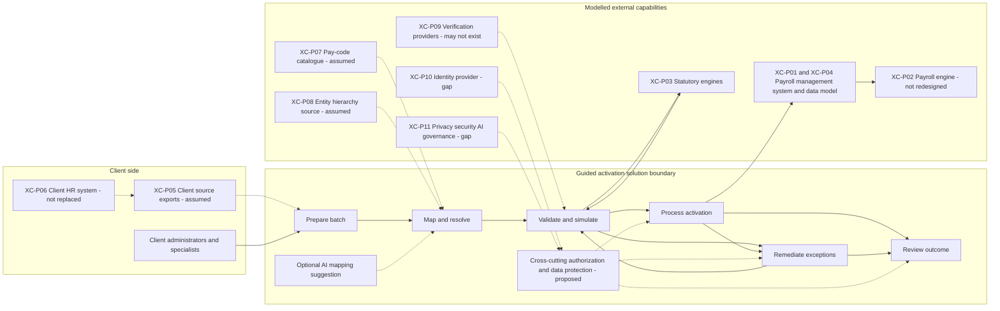

# SOL-002: Task 04.2, Enterprise Architecture View: Working Analysis

## 1. Document control

| Field | Value |
| :-- | :-- |
| Artifact | SOL-002 |
| Task | Task 04, activity 4.2 (Enterprise Architecture View) |
| Version | 0.1 |
| Date | 2026-11-26 |
| Author | AI-generated draft (Claude Code) for review by the architecture team |
| Status | DRAFT. Working analysis. Ready for human review. Nothing has been approved. |
| Approval record | None. Approval must be recorded by an authorised person. |
| Input | SOL-001 (Task 04.1, draft) and the Task 01 to Task 03 Part 1 working baseline |
| Prompt | docs/prompts/task-04-2-enterprise-architecture-view-prompt.md |

## 2. Summary

The solution fits into the payroll enterprise as an activation layer between client source data and the payroll system of record. It prepares, maps, validates, simulates, activates and reviews batches of employee profiles, and it relies on external payroll, statutory and client systems that no source identifies. The business view is strong and traceable. The application, integration and technology views can only be shown as modelled external capabilities until the payroll management system, the authoritative statutory engine and AD-01 are settled.

Three points shape the whole view.

- No source artifact is approved. Task 01 and Task 02 are working baselines. Task 03 Part 1 and SOL-001 are drafts. This document uses the label W (working baseline) for their content and never presents it as an approved or validated fact.
- The proposed Google Cloud stack in `tech-stack.md` is a proposal (DEC-022, decided as such). No element of it is adopted, assumed or used as evidence here. Adoption is a separate decision (AD-03).
- The external systems in section 5 are modelled capabilities with assessment-local references (XC-P01 to XC-P11). They are not confirmed products, owners or interfaces.

## 3. Scope, sources and evidence classification

### Scope

This view covers bulk guided activation of employee profiles during enterprise onboarding, tenant provisioning or organisational restructuring (`Problem statement.md` section 1). It places the solution in its enterprise context across six domains. It does not decompose the solution into logical components. That is Task 04.3. Migration of historical payroll data is out of scope (CON-007, OOS-001).

### Sources reviewed

| Source | Status | Used for |
| :-- | :-- | :-- |
| `Problem statement.md` | Verified source | Problem, bottlenecks, target metrics |
| `Business Model Canvas to Business Architecture Blueprint.md` | Baseline | Key resources, partners, information handled, rules |
| `product-backlog.md`, epic-01 to epic-06 | Baseline | Stories PA-01 to PA-16 |
| BIZ-001 to BIZ-008 | DRAFT, working baseline | Stakeholders, objectives, KPIs, assumptions, constraints, risks, decisions, AI rules, scope |
| ARC-001 to ARC-007 | DRAFT, working baseline | Capabilities, value stream, traceability, ownership, dependencies, business rules, proposed changes |
| OPS-002, OPS-003, OPS-009 | DRAFT, review pending | Processes PRC-01 to PRC-06, exceptions EXC-01 to EXC-23, questions Q-01 to Q-10 |
| SOL-001 | DRAFT, working analysis | Systems, integrations I-1 to I-9, gaps G-01 to G-17, decisions AD-01 to AD-03 |
| `tech-stack.md`, `docs/solution-architecture.svg` | Proposal (DEC-022) | Reference only |

### Evidence codes

| Code | Meaning in this document |
| :-- | :-- |
| C | Confirmed. A recorded decision or binding constraint, for example DEC-022 as decided, the scope exclusions in BIZ-008, and the project rules in CLAUDE.md. |
| W | Working baseline. Content in the Task 01 to Task 03 Part 1 artifacts or SOL-001. Accepted for progression. Proposed, not approved or validated. |
| A | Assumption. Unvalidated, for example ASM-001 to ASM-014 and A-01 to A-07 in OPS-009. |
| G | Information gap. No supporting information exists in the baseline. G-01 to G-17 are defined in SOL-001. |
| D | Decision requiring approval. An open decision for an accountable human. |

Local references. XC-P01 to XC-P11 (external capabilities), EAV-G01 onward (new gaps), EAV-D01 onward (new decisions), EAV-R01 onward (risks) and DC-01 onward (dependencies and constraints register rows) are assessment-local to this document. They are not repository identifiers and are not in any register. All other identifiers come from the baseline and keep their meaning.

## 4. Executive Architecture Overview

| Topic | Position | Evidence |
| :-- | :-- | :-- |
| What the solution is | An activation capability that takes an external employee data batch through six stages and commits only eligible records, one at a time, to the payroll system of record | W |
| Where it sits | Between client source systems and the payroll management system, using statutory engines for validation and dry run | W for the roles, G for the systems |
| What it does not do | Replace the payroll engine, statutory engines or client HR system; migrate historical payroll data; act as a general integration or analytics platform | C (OOS-001 to OOS-003, OOS-014, OOS-018) |
| AI position | Optional and suggestion-only; core activation works without it | W, binding on approval (AIB-002, AIB-012, CON-006) |
| Technology position | Not selected. The proposed stack is a proposal | C (DEC-022, OOS-010) |
| Largest unknown | Identity, hosting and interfaces of the payroll management system, and whether the solution extends it or runs beside it | G-01, D AD-01 |

Architecture direction. Keep the architecture option-preserving. The business capabilities and their order are stable. Component boundaries, integration patterns and technology depend on four decisions: AD-01 (extend or integrate), AD-02 (where batch working state lives), DEC-015 and DEC-016 (authoritative statutory engine and dry-run scope), and DEC-007 (authorization model).

## 5. Business Architecture View

Status: W. The capability map is DRAFT (ARC-001). CAP-001 to CAP-007 keep the names in BIZ-008. CAP-008 and CAP-009 are proposed additions pending PCR-010. CAP-030 is pending DEC-023.

### 5.1 Domain analysis

| Item | Content |
| :-- | :-- |
| Purpose | State what the enterprise must be able to do for activation, who takes part, and where responsibility lies |
| Major elements | 9 Level 1 capabilities and 38 capabilities in all (ARC-001); value stream VS-01 to VS-06 and boundary VSB-01 (ARC-002); processes PRC-01 to PRC-06 (OPS-002); exceptions EXC-01 to EXC-23 (OPS-003); business rules BR-001 to BR-009 (ARC-006); stakeholders STK-001 to STK-013 (BIZ-003) |
| Relationships | Capabilities set the need for application responsibilities (section 6), define the information in section 7, drive the integrations in section 9 and are bounded by the controls in section 10 |
| Dependencies | Capability dependencies CD-001 onward (ARC-005); payroll or compliance owner to define rules (DEP-008) |
| Constraints | CON-001 to CON-008; OOS-001 to OOS-003 |
| Open decisions | DEC-006, DEC-007, DEC-021, DEC-023, PCR-010 to PCR-012 |
| Information gaps | Owners are provisional (all 38 ownership assignments in ARC-004, W); no current-state baseline for the KPIs (DEC-005, OQ-005) |
| Architecture risks | RSK-001 (wrong record activated because blocking policy is undefined), RSK-007 (targets treated as commitments before baselines exist), RSK-012 (cohort left incomplete) |

### 5.2 Capabilities and value stream

| Stage | Level 1 capabilities | Process | Epic | Objectives | Evidence |
| :-- | :-- | :-- | :-- | :-- | :-- |
| VS-01 Prepare batch | CAP-001 | PRC-01 | EPIC-01 | BO-001, BO-008 | W |
| VS-02 Map and resolve | CAP-002, CAP-003 | PRC-02 | EPIC-02 | BO-002, BO-003, BO-006 | W |
| VS-03 Validate and simulate | CAP-004 | PRC-03 | EPIC-03 | BO-003, BO-004, BO-006 | W |
| VS-04 Process activation | CAP-005 | PRC-04 | EPIC-04 | BO-001, BO-005, BO-006 | W |
| VS-05 Remediate exceptions | CAP-006 | PRC-05 | EPIC-05 | BO-002, BO-005, BO-007 | W |
| VS-06 Review outcome | CAP-007 | PRC-06 | EPIC-06 | BO-007, BO-008 | W |
| Across VS-04 to VS-06 | CAP-008 (proposed), CAP-009 (proposed) | PRC-04, PRC-05, PRC-06 | EPIC-04 to EPIC-06 | BO-006 | W, pending PCR-010 |
| VSB-01 Hand-off to first live payroll | None | None | None | None | Boundary only; D DEC-021 |

The three programme targets map to this stream as targets, not commitments: 65 percent faster activation (KPI-001), 75 percent fewer support touchpoints per 1,000 activations (KPI-002) and a 99.8 percent first-time-right rate (KPI-003). Baselines are not agreed (DEC-005, RSK-007). Evidence: W.

### 5.3 Actors and stakeholders

| Group | Roles | Part in the stream | Evidence |
| :-- | :-- | :-- | :-- |
| Prepare, map, validate, correct | STK-001 client payroll administrator, STK-002 implementation specialist | Primary users in VS-01 to VS-05 | W |
| Rule and policy authority | STK-003 payroll or compliance owner | Confirms rules, blocking conditions and bulk fixes; authority for approvals undefined | W; D DEC-006, DEC-007 |
| Delivery and operation | STK-004 product or engineering owner, STK-005 payroll operations user | Delivers the capability; recovers interrupted processing (Q-05 open) | W |
| Review and investigation | STK-006 authorized reviewer, STK-008 payroll provider | Use VS-06 history and outcomes | W |
| External and affected | STK-007 client organization, STK-009 employees | Supply data; no interaction with the solution | W |
| Inferred governance roles | STK-010 business sponsor, STK-011 data protection owner, STK-012 information security owner, STK-013 customer success owner | Approvals and sign-off where named | A (inferred, unconfirmed) |

### 5.4 Automation boundaries

| Activity type | Examples | Source | Evidence |
| :-- | :-- | :-- | :-- |
| Deterministic | Structural inspection, field and pay-code validation, severity classification, dry-run execution, per-record commit, isolation, revalidation | BR-001 to BR-009; OPS-002 | W |
| AI-supported (optional) | Suggesting source-to-payroll and pay-code mappings | AI-001, AI-002; AIB-002, AIB-012 | W; D DEC-014 on whether AI is used at all |
| Human review | Accepting, editing or rejecting mappings and suggestions; resolving ambiguous entity or jurisdiction assignments; reviewing findings | PA-03 to PA-06; BR-004; AIB-009 | W |
| Reserved to an authorised human | Activation approval; sensitive change and bulk-fix authorization; stop, resume or abandon a batch; fraud indicator handling; dispute ownership | CAP-031, CAP-032; EXC-13, EXC-18 to EXC-20, EXC-22, EXC-23 | W; authority undefined (D DEC-007, Q-01, Q-02, Q-09, Q-10) |

Rejected AI uses (AI-005 to AI-009) remain rejected: AI must not decide entity or jurisdiction assignments or any other decision listed there.

## 6. Application Architecture View

Status: W for responsibilities, G for everything about the actual systems.

### 6.1 Domain analysis

| Item | Content |
| :-- | :-- |
| Purpose | Show which application responsibilities deliver the capabilities, which already exist outside the solution and where the boundaries lie |
| Major elements | Six solution-level responsibility groups and two cross-cutting controls (6.3); eleven modelled external capabilities (6.2) |
| Relationships | Delivers business capabilities; owns or coordinates the information in section 7; calls the external capabilities through section 9; operates inside the controls of section 10 and the conditions of section 8 |
| Dependencies | DEP-001, DEP-002, DEP-003, DEP-004, DEP-005 |
| Constraints | The payroll engine and statutory engines are not redesigned (OOS-002). The client HR system is not replaced (OOS-003). AI is optional (CON-006). A general integration platform is out of scope (OOS-014) |
| Open decisions | AD-01 extend or integrate; AD-02 batch working state versus system of record; DEC-003 delivery surface; DEC-014 AI in the first release |
| Information gaps | G-01 payroll management system identity, hosting and interfaces; G-06 delivery surface; G-13 identity provider; G-15 governance owners |
| Architecture risks | EAV-R01, EAV-R02, EAV-R03 (section 12) |

### 6.2 Modelled external capabilities

These are assessment-local. None is a confirmed product, vendor, owner or interface.

| Ref | External capability | Known role in the baseline | Source | Evidence |
| :-- | :-- | :-- | :-- | :-- |
| XC-P01 | Payroll management system, including the current guided activation wizard | Hosts the current semi-manual activation workflow | Problem statement sections 1 and 2 | W for the role; G for details |
| XC-P02 | Payroll engine | Receives activated cohorts; runs the first live payroll; not redesigned | Problem statement section 2; OOS-002 | W; C for the exclusion |
| XC-P03 | Statutory engines | Apply statutory rules; expected to validate and run a dry run | Problem statement sections 3 and 5; ASM-006; DEP-001, DEP-004 | W; A for dry-run support; D DEC-015, DEC-016 |
| XC-P04 | Payroll data model | Target structure for activated profiles | Blueprint key resources; DEP-005 | W; G for access |
| XC-P05 | Client source systems producing external payroll exports | Origin of employee data | ASM-004; DEC-009 | A |
| XC-P06 | Client HR information system | Named only as not to be replaced | OOS-003 (source: Task 01 prompt only) | C for the exclusion; G for any other role |
| XC-P07 | Pay-code catalogue | Authoritative list for custom pay-code mapping | PA-04; ASM-010; DEP-002 | A |
| XC-P08 | Entity hierarchy source | Authoritative parent-child entity structure | PA-05; ASM-005; DEP-003 | A |
| XC-P09 | Source-system, statutory-data or verification providers | Possible external dependencies | DEC-004; DEP-006 | G; may not exist |
| XC-P10 | Identity provider for client users | Sign-in for client administrators | None | G (G-13) |
| XC-P11 | Data protection, information security and AI governance functions | Approve access, masking, retention and AI use | OQ-007, OQ-011; STK-011, STK-012 | A for the roles; G for owners (G-15) |

### 6.3 Solution-level responsibilities

These are responsibilities, not components. Level 1 capability groups stand in for business domains because no domain model exists (OPS-009 A-07, evidence A). Task 04.3 decides whether any becomes a component and which existing system fulfils it. Not every responsibility needs a new application.

| Responsibility group | Capabilities | May be fulfilled by an existing system | Evidence |
| :-- | :-- | :-- | :-- |
| Batch intake and inspection | CAP-001, CAP-010 to CAP-012 | Possibly the current activation wizard (XC-P01) | W; D AD-01 |
| Mapping and context resolution | CAP-002, CAP-003, CAP-013 to CAP-018 | Pay-code and hierarchy sources are read, not replaced (XC-P07, XC-P08) | W |
| Validation and simulation | CAP-004, CAP-019 to CAP-021, CAP-035 to CAP-038 | Rule evaluation stays with the statutory engines (XC-P03) | W; D DEC-015, DEC-016 |
| Activation processing and isolation | CAP-005, CAP-022 to CAP-024 | Commit lands in the payroll system of record (XC-P01, XC-P04) | W; G G-01 |
| Remediation | CAP-006, CAP-025 to CAP-027 | None identified | W |
| Review, history and measurement | CAP-007, CAP-028 to CAP-030 | None identified | W; D DEC-023 for CAP-030 |
| Cross-cutting: authorization and approval | CAP-008, CAP-031, CAP-032 | Possibly existing access control (G-13) | W, proposed; D DEC-007, PCR-010 |
| Cross-cutting: data protection | CAP-009, CAP-033, CAP-034 | Possibly existing enterprise controls (XC-P11) | W, proposed; G G-09, G-15 |
| Optional AI mapping suggestion | AI-001, AI-002 | Not applicable | W; D DEC-014 |

## 7. Data Architecture View

Status: W for the information concepts, A for ownership and classification, G for systems of record.

### 7.1 Domain analysis

| Item | Content |
| :-- | :-- |
| Purpose | Show what information the solution needs, creates, exchanges and must govern |
| Major elements | Employee data handled (7.2); data the solution creates (7.3); data dependencies DEP-001 to DEP-009 |
| Relationships | Supports every capability; is exchanged through the integrations in section 9; sits under the access, audit and retention controls in section 10; its volume and location shape section 8 |
| Dependencies | DEP-002, DEP-003, DEP-005, DEP-007, DEP-009 |
| Constraints | CON-004 (protect sensitive data, limit access and retention); CON-005 (no jurisdiction assumed); CON-007 (no historical payroll data); OOS-016 (no immutability claim); OOS-017 (no retention periods invented) |
| Open decisions | AD-02 batch working state and system of record; DEC-008 audit events, viewing and retention; DEC-009 and DEC-012 input formats and required fields; DEC-013 inheritable settings and hierarchy source |
| Information gaps | G-05 required fields and formats; G-09 audit events and retention; G-11 owners of the catalogue and hierarchy; G-14 tenant isolation; no data owner or system of record is named for any domain |
| Architecture risks | RSK-004 (sensitive data exposed to a model or unauthorised users), RSK-009 (wrong jurisdiction inherited), RSK-013 (history insufficient) |

### 7.2 Information the solution handles

| Information concept | Source and use | Sensitivity | Owner | Evidence |
| :-- | :-- | :-- | :-- | :-- |
| Employee identity | Client export; mapped, validated, activated | Sensitive (hypothesis) | G | W for the concept; A for sensitivity |
| Compensation | As above; compensation framework validation (CAP-035) | Sensitive (hypothesis) | G | W; A |
| Tax withholding and jurisdiction | As above; CAP-017, CAP-036 | Sensitive (hypothesis) | G | W; A |
| Banking details | As above; CAP-038 | Sensitive (hypothesis); fraud indicator handling is open (EXC-22) | G | W; A |
| Benefit data | As above; CAP-037 | Sensitive (hypothesis) | G | W; A |
| Pay-code and entity data | XC-P07, XC-P08; CAP-014, CAP-016 | Not stated | G | W; A |

The sensitivity labels are working hypotheses drawn from the information handled in the blueprint and CON-004. They are not validated classifications.

### 7.3 Information the solution creates

| Information | Created by | Used by | Evidence |
| :-- | :-- | :-- | :-- |
| Batch and lifecycle status | CAP-010 | All stages | W |
| Activation context | CAP-012 | Mapping and resolution | W; D DEC-010 |
| Field and pay-code mappings, with review decisions | CAP-013 to CAP-015 | Validation | W |
| Entity and jurisdiction assignments | CAP-016, CAP-017 | Validation | W |
| Validation findings with severity | CAP-019, CAP-020 | Remediation, activation gate | W; D DEC-006 |
| Dry-run results and stated limitations | CAP-021 | Activation decision | W; D DEC-016 |
| Per-record activation outcomes | CAP-023 | Review, remediation | W |
| Remediation items and corrections | CAP-025 to CAP-027 | Revalidation | W |
| Approvals and authorizations | CAP-031, CAP-032 | Activation, remediation | W; D DEC-007 |
| Activation history | CAP-029 | Review, audit | W; D DEC-008 |
| AI suggestions and the human decision on each | AIB-010 | Review, audit | W, if AI is adopted |
| Outcome measures | CAP-030 | KPI reporting | W; D DEC-023 |

### 7.4 Data movement

| Movement | From | To | Purpose | Evidence |
| :-- | :-- | :-- | :-- | :-- |
| Batch input | XC-P05 | Solution | Intake and inspection | W; G for method (DEC-009) |
| Reference reads | XC-P07, XC-P08 | Solution | Pay-code and hierarchy resolution | A |
| Validation and dry-run exchange | Solution | XC-P03 and back | Findings and simulation results | W; G for interface |
| Activation commit | Solution | XC-P01 and XC-P04 | One record at a time, no duplicate effects | W; G for interface |
| Review and history reads | Solution | Authorised users | Outcome and audit review | W |
| Outcome and measurement data | Existing case and payroll records | Solution | KPI measurement | A (ASM-011); D DEC-023 |

Lineage and traceability. Each record must remain associated with its batch (VS-04 exit condition) and each mapping, correction, validation result, approval and outcome must be recorded with the deciding person (CAP-029, AIB-008). The events to record are not defined (D DEC-008). No claim is made that the record is immutable (OOS-016).

Retention and residency. Both depend on the unresolved jurisdiction (DEC-001, CON-005) and on DEC-008. No period, region or regime is named here.

## 8. Technology and Infrastructure Architecture View

Status: technology-neutral. Confirmed constraints are separated from requirements that still need definition. No technology is selected or recommended.

### 8.1 Domain analysis

| Item | Content |
| :-- | :-- |
| Purpose | State the operating conditions the solution must meet, without choosing products |
| Major elements | Hosting and execution conditions; asynchronous processing; recovery; AI execution boundary; processing location; monitoring (8.2) |
| Relationships | Hosts the application responsibilities; carries the data and its residency rules; supports the integrations; enforces the controls |
| Dependencies | DEP-005 (access to the existing workflow and data model); owner decisions on hosting (G-01) |
| Constraints | OOS-010 (no event broker, cloud, service boundaries or provider before technical discovery); DEC-022 (stack is a proposal); CON-003, BR-008 (isolation and no duplicate effects); AIB-012 (core works without AI) |
| Open decisions | AD-01 (inside or beside the payroll management system); AD-03 (whether any part of the proposed stack is adopted); DEC-017 retry and recovery; DEC-018 user controls during processing |
| Information gaps | G-04 volumes and peaks; G-10 availability, recovery and performance targets; G-14 tenant isolation; G-03 residency |
| Architecture risks | RSK-005 (duplicate effects on retry), RSK-011 (architecture locked in too early), EAV-R04 |

### 8.2 Considerations

| Area | What the baseline supports | What still needs definition | Evidence |
| :-- | :-- | :-- | :-- |
| Hosting and deployment | The solution must be able to operate with the payroll management system. No hosting is stated for either. | Hosting model, tenancy, deployment boundary | G (G-01); D AD-01 |
| Execution | Batches of hundreds or thousands of profiles are processed asynchronously with visible progress (CAP-022) | Volumes, batch sizes, frequency, concurrency | W; G (G-04, OQ-004) |
| Isolation and recovery | A failing record never blocks the batch. A retried or interrupted operation creates no duplicate effect (CON-003, BR-001, BR-002, BR-008) | Retry semantics, idempotency support in the payroll system | W; D DEC-017; G (G-01) |
| Availability and resilience | Not stated | Availability, recovery time and point targets | G (G-10) |
| Scalability and performance | Qualitative: large batches. The 65 percent cycle-time reduction is a target, not a system response target | Throughput and response targets | W; G (G-10) |
| AI service boundary | AI receives no unrestricted access and only masked inputs; core activation works without it (AIB-005, AIB-006, AIB-012) | Whether AI is used at all; where it would run | W; D DEC-014 |
| Processing location and residency | Depends on the first-release jurisdiction (CON-005) | Jurisdiction, regions, residency rules | G (G-03); D DEC-001 |
| Monitoring and continuity | Progress visibility and diagnostics are required (CAP-022, CAP-028). Support for interrupted processing sits with payroll operations or engineering (Q-05) | Operational monitoring requirements, continuity targets | W; G (G-10); D Q-05 |

Out of this view by design. No cloud provider, infrastructure platform, database, programming framework, LLM provider or model, AI orchestration framework, middleware, event broker, or container or deployment platform is named or recommended. The proposed stack in `tech-stack.md` and the SVG remain proposals and are unchanged.

## 9. Integration Architecture View

Status: the needs are W. The systems and interfaces are G or A.

### 9.1 Domain analysis

| Item | Content |
| :-- | :-- |
| Purpose | Show which systems exchange information with the solution, why, and what is unknown |
| Major elements | Integration relationships I-1 to I-9 (9.2); capability dependencies CD-001 onward (ARC-005) |
| Relationships | Realises the data movement in 7.4; connects the application responsibilities to the external capabilities; relies on the conditions in section 8; carries the controls in section 10 |
| Dependencies | DEP-001, DEP-002, DEP-003, DEP-004, DEP-005, DEP-006 |
| Constraints | OOS-002 and OOS-003 (do not replace engines or the HR system); OOS-014 (no general integration platform); BR-006 (dry run has no live effect); BR-008 (no duplicate effects) |
| Open decisions | DEC-015, DEC-016, DEC-009, DEC-004, DEC-021 |
| Information gaps | G-01, G-02, G-05, G-11, G-12 |
| Architecture risks | RSK-002 (dry run diverges from production), RSK-005, EAV-R05 |

### 9.2 Integration relationships

| Ref | Relationship | Trigger and purpose | Information exchanged | Capabilities | Criticality | Evidence |
| :-- | :-- | :-- | :-- | :-- | :-- | :-- |
| I-1 | Solution and XC-P03, validation | A record or batch reaches validation; obtain statutory and configuration findings | Candidate profile data out, findings back | CAP-019, CAP-035 to CAP-038 | High; validation cannot be confirmed without it | W for the need; G for engine and interface; D DEC-015 |
| I-2 | Solution and XC-P03, dry run | Activation decision approaches; simulate with no live effect | Candidate data out, simulated results and limits back | CAP-021 | High; wrong fidelity gives false confidence (RSK-002) | W; A (ASM-006); D DEC-016 |
| I-3 | Solution and XC-P01 and XC-P04, commit | Eligible record is approved; activate one record without duplicate effects | Record and outcome | CAP-023, CAP-024 | Highest; writes the system of record | W; G for interface and idempotency |
| I-4 | XC-P05 and solution, intake | A batch is started | Employee data as external exports | CAP-011, CAP-013 | High | W; A (ASM-004); D DEC-009 |
| I-5 | XC-P07 and solution | Pay-code mapping | Pay codes read | CAP-014 | Medium | A |
| I-6 | XC-P08 and solution | Entity resolution | Hierarchy read | CAP-016 | Medium | A |
| I-7 | XC-P09 and solution | Possible verification of banking or statutory data | Not stated | CAP-038 | Not assessed | G; may not exist (DEC-004) |
| I-8 | Solution and the first live payroll run | Activation outcome is reviewed | Not defined | Boundary VSB-01 | Not assessed | D DEC-021 |
| I-9 | Case and payroll records and solution | KPI measurement | Cycle time, touchpoints, first-payroll corrections | CAP-030 | Low | A (ASM-011); D DEC-023 |

Dependencies between integration points. I-3 depends on I-1 and I-2 having completed for the record (CON-002, BR-003). I-1 and I-2 depend on I-4, I-5 and I-6 having produced a mapped record (CD-001 onward). Corrected records return from remediation to I-1 on their own (BR-005). Evidence: W.

Further information flows with no confirmed system.

- Approval authority and access: needs the authorization model (CAP-031, CAP-032, DEC-007) and a user identity source (XC-P10). Evidence: D, G.
- Activation history and evidence retention: needs the audit event list and retention rules (DEC-008). Evidence: D, G.
- AI governance reporting: no source describes any reporting to an enterprise AI governance function. Evidence: G (OQ-011).

No API, endpoint, protocol, interface specification or integration product is proposed. Where an interface is unknown, it is a dependency and a gap.

## 10. Security and Governance Architecture View

Status: the principles are W and binding on approval. The controls, owners and obligations are G or D.

### 10.1 Domain analysis

| Item | Content |
| :-- | :-- |
| Purpose | Define the controls that apply across all five other domains |
| Major elements | AI boundary rules AIB-001 to AIB-012; business rules BR-001 to BR-009; capabilities CAP-008 and CAP-009 (proposed); controls in 10.2 |
| Relationships | Constrains the application responsibilities, restricts access to the data, governs the integrations, and sets requirements for hosting and AI execution |
| Dependencies | DEP-008 (rule owner); DEP-009 (approved privacy and security controls) |
| Constraints | CON-001 to CON-006; OOS-016; AIB-001 to AIB-012 |
| Open decisions | DEC-006, DEC-007, DEC-008, PCR-010, PCR-013 (confirmation of AIB-005 and AIB-006) |
| Information gaps | G-07 authorization model; G-09 audit and retention; G-13 identity provider; G-15 owners; OQ-002 obligations |
| Architecture risks | RSK-001, RSK-003, RSK-004, RSK-006 |

### 10.2 Principles

| Principle | Basis | Evidence |
| :-- | :-- | :-- |
| Identity and access: users see activation detail according to role; sensitive details are not exposed to unauthorised users | BR-009, CAP-033 | W; G for identity source (G-13) |
| Least privilege: AI receives no unrestricted access to payroll systems or personal data; inputs are limited to what each suggestion needs | AIB-005 | W; pending security confirmation (PCR-013) |
| Masking: mask tax identifiers, bank details and similar values before any model call | AIB-006 | W; pending security confirmation (PCR-013) |
| Human approval and accountability: high-impact decisions need appropriate human accountability and the deciding person is recorded | AIB-008, CAP-031, CAP-032 | W; D DEC-007 |
| AI oversight: AI only suggests; people approve; deterministic rules and statutory engines decide validity | AIB-002 | W |
| AI cannot approve, activate or commit, and cannot bypass validation, authorization or activation gates | AIB-004, AIB-007 | W |
| AI cannot determine statutory rules or calculate payroll results | AIB-011 | W |
| Model confidence is never proof of correctness; it may only order or route items for review | AIB-003 | W |
| AI use must show a justified benefit against the deterministic alternative | AIB-001 | W |
| AI contribution records: every suggestion and the human decision on it is recorded with the record and field | AIB-010 | W |
| Ambiguity is surfaced, never silently resolved | AIB-009, BR-004 | W |
| Untrusted input: uploaded batch files and AI suggestions are untrusted until deterministic rules validate them. This applies the principle to this domain; it is not stated in a source as a separate rule | CON-001, AIB-002, BR-001 | A |
| Fault isolation: a bad record never blocks the whole batch, and corrected records are revalidated on their own | CON-003, BR-001, BR-002, BR-005 | W |
| Resilience and manual fallback: core activation works without AI | AIB-012, CON-006 | W |
| Policy precedence: rules and policy take precedence over AI output | AIB-004 | W |
| Auditability: record mappings, corrections, validation results, approvals and outcomes. No immutability claim | CAP-029, OOS-016 | W; D DEC-008 |
| Retention: limit to what activation needs; no periods named | CON-004, CAP-034, OOS-017 | W; G (G-09) |
| External provider governance | DEC-004, DEP-006 | G; providers may not exist |

Regulatory position. No statutory jurisdiction, regulation or obligation has been identified (DEC-001, OQ-002, CON-005). This view does not claim compliance with any instrument. Evidence: C for the constraint, G for the obligations.

## 11. Cross-Domain Architecture Relationship Matrix

Each cell states how the row domain depends on or influences the column domain. Evidence is W unless marked.

| From, to | Business | Application | Data | Technology | Integration | Security and governance |
| :-- | :-- | :-- | :-- | :-- | :-- | :-- |
| Business | Not applicable | Capabilities create the need for the responsibility groups in 6.3 | Capabilities define the information handled and created | Volumes and batch behaviour set execution needs | Capabilities require the exchanges in I-1 to I-9 | Capabilities carry the rules BR-001 to BR-009 |
| Application | Responsibilities realise the capabilities | Not applicable | Responsibilities own or coordinate the created data (D AD-02) | Responsibilities need an execution environment (G) | Responsibilities call the external capabilities | Responsibilities enforce approval and access |
| Data | Information shapes decisions and outcomes | Data defines each responsibility's inputs and outputs | Not applicable | Volume, residency and retention shape hosting (G) | Data defines what each integration carries | Data sets the protection, masking and audit needs |
| Technology | Conditions bound what the business can promise (KPI-001) | Hosting constrains where responsibilities run (D AD-01) | Processing location and residency apply (G) | Not applicable | Hosting and network shape interface choices (G) | Hosting must support access control and AI isolation |
| Integration | Delivers the cross-stage flow in the value stream | Defines the application boundaries | Moves and transforms the information | Depends on connectivity and availability (G) | Not applicable | Interfaces must carry approval, identity and audit context |
| Security and governance | Sets who may approve and decide | Limits what each responsibility may do, including AI | Classifies, masks and retains data | Sets resilience and isolation requirements | Sets the controls on every exchange | Not applicable |

Traceability example. Capability CAP-023 (eligible-record activation and record isolation, VS-04, PA-10, BR-001 to BR-003) leads to the activation processing responsibility, which creates per-record outcomes and calls I-3 to commit one record at a time. It needs idempotent commit semantics from the payroll system (G-01, D DEC-017), is gated by approval (CAP-031, D DEC-007) and records the deciding person (AIB-008).

## 12. Architecture Dependencies and Constraints Register

Rows DC-01 onward are assessment-local. Baseline identifiers are preserved.

| Ref | Type | Statement | Source | Domains | Status | Evidence |
| :-- | :-- | :-- | :-- | :-- | :-- | :-- |
| DC-01 | Constraint | Preserve payroll data integrity and statutory compliance | CON-001 | All | Binding on approval | W |
| DC-02 | Constraint | Validate and simulate before hard commit | CON-002 | Business, integration | Binding on approval | W |
| DC-03 | Constraint | Isolate invalid records without losing valid records' status | CON-003 | Application, technology | Binding on approval | W |
| DC-04 | Constraint | Protect sensitive data; limit access and retention | CON-004 | Data, security | Controls pending (DEP-009) | W |
| DC-05 | Constraint | No jurisdiction or regulation assumed | CON-005 | Data, technology, security | Active | C |
| DC-06 | Constraint | AI is optional and cannot block core activation | CON-006, AIB-012 | Application, technology, security | Binding on approval | W |
| DC-07 | Constraint | No historical payroll migration | CON-007 | Data | Active | C |
| DC-08 | Constraint | No fixed batch-stop threshold without an approved policy | CON-008 | Business, application | Active | W |
| DC-09 | Constraint | Payroll engine and statutory engines are not redesigned; HR system is not replaced | OOS-002, OOS-003 | Application, integration | Active | C |
| DC-10 | Constraint | No event broker, cloud, service boundaries or provider before technical discovery | OOS-010 | Technology | Active | C |
| DC-11 | Constraint | The proposed stack is a proposal, not a constraint | DEC-022 | Technology | Decided | C |
| DC-12 | Constraint | No general integration platform and no analytics product | OOS-014, OOS-018 | Integration, data | Active | C |
| DC-13 | Constraint | No immutability claim for audit records | OOS-016 | Data, security | Active | C |
| DC-14 | Dependency | Statutory engine identified, supporting validation and non-committing dry run | DEP-001, DEP-004 | Application, integration | Open | G, A |
| DC-15 | Dependency | Access to the existing activation workflow and payroll data model | DEP-005 | Application, integration, technology | Open | G |
| DC-16 | Dependency | Pay-code catalogue and entity hierarchy sources | DEP-002, DEP-003 | Application, data, integration | Open | A |
| DC-17 | Dependency | Rule owner defines blocking policy and rules | DEP-008 | Business, security | Open | D |
| DC-18 | Dependency | Approved privacy and security controls | DEP-009 | Data, security | Open | G |
| DC-19 | Dependency | Providers identified, if any | DEP-006 | Integration | Open | G |
| DC-20 | Dependency | Case data for the KPI-002 baseline | DEP-007 | Business, data | Open | G |
| DC-21 | Dependency | Task 03 Part 2 (state model, rules, decisions, requirements) | OPS-009 | All | Not started | G |

### Risks

| Ref | Risk | Domains | Related | Evidence |
| :-- | :-- | :-- | :-- | :-- |
| EAV-R01 | Two systems of record for the same profile if batch working state and committed state are not separated | Application, data | AD-02 | D |
| EAV-R02 | Component boundaries set before AD-01 is decided have to be redrawn | Application, technology | AD-01, RSK-011 | D |
| EAV-R03 | The activation commit cannot be made safe to repeat if the payroll system lacks idempotent commit | Application, integration | G-01, BR-008, RSK-005 | G |
| EAV-R04 | Residency, availability and performance targets arrive late and change the hosting view | Technology, data | G-03, G-10 | G |
| EAV-R05 | A dry run that diverges from the statutory engines gives false confidence | Integration | ASM-006, RSK-002 | A |
| EAV-R06 | The modelled external capabilities are mistaken for confirmed systems | All | XC-P01 to XC-P11 | W |
| EAV-R07 | Authorization is designed before DEC-007 and bakes in approval authority nobody has agreed | Security, business | DEC-007, Q-01 | D |

## 13. Architecture Decisions and Information Gaps Register

### 13.1 Decisions, highest priority first

Decide-by roles are those recorded in BIZ-005 or SOL-001. Where no role is recorded, it is stated. Evidence: D for all rows.

| Priority | Decision | Effect on this view | Accountable role | Source |
| :-- | :-- | :-- | :-- | :-- |
| 1 | DEC-015, DEC-016: authoritative statutory engine and dry-run scope | Defines I-1, I-2 and the dry-run trust boundary | STK-003 | BIZ-005 |
| 2 | AD-01: extend the existing activation workflow, or run as a separate service | Sets application boundaries and hosting | STK-004 | SOL-001 |
| 3 | DEC-006: blocking policy and batch-stop conditions | Determines validation, isolation and stop behaviour | STK-003 | BIZ-005 |
| 4 | DEC-007: authorization and approval model | Determines CAP-008 and the approval gates | STK-003 | BIZ-005 |
| 5 | DEC-001: first-release jurisdiction | Drives residency, obligations and statutory scope | STK-010 | BIZ-005 |
| 6 | AD-02: where batch working state lives and which system is the system of record | Prevents two systems of record | STK-004 | SOL-001 |
| 7 | DEC-017: retry and recovery behaviour | Shapes I-3 and recovery | STK-004 | BIZ-005 |
| 8 | DEC-008: audit events, visibility, retention | Determines the history design; immutability must not be assumed | STK-011 | BIZ-005 |
| 9 | PCR-010: accept CAP-008 and CAP-009 | Confirms authorization and data protection as capabilities | STK-004 | ARC-007 |
| 10 | DEC-014: deterministic, AI-assisted or combined mapping | Decides whether an AI boundary exists in the first release | STK-004 | BIZ-005 |
| 11 | DEC-003, DEC-009: delivery surface and input methods | Front-end and intake responsibilities | STK-004 | BIZ-005 |
| 12 | DEC-021: whether the hand-off to the first live payroll is in scope | Adds or removes I-8 | STK-004 | BIZ-005 |
| 13 | AD-03: whether any element of the proposed stack is adopted | Technology options for 4.3 onward | STK-004 | SOL-001 |
| 14 | DEC-023: whether outcome measurement is in scope | Adds or removes CAP-030 and I-9 | STK-004 | BIZ-005 |
| 15 | EAV-D01: whether the identity source for client users is the provider's own or a client identity provider | Access design; depends on G-13 | None recorded | Raised here |
| 16 | EAV-D02: whether the 11 modelled external capabilities, XC-P01 to XC-P11, are adopted as the working vocabulary for Task 04.3 | Consistent naming across later diagrams | Architecture team; none recorded | Raised here |

Open questions that Task 03 Part 1 already raised stay open: Q-01 (who authorizes), Q-05 (who recovers interrupted processing), Q-06 and Q-07 (dry-run gate and repeat), Q-09 and Q-10 (fraud and dispute ownership). OQ-001 (sponsor) and OQ-002 (obligations) also stay open. Nothing in this view resolves them.

### 13.2 Information gaps

The gaps G-01 to G-17 in SOL-001 section 11 still apply and are not repeated. This view adds:

| Ref | Gap | Blocks | Closes through |
| :-- | :-- | :-- | :-- |
| EAV-G01 | Whether the payroll management system exposes a per-record commit that can be repeated safely | I-3 design | G-01, DEC-017 |
| EAV-G02 | Whether the payroll management system and the statutory engines belong to the provider or to a third party | Ownership of I-1 to I-3 | G-01, G-02 |
| EAV-G03 | Which enterprise controls (identity, privacy, records retention, AI governance) already exist and can be reused | CAP-008 and CAP-009 design | OQ-007, OQ-011 |
| EAV-G04 | Whether client users and internal roles sign in through the same identity source | Access design | EAV-D01 |

## 14. Enterprise architecture diagram

The diagram is at enterprise level. The solid boundary is the proposed activation solution. External capabilities are modelled. Dashed lines and the label (assumed) mark relationships and systems that no source confirms. It does not show components, products, protocols or hosting. It is written for Mermaid 8.8.0.

How to read it.

- The six stages and the loop from remediation back to validation come from ARC-002. Records with errors leave validation for remediation, and corrected records return to validation on their own.
- The hand-off from the payroll management system to the first live payroll run is shown only as the link to the payroll engine. It is a boundary (VSB-01, DEC-021) and no process is modelled for it.
- The line from the client HR system to the source exports is dashed because no source says whether the HR system is a source (SOL-001 section 5).
- Nothing on the diagram is a confirmed product, interface or owner. It is consistent with the written view and does not change `tech-stack.md` or `docs/solution-architecture.svg`.

## 15. Conclusions

### 15.1 Key architectural findings

1. The business and operating model is consistent and traceable from capability to process, epic and story. The six stages, six processes and six epics line up one to one, and two proposed cross-cutting capabilities (CAP-008, CAP-009) apply across them.
2. Almost every application, integration and technology statement is a modelled need, not a fact. The solution fits between client source data and the payroll system of record, but no source names the payroll management system, its hosting or its interfaces.
3. Four integrations decide the architecture: statutory validation (I-1), the non-committing dry run (I-2), the per-record activation commit (I-3) and client intake (I-4). Each needs a system that is not yet identified.
4. The AI boundary is clear and narrow. AI only suggests, never decides, approves or commits, and core activation must work without it. This is the strongest control in the baseline, but it is binding only on approval and two of its rules still await security confirmation.
5. Security and governance are strong as principles and weak as controls. Authorization, audit events and retention are undefined, and no owner is named for data protection, information security or AI governance.
6. Nothing in the baseline supports a technology selection, and the proposed stack should stay a proposal until AD-03 is decided.

### 15.2 Unresolved dependencies and decisions

The highest priority items are DEC-015 and DEC-016, AD-01, DEC-006, DEC-007 and DEC-001. The full list is in section 13.1. The dependencies are in DC-14 to DC-21. Task 03 Part 2 has not started (DC-21).

### 15.3 Information required from the client, the payroll provider and the statutory engine owners

1. The identity, owner, hosting and interfaces of the payroll management system, and whether it can commit and re-commit one record at a time (G-01, EAV-G01, EAV-G02).
2. The authoritative statutory engine, its owner, and whether it can run a non-committing simulation with production-equivalent rules (G-02, ASM-006).
3. The first-release jurisdiction and the obligations that follow (G-03, OQ-002).
4. Activation volumes, batch sizes, frequency and peak concurrency (G-04, OQ-004).
5. Supported input methods, formats and required fields, and whether the client HR system is a source (G-05).
6. Owners and existence of the pay-code catalogue and entity hierarchy source (G-11).
7. Availability, recovery and performance targets (G-10).
8. Owners of data protection, information security and AI governance, and which enterprise controls already exist (G-15, EAV-G03).
9. The identity source for client users (G-13, EAV-D01).

### 15.4 Risks that could affect the Solution Architecture Blueprint

The register is in section 12. In priority order:

1. EAV-R02: boundaries drawn before AD-01 is decided.
2. EAV-R01: two systems of record for one profile.
3. EAV-R03: no safe repeat of the activation commit.
4. EAV-R05: dry run diverges from the statutory engines.
5. EAV-R07: authorization designed ahead of DEC-007.
6. EAV-R06: modelled external capabilities mistaken for confirmed systems.
7. EAV-R04: late residency, availability and performance targets.

### 15.5 Recommendations for proceeding to Task 04.3

In priority order.

1. Decide AD-01 and AD-02 before decomposing into components. If they cannot be decided, produce two options for 4.3 and keep both visible.
2. Identify the payroll management system and the authoritative statutory engine, with owners (G-01, G-02), or carry them as named unknowns in every 4.3 view.
3. Use the six responsibility groups and two cross-cutting controls in 6.3 as the starting point, and keep them logical. Do not assume a component per capability.
4. Carry XC-P01 to XC-P11 into 4.3 as modelled external capabilities with the same names and evidence labels, once EAV-D02 is accepted.
5. Keep DEC-006 and DEC-007 open, or leave their options visible. Do not choose a blocking policy or approval authority in 4.3.
6. Add the registers in sections 12 and 13 to the decision register if the reviewer accepts them, and decide whether the PCR items need re-ordering.
7. Run Task 03 Part 2, then re-check this view against its state model, rules and requirements.
8. Update the Mermaid diagrams and SVG together when the architecture changes, as CLAUDE.md requires. They are unchanged by this document.

### 15.6 Validation notes

- Every statement carries an evidence code and a source identifier. No system, interface, data source, vendor, product or technology is presented as existing unless a source states it. XC-P01 to XC-P11 are labelled modelled and assessment-local.
- No jurisdiction, regulation, retention period, region or compliance claim is made.
- No source file was changed. Only this file was created.
- No technology selection was made. The proposed stack is untouched.
- The three target metrics are described as targets. No baselines or figures were invented.
- Identifier check. A text search confirmed that every baseline identifier cited here (CAP, PCR, DEC, OQ, OOS, ASM, RSK, DEP, AIB, CON, BR, BO, KPI, STK, EXC, PRC, PA, AI and CD) appears in the source files. It did not check that each identifier is used with the meaning the source gives it.
- Diagram. The Mermaid diagram in section 14 was written to the Mermaid 8.8.0 syntax but was not rendered. The environment blocked the download of the Mermaid command-line tool, so a reviewer should render it before approval.
- Limitations. The content was checked by reading, so a reviewer should confirm the identifiers and their meanings. Section 6.3 uses the Level 1 capability groups as business domains because no domain model exists (OPS-009 A-07). The untrusted-input principle in section 10.2 is an application of existing rules, marked A, because no source states it as a separate rule. The ownership assignments in ARC-004 were not reviewed in detail.
