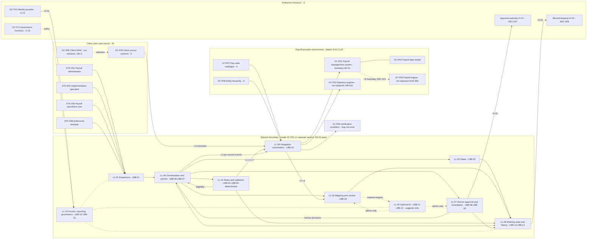
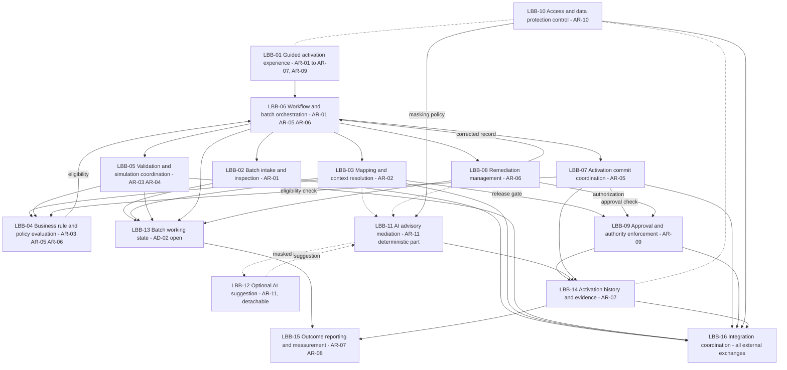
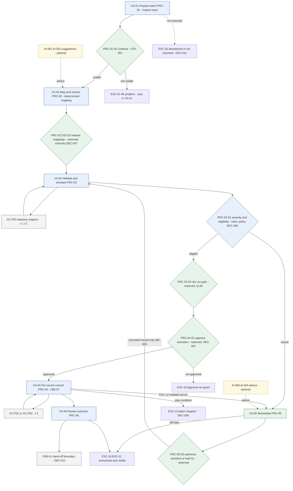
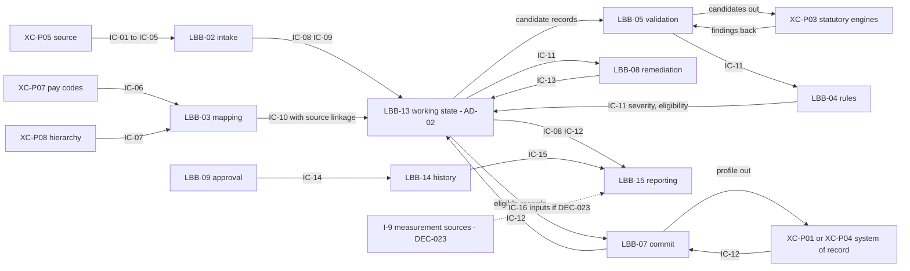
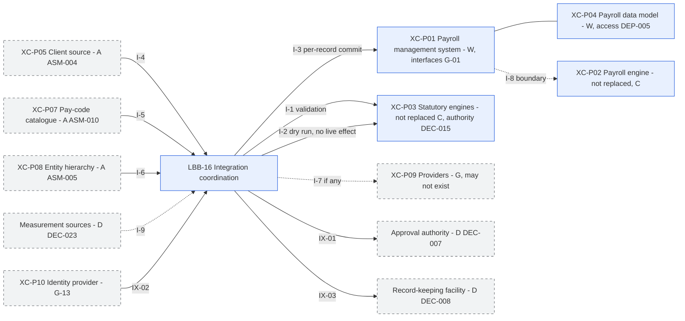
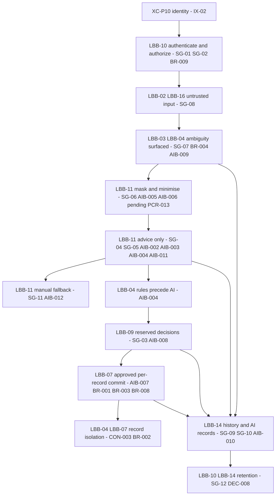
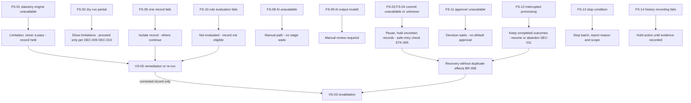

# Task 04.3, Solution Architecture Blueprint: Working Analysis

## Document control

- Artifact: SOL-003
- Task: Task 04, activity 4.3 (Solution Architecture Blueprint)
- Version: 0.1
- Status: DRAFT. Working analysis. Ready for human review. Nothing has been approved.
- Approval record: None.
- Date: 2026-11-27
- Author: AI-generated draft (Claude Code) for review by the architecture team.
- Inputs: SOL-002 (draft, immediate input), SOL-001 (draft), BIZ-001 to BIZ-008 and ARC-001 to ARC-007 (working baselines), OPS-002, OPS-003 and OPS-009 (draft, review pending), `Problem statement.md`, the Business Model Canvas blueprint, `product-backlog.md`, epic-01 to epic-06. `tech-stack.md` and `docs/solution-architecture.svg` were treated as context only (DEC-022) and are not a source of building blocks.

## 1. Executive Summary

This blueprint organises the guided activation solution into 16 technology-neutral logical building blocks (LBB-01 to LBB-16) that realise application responsibilities AR-01 to AR-11, with deterministic rules, optional AI advice and reserved human decisions held in separate blocks so that AI can never validate, approve or activate. The logical design is complete enough to guide Task 04.4, but it cannot be finalised until AD-01 (placement relative to XC-P01), AD-02 (working state and system of record), DEC-006 (blocking policy), DEC-007 (approval authority) and the gaps G-01, G-02 and G-16 are resolved.

What the blueprint establishes, as proposed architecture interpretation [W unless stated]:

- A workflow and orchestration block (LBB-06) coordinates the six stages VS-01 to VS-06 and the single-record revalidation loop, while a business rule block (LBB-04) alone decides severity, eligibility, isolation and stop conditions once their policies are approved.
- All writes to the payroll environment pass through one activation commit block (LBB-07) and one integration coordination block (LBB-16). No AI path reaches XC-P01, XC-P02, XC-P03 or XC-P04.
- AI assistance (LBB-12) is optional and detachable, reached only through a deterministic mediation block (LBB-11) that masks inputs, marks outputs as suggestions and records every suggestion with the human decision on it.
- Every reserved human decision in OPS-002 passes through an approval and authority enforcement block (LBB-09) whose authority model is deliberately left configurable because DEC-007 is open.
- Both AD-01 options (extend XC-P01, or a separate integrated service) are modelled; the blueprint does not choose.

The three programme targets remain targets: 65 percent faster activation, 75 percent fewer support touchpoints per 1,000 activations and a 99.8 percent first-time-right rate. Baselines are not agreed (DEC-005).

## 2. Architecture Scope, Inputs and Governance Status

### 2.1 Governance status and permitted scope

Repository: guided-payroll-activation. Branch: `claude/magical-mayer-itgbof`. Git status at start: clean. Permitted scope: read the repository and write this one file. No existing file was changed, no proposed change was applied, and nothing was committed. [C for the boundary set by the task prompt and CLAUDE.md]

No conflict was found between CLAUDE.md and the Task 04.3 prompt. One tension is noted for transparency: CLAUDE.md lists a proposed Google Cloud stack, while the prompt forbids using it as a basis. Both describe the stack as a proposal (DEC-022), so the prompt's narrower rule is followed without contradicting CLAUDE.md.

### 2.2 Inputs and their provenance

| Input | Role in this blueprint | Status |
| :-- | :-- | :-- |
| `Problem statement.md` | Problem, bottlenecks BN-01 to BN-05, target metrics | Verified source |
| BIZ-001 to BIZ-008 | Constraints, risks, decisions, AI opportunities and AIB rules, scope exclusions | W |
| ARC-001 to ARC-007 | CAP-001 to CAP-038, VS-01 to VS-06, VSB-01, BR-001 to BR-009, CD-001 to CD-021, PCR-001 to PCR-013 | W |
| OPS-002, OPS-003, OPS-009 | PRC-01 to PRC-06 steps and decision points, EXC-01 to EXC-23, Q-01 to Q-10, A-01 to A-07 | W, draft, review pending |
| SOL-001 | I-1 to I-9, G-01 to G-17, AD-01 to AD-03 | W, draft |
| SOL-002 | AR-01 to AR-11, XC-P01 to XC-P11, IC-01 to IC-16, TC-01 to TC-10, IX-01 to IX-03, SG-01 to SG-12, EAR-01 to EAR-08, EPC-01 to EPC-05 | W, draft |
| `tech-stack.md`, SVG | Context only | Proposal (DEC-022) |

Task 03 Part 2 has not been run. There is no approved state model, decision model, requirements catalogue or controls catalogue (G-16). Wherever this blueprint needs them, it records a gap rather than inventing content. [G]

### 2.3 Evidence labels and assessment-local references

Labels follow the prompt: C confirmed, W working baseline, A assumption, G information gap, D decision requiring approval. AIB-001 to AIB-012 are shown as "W, binding on approval"; AIB-005 and AIB-006 remain pending security confirmation (PCR-013).

New assessment-local references introduced here. They are not repository IDs and must not be copied into a register without review.

| Prefix | Meaning | Range |
| :-- | :-- | :-- |
| LBB | Logical building block | LBB-01 to LBB-16 |
| LL | Logical layer | LL-01 to LL-10 |
| VP | Architecture variation point | VP-01 to VP-12 |
| FS | Failure scenario | FS-01 to FS-14 |
| SAF | Solution architecture finding or inconsistency | SAF-01 to SAF-12 |
| SPC | Proposed baseline change raised here, recorded in this document only | SPC-01 to SPC-06 |

References from SOL-001 and SOL-002 (AR, XC-P, IC, TC, I, IX, SG, EAR, EPC, G, AD) remain assessment-local to those documents.

## 3. Architecture Principles and Binding Constraints

### 3.1 Confirmed constraints [C]

| ID | Constraint | Architectural consequence |
| :-- | :-- | :-- |
| CON-001, CON-002 | Preserve integrity and compliance; validate and simulate before hard commit | LBB-07 commits only records LBB-04 has marked eligible after LBB-05 checks |
| CON-003 | Isolate invalid records without losing valid records' status | Record-level status in LBB-13; isolation in LBB-04 and LBB-07 |
| CON-004 | Protect sensitive data; limit access and retention | LBB-10 enforces access and retention; LBB-11 masks before AI |
| CON-005 | Assume no jurisdiction or regulation | No statutory rule is held in the solution; XC-P03 remains authoritative |
| CON-006 | AI optional; must not block core activation | LBB-12 is detachable; every AI-supported step has a manual path |
| CON-007, OOS-001 | No historical payroll migration | No block accepts prior pay runs or year-to-date balances |
| CON-008, OOS-011 | No fixed error-rate threshold without policy | LBB-04 holds no default stop threshold |
| OOS-002, OOS-003 | XC-P02, XC-P03 not redesigned; XC-P06 not replaced | These stay outside the boundary in both AD-01 options |
| OOS-010, DEC-022 | No technology selection; stack is a proposal | Blueprint is logical only |
| OOS-013, OOS-014, OOS-016, OOS-017, OOS-018 | No formats or integration platform; no immutability claim; no invented retention; no analytics product | LBB-16 is a responsibility, not a platform; LBB-14 is not described as immutable; LBB-15 is not an analytics product |

### 3.2 Binding AI boundary rules [W, binding on approval]

AIB-001 to AIB-012 apply in full. The architecture treats AIB-002, AIB-004, AIB-007 and AIB-011 as structural rules: no AI block has an interaction edge to a validation decision, an approval, a commit or an external write. AIB-005 and AIB-006 are pending PCR-013.

### 3.3 Proposed architecture principles [W, proposed here for review]

1. Deterministic authority: only LBB-04 (business rules), XC-P03 (statutory rules) and LBB-09 (human authority) can change a record's eligibility or approval state.
2. Record as the unit of control: status, isolation, correction, revalidation and commit operate per record (CON-003, BR-002, BR-005).
3. Single write path: one commit coordination block and one integration block reach the system of record (BR-008, AIB-007).
4. Advice is untrusted: source data and AI output are untrusted until deterministic checks pass (SG-08).
5. Limitation is never a pass: a rule that cannot be evaluated produces a visible limitation (EXC-09).
6. Policy as configuration, not code assumption: blocking, stop, approval and retention policies stay as variation points until DEC-006, DEC-007 and DEC-008 are decided.
7. Controls are never skipped to maintain throughput.
8. Placement neutrality: every block can be realised inside XC-P01 or as a separate service (AD-01).

Policy precedence, highest first, carried from SOL-002 section 7.3: CON and OOS; statutory rules in XC-P03; BR-001 to BR-009 and the blocking policy once decided; human approval under DEC-007; AI suggestions, which carry no authority. [W]

## 4. Overall Logical Solution Architecture

### 4.1 Position

The solution sits between client source data (XC-P05) and the payroll environment (XC-P01 to XC-P04, XC-P07, XC-P08). It receives untrusted exports, reconciles and validates them with authoritative references and statutory engines, obtains human decisions where reserved, and commits eligible records one at a time to the system of record. It does not calculate payroll, decide statutory rules, replace the client HRIS or migrate historical data. [C for exclusions, W for the flow]

### 4.2 Boundary zones

| Zone | Contents | Status |
| :-- | :-- | :-- |
| Client users and source data | STK-001, STK-002, STK-005, STK-006, STK-003; XC-P05; XC-P06 (role as source unknown) | W; XC-P06 G |
| Solution boundary | LBB-01 to LBB-16 | W proposed; placement D (AD-01) |
| Payroll provider environment | XC-P01, XC-P02, XC-P03, XC-P04, XC-P07, XC-P08 | W for existence; G for details (G-01, G-02, G-11) |
| Enterprise functions | XC-P10 identity, XC-P11 governance, approval authority (IX-01), record-keeping (IX-03) | G-13, G-15; D (DEC-007, DEC-008) |
| External providers | XC-P09, which may not exist | G-12; D (DEC-004) |

### 4.3 AD-01 placement options [D]

AD-01 is open. The blueprint models both options at logical level and a combination. It does not choose.

| Aspect | Option A: extend XC-P01 activation workflow | Option B: separate service integrated with XC-P01 |
| :-- | :-- | :-- |
| LBB-01, LBB-02, LBB-03, LBB-06, LBB-08 | Enhancements to the existing wizard and its workflow | New solution responsibilities; XC-P01 wizard may remain for single-record use (G-01) |
| LBB-07 commit coordination | Internal to XC-P01; commit is a local operation | Calls XC-P01 or XC-P04 per record through LBB-16 (I-3) |
| LBB-13 working state | Held within XC-P01 (AD-02 option 1) | Held by the solution, with XC-P01 as system of record (AD-02 option 2) |
| LBB-09, LBB-10 | Reuse XC-P01 roles and approvals if they exist (G-01, G-07) | Rely on XC-P10, XC-P11 and IX-01 through LBB-16 |
| LBB-14 history | Existing XC-P01 audit facilities, if any (G-01), or IX-03 | Solution-held evidence, possibly exported to IX-03 |
| LBB-11, LBB-12 AI | Detachable from XC-P01 in either case (AIB-012) | Detachable from the service |
| Main risk | Constrained by unknown XC-P01 extensibility (G-01, EAR-02) | Two systems of record if AD-02 is not settled (EAR-03) |

In both options XC-P02, XC-P03, XC-P05 and XC-P06 stay outside the boundary, statutory evaluation stays with XC-P03, and the commit itself is performed by XC-P01 or XC-P04. [C, W]

## 5. Logical Building Block Catalogue

### 5.1 Grouping rationale

AR-01 to AR-11 are the traceability anchors. Blocks are architecture abstractions: none implies an application, service, container, database or deployable unit. Grouping decisions [W, proposed]:

- AR-01 is split: batch identity and lifecycle (CAP-010) belong with orchestration (LBB-06) because lifecycle state drives every stage, while intake and inspection (CAP-011, CAP-012) form LBB-02.
- AR-03 is split: rule evaluation (CAP-020, eligibility) forms LBB-04 so that the deterministic decision point is visibly separate from AI; validation and dry-run coordination (CAP-019, CAP-021, CAP-035 to CAP-038) form LBB-05 together with AR-04, because both coordinate with XC-P03.
- AR-05 is split: processing and progress (CAP-022) sit in LBB-06; per-record commit and recovery (CAP-023, CAP-024) form LBB-07 as the single write path.
- AR-07 is split: history (CAP-029) forms LBB-14; reporting (CAP-028) joins AR-08 (CAP-030) in LBB-15.
- AR-11 is split: deterministic mediation (masking, minimisation, marking, recording) forms LBB-11, which is core; the optional suggestion function forms LBB-12, which is detachable.
- LBB-01 (experience), LBB-13 (working state) and LBB-16 (integration) are cross-AR responsibilities that the baseline implies but does not name. They are interpretation [W, proposed].

### 5.2 Catalogue

| LBB | Name | Purpose | Responsibilities | AR | CAP | PRC and steps | IC | Interactions | Controls | Status | Open decisions |
| :-- | :-- | :-- | :-- | :-- | :-- | :-- | :-- | :-- | :-- | :-- | :-- |
| LBB-01 | Guided activation experience | Give users one guided path through all stages | Present batches, mappings, findings, approvals, remediation and outcomes; mark AI suggestions as suggestions; show limitations and attention states | AR-01 to AR-07, AR-09 (interaction only) | CAP-001 to CAP-008 (interaction) | All human steps in PRC-01 to PRC-06 | All, filtered by LBB-10 | LBB-06, LBB-09, LBB-10; XC-P10 via LBB-16 | BR-009, SG-02, PA-06 acceptance rules | W | DEC-003, DEC-009, G-06, AD-01 |
| LBB-02 | Batch intake and inspection | Accept source input and separate file problems from record problems | Accept input; inspect structure; report specific file-level reasons; capture activation context | AR-01 | CAP-011, CAP-012 | PRC-01 S2 to S5, D1, D2 | IC-01 to IC-07, IC-09 | LBB-06, LBB-13; XC-P05 via LBB-16 (I-4) | SG-08, CON-001, CON-007 | W; CAP-012 no story (PCR-011) | DEC-009, DEC-010, G-05 |
| LBB-03 | Mapping and context resolution | Reconcile source data to payroll fields, pay codes, entities and jurisdictions | Deterministic field and pay-code mapping of recognised values; entity hierarchy and inheritance; jurisdiction assignment from authoritative source; surface ambiguity; keep source linkage and effective-value source | AR-02 | CAP-013, CAP-014, CAP-016, CAP-017, CAP-018 | PRC-02 S1, S4, S7, S8 | IC-06, IC-07, IC-10 | LBB-04, LBB-11, LBB-13, LBB-09 (release gate); XC-P07, XC-P08 via LBB-16 (I-5, I-6) | BR-004, AIB-009, SG-07 | W | DEC-012, DEC-013, DEC-014, G-11 |
| LBB-04 | Business rule and policy evaluation | Hold the deterministic decisions the baseline reserves for rules | Mapping status rules; severity classification; record eligibility; isolation versus batch-stop evaluation; bulk-fix field eligibility; staleness of results after upstream change | AR-02, AR-03, AR-05, AR-06 | CAP-015 (status only), CAP-020, CAP-023, CAP-027 | PRC-03 S7, D1; PRC-04 S5, D2; PRC-05 D2 | IC-10, IC-11, IC-13 | LBB-03, LBB-05, LBB-06, LBB-07, LBB-08 | BR-001, BR-002, BR-003, BR-007, CON-008, AIB-002, AIB-004 | W; policies D | DEC-006, Q-08, G-08, G-16 |
| LBB-05 | Validation and simulation coordination | Obtain authoritative findings and a non-committing dry run before commit | Coordinate data, configuration, compensation, tax and withholding, benefits and banking validation; coordinate dry run; record rules not evaluated as limitations; validate corrected records only | AR-03, AR-04 | CAP-019, CAP-021, CAP-035 to CAP-038 | PRC-03 S1 to S6, S8, S9; D2 | IC-01 to IC-05, IC-11 | LBB-04, LBB-06, LBB-13; XC-P03, XC-P09 via LBB-16 (I-1, I-2, I-7) | CON-002, BR-006, SG-08, EXC-09 | W; dry run A (ASM-006) | DEC-015, DEC-016, Q-06, Q-07, G-02 |
| LBB-06 | Workflow and batch orchestration | Coordinate stage progression, routing and the revalidation loop | Batch identity and lifecycle; stage transitions; asynchronous processing and progress; routing to users and reviewers; exception routing; revalidation loop; attention states; resume and abandon handling | AR-01, AR-05, AR-06 | CAP-010, CAP-022, CAP-026 (loop) | PRC-01 S1, S6; PRC-03 S11; PRC-04 S3, S6; PRC-05 S8; PRC-06 S8 | IC-08 | All internal blocks | CON-003, BR-002, BR-005, AIB-007 | W; state model G-16 | DEC-011, DEC-018, Q-02, G-16 |
| LBB-07 | Activation commit coordination | Activate each eligible, approved record once | Confirm eligibility and approval immediately before commit; commit per record; isolate a failed record; detect partial completion; recover without duplicate effects | AR-05 | CAP-023, CAP-024 | PRC-04 S4, S7, D3 | IC-12 | LBB-04, LBB-06, LBB-09, LBB-14; XC-P01 or XC-P04 via LBB-16 (I-3) | BR-001, BR-003, BR-008, CON-002, CON-003, AIB-007 | W; idempotency support G-01 | DEC-017, Q-05, AD-02, G-01 |
| LBB-08 | Remediation management | Let users correct failing records without restarting the batch | Record- and field-level diagnosis; single-record correction; bulk-fix preparation and preview; apply corrections to selected records and fields only; submit corrected records for revalidation | AR-06 | CAP-025, CAP-026, CAP-027 | PRC-05 S1, S4, S5, S7, S8 | IC-11, IC-13 | LBB-04, LBB-06, LBB-09, LBB-11, LBB-13 | BR-005, BR-007, OOS-015, AIB-004 | W | DEC-019, DEC-020, Q-08 |
| LBB-09 | Approval and authority enforcement | Make every reserved human decision attributable and authorised | Enforce reserved decisions (mapping release, dry-run gate if required, activation approval, sensitive change and bulk-fix authorisation); check authority under the model once decided; record the deciding person | AR-09; supports AR-02 release gate | CAP-031, CAP-032; CAP-015 gate (see SAF-03) | PRC-02 S10, D3; PRC-03 D2; PRC-04 S2, D1; PRC-05 S6, D3 | IC-14 | LBB-01, LBB-06, LBB-07, LBB-08, LBB-14; IX-01 via LBB-16 | SG-03, AIB-007, AIB-008 | Proposed (PCR-010); CAP-031 no story (PCR-012) | DEC-007, Q-01, G-07 |
| LBB-10 | Access and data protection control | Limit who sees what, and for how long | Authenticate through the identity provider; role-based visibility; hide sensitive values from unauthorised users; apply retention rules once decided; supply masking policy to LBB-11 | AR-10 | CAP-033, CAP-034 | PRC-06 S5, S6, D1 | All, chiefly IC-01 to IC-05, IC-15 | LBB-01, LBB-11, LBB-14; XC-P10, XC-P11 via LBB-16 (IX-02) | SG-01, SG-02, SG-06, SG-12, BR-009, CON-004 | Proposed (PCR-010) | DEC-008, G-09, G-13, G-14, G-15 |
| LBB-11 | AI advisory mediation | Keep AI inside its boundary, and keep core function when AI is absent | Minimise and mask inputs before any model call; mark outputs as suggestions; route outputs to the receiving block for human review; record each suggestion and the decision on it; switch to manual path when AI is unavailable or disabled | AR-11 (deterministic part) | CAP-013, CAP-014, CAP-025 (support) | PRC-02 S2, S5; PRC-05 S2, S3 (mediation) | IC-10, IC-13, IC-15 | LBB-03, LBB-08, LBB-10, LBB-12, LBB-14 | AIB-003 to AIB-006, AIB-010, AIB-012, SG-06, SG-09, SG-11 | W; AIB-005, AIB-006 pending PCR-013 | DEC-014, PCR-013, G-15 |
| LBB-12 | Optional AI suggestion | Offer advisory suggestions where a justified benefit exists | Field-mapping suggestions (AI-001); pay-code suggestions (AI-002); plain-language explanations (AI-003); drafted corrective suggestions (AI-004) | AR-11 (optional part) | CAP-013, CAP-014, CAP-025 | PRC-02 S2, S5; PRC-05 S2, S3 | Masked subsets of IC-01 to IC-07, IC-11 | LBB-11 only | AIB-001 to AIB-012, CON-006 | D (DEC-014); detachable | DEC-014, AIB-001 evaluation |
| LBB-13 | Batch working state and information management | Hold batch and record working information before commit with source linkage | Hold mappings, assignments, findings, remediation items and record status; keep source linkage and effective-value source; expose current state to other blocks | AR-01 to AR-06 (information) | CAP-010, CAP-013 to CAP-027 (information) | All system steps | IC-01 to IC-13 | All internal blocks | CON-004, CON-007, BR-002 | W need; placement D | AD-02, DEC-008, G-14, G-16 |
| LBB-14 | Activation history and evidence | Keep a traceable record of changes, decisions and outcomes | Record mapping changes, corrections, findings, approvals, AI suggestions and human decisions, outcomes and deciding persons; support reviewer access; supply evidence to IX-03 if used | AR-07 | CAP-029 | PRC-06 S3, S4 (throughout, A-06) | IC-14, IC-15 | All internal blocks; IX-03 via LBB-16 | SG-09, SG-10, AIB-008, AIB-010, OOS-016 | W; scope D | DEC-008, G-09 |
| LBB-15 | Outcome reporting and measurement | Make results transparent and, if decided, measure outcomes | Batch and record summaries; reason and next action for each record not activated; outcome measures against targets if DEC-023 includes them | AR-07, AR-08 | CAP-028, CAP-030 (provisional) | PRC-06 S1, S2, S7 | IC-08, IC-12, IC-16 | LBB-01, LBB-13, LBB-14; I-9 sources via LBB-16 | BR-002, BR-009, OOS-018 | W; CAP-030 D (DEC-023) | DEC-023, DEC-005 |
| LBB-16 | Integration coordination | Mediate every exchange with external capabilities | Request and receive per relationship I-1 to I-9 and IX-01 to IX-03; treat inbound data as untrusted; report unavailability explicitly; never convert a failure into a pass | AR-01 to AR-10 (external exchanges) | CAP-011, CAP-014, CAP-016, CAP-019, CAP-021, CAP-023, CAP-029, CAP-033 | Steps with external dependencies | IC-01 to IC-07, IC-11, IC-12, IC-15, IC-16 | XC-P01 to XC-P11 | SG-08, AIB-005, AIB-007, OOS-014 | W need; all interfaces A or G | AD-01, G-01, G-02, G-11 to G-13 |

LBB-16 is a logical responsibility, not an integration platform or middleware product (OOS-014). Whether any block is supplied by an existing enterprise service or by XC-P01 is an open placement decision (AD-01), recorded as VP-01.

## 6. Logical Architecture Layer View

The ten candidate groupings are used, adjusted where the evidence supports it. Layers are logical groupings unless stated as a distinct responsibility.

| Layer | Purpose | Responsibilities and blocks | AR | Information dependencies | Interacts with | Controls | Distinct or grouping |
| :-- | :-- | :-- | :-- | :-- | :-- | :-- | :-- |
| LL-01 Experience and interaction | One guided path for all roles | LBB-01 | AR-01 to AR-07, AR-09 | All IC through LBB-10 filtering | LL-06, LL-07, LL-10 | SG-01, SG-02, BR-009 | Grouping; surface open (DEC-003) |
| LL-02 Batch intake and preparation | Separate input problems from record problems | LBB-02 | AR-01 | IC-01 to IC-07, IC-09 | LL-06, LL-08, LL-09 | SG-08 | Grouping |
| LL-03 Mapping and context resolution | Reconcile and surface ambiguity | LBB-03 | AR-02 | IC-06, IC-07, IC-10 | LL-04, LL-05, LL-07, LL-09 | BR-004, SG-07 | Grouping |
| LL-04 Validation, rules and simulation | Decide validity deterministically | LBB-04, LBB-05 | AR-03, AR-04, parts of AR-05, AR-06 | IC-11 | LL-06, LL-09 | CON-002, BR-001, BR-006 | Distinct: the only internal decision authority on validity |
| LL-05 Optional AI suggestion and explanation | Advisory support only | LBB-11, LBB-12 | AR-11 | Masked subsets; IC-15 for records | LL-03, LL-07 (through LBB-03, LBB-08), LL-08 | AIB-001 to AIB-012 | Distinct: must be detachable (AIB-012) |
| LL-06 Workflow and batch orchestration | Coordinate stages and records | LBB-06, LBB-07 | AR-01, AR-05 | IC-08, IC-12 | All layers | CON-003, BR-002, BR-008 | Distinct: holds the single write path |
| LL-07 Human review, approval and remediation | Reserved human decisions and corrections | LBB-08, LBB-09 | AR-06, AR-09 | IC-13, IC-14 | LL-01, LL-04, LL-06 | SG-03, AIB-008, BR-007 | Grouping; authority D (DEC-007) |
| LL-08 Information, history and evidence | Working state and history | LBB-13, LBB-14 | AR-01 to AR-07 | IC-01 to IC-15 | All layers | CON-004, SG-10 | Grouping; placement D (AD-02) |
| LL-09 Integration and external coordination | Exchanges with XC-P | LBB-16 | All external exchanges | Per relationship | LL-02 to LL-06, LL-10 | SG-08, AIB-005 | Distinct responsibility; no product |
| LL-10 Audit, monitoring and governance | Cross-cutting protection and transparency | LBB-10, LBB-15 | AR-07, AR-08, AR-10 | IC-12, IC-15, IC-16 | All layers | SG-01, SG-02, SG-12 | Cross-cutting grouping |

Operational monitoring of processing health is not modelled as a separate block. The baseline records only that STK-004 operates the capability and that monitoring scope is a gap (TC-10, G-10). LBB-06 exposes attention states; anything further waits for G-10. [G]

## 7. Business Workflow and Orchestration Architecture

### 7.1 Stage coordination

| Stage | Process | Coordinating block | Deterministic work | AI advice (optional) | Human decisions | External dependencies |
| :-- | :-- | :-- | :-- | :-- | :-- | :-- |
| VS-01 Prepare batch | PRC-01 | LBB-06 with LBB-02 | S1, S3, S4, S6; D1 | None (BIZ-007) | S2, S5; D2 | I-4 |
| VS-02 Map and resolve | PRC-02 | LBB-06 with LBB-03 | S1, S4, S7, S8 | S2 (AI-001), S5 (AI-002) | S3, S6, S9; D1, D2; S10 and D3 reserved | I-5, I-6 |
| VS-03 Validate and simulate | PRC-03 | LBB-06 with LBB-05, LBB-04 | S1 to S9, S11; D1 | None in OPS-002 (see SAF-04) | S10; D2 reserved | I-1, I-2, I-7 |
| VS-04 Process activation | PRC-04 | LBB-06 with LBB-07 | S3 to S6; D2 | None | S1; S2 and D1 reserved; S7, D3 | I-3, IX-01 |
| VS-05 Remediate | PRC-05 | LBB-06 with LBB-08 | S7, S8; D2 | S2 (AI-003), S3 (AI-004) | S1, S4, S5; D1; S6 and D3 reserved | IX-01; I-1 reused |
| VS-06 Review outcome | PRC-06 | LBB-06 with LBB-15, LBB-14 | S1 to S3, S5 to S7; D1 | None | S4, S8; D2 | IX-03, I-9 |
| VSB-01 Hand-off | None | Boundary only | None | None | None | I-8, pending DEC-021 |

The revalidation loop runs from PRC-05 S8 to PRC-03 S1 for corrected records only (BR-005). LBB-06 submits the corrected record; LBB-05 revalidates it alone; completed records are not reprocessed. Whether the dry run repeats for corrected records is open (Q-07). [W, D]

### 7.2 Alternative outcomes

| Outcome | Exception | Routing in this architecture | Status |
| :-- | :-- | :-- | :-- |
| Record isolated and routed to remediation | EXC-12 | LBB-07 marks the record failed; LBB-06 routes it to LBB-08; other records continue | W |
| Record left unresolved and visible | EXC-16, EXC-21 | LBB-13 keeps the record with reason and next action; LBB-15 shows it | W; whether a cohort may go live with it is D (Q-04) |
| Batch stopped for a condition that requires it | EXC-13 | LBB-04 evaluates the stop condition; LBB-06 stops and reports reason and scope | W; conditions D (DEC-006) |
| Batch abandoned or not resumed | EXC-20 | LBB-06 holds the batch in a visible state; abandon or resume requires a person | Proposed; D (DEC-011, Q-02) |
| Activation not approved | EXC-19 | LBB-09 records the refusal; LBB-06 keeps records eligible but not activated | Proposed; D (DEC-007) |

No additional branches are introduced. Escalation destinations for these outcomes are not modelled because none is recorded (Q-03, Q-09, Q-10). [G]

### 7.3 Batch and record status

No approved state model exists (G-16, Task 03 Part 2). The blueprint therefore requires, without defining states, that LBB-13 hold batch status and record status separately; that each record status carry the reason and next action (PRC-06 S2); that a change upstream can mark dependent findings stale (EXC-11, proposed); and that the status of one record can never be overwritten by another's failure (BR-002). The states and transitions are an open design item for Task 03 Part 2. [W need, G content]

### 7.4 Routing of work

LBB-06 routes work by stage to the performer roles in OPS-002: STK-001 for intake, mapping, review and remediation; STK-002 for implementation support; STK-005 for recovery (PRC-04 S7, A-04); STK-006 for history review (PRC-06 S4); and an unresolved approver for reserved decisions (DEC-007). Role assignments are assumptions (A-02, ARC-004). [A]

### 7.5 Gating before activation

LBB-07 commits a record only when all of the following hold at the moment of commit: LBB-04 has marked it eligible with no activation-blocking finding (BR-001); its findings are current, not stale (EXC-11); the dry run has been run if it is a required gate (Q-06, DEC-016); and LBB-09 has recorded the required approval (DEC-007, A-05). Partial commit keeps every control (BR-003). A failing record is isolated and never blocks others (CON-003, BR-002). [C for CON-002, CON-003; W for BR; D for gate policies]

### 7.6 Unresolved workflow decisions

DEC-006 (blocking and stop policy), DEC-007 and Q-01 (approval authority), DEC-016 and Q-06 (dry-run scope and gate), DEC-017 (retry and recovery), DEC-011 and Q-02 (resume or abandon), and DEC-021 and Q-04 (hand-off) remain open. Each is a configurable variation point in section 16, not a fixed branch. [D]

## 8. Deterministic Rules and AI-Assisted Architecture

### 8.1 Deterministic responsibilities [W]

| Responsibility | Block | Baseline |
| :-- | :-- | :-- |
| Input inspection and structural checks | LBB-02 | CAP-011, PRC-01 S4, D1 |
| Mapping of recognised values | LBB-03 | CAP-013, CAP-014, PRC-02 S1, S4 |
| Entity hierarchy and jurisdiction from authoritative sources | LBB-03 with I-6 | CAP-016, CAP-017, PRC-02 S7, S8; AI-005 rejected |
| Validation of data, configuration, compensation, tax, benefits, banking | LBB-05 with XC-P03 | CAP-019, CAP-035 to CAP-038, PRC-03 S2 to S6 |
| Severity classification and record eligibility | LBB-04 | CAP-020, PRC-03 S7, D1 |
| Dry-run coordination | LBB-05 with XC-P03 | CAP-021, PRC-03 S9, BR-006 |
| Approval authority enforcement | LBB-09 | CAP-031, CAP-032, DEC-007 |
| Per-record activation, isolation and recovery | LBB-07 | CAP-023, CAP-024, BR-008 |
| Revalidation of corrected records only | LBB-06, LBB-05 | CAP-026, BR-005 |
| Access, retention and audit recording | LBB-10, LBB-14 | CAP-029, CAP-033, CAP-034 |
| Status management | LBB-06, LBB-13 | CAP-010, CAP-022 |

### 8.2 AI-assisted responsibilities [W; adoption D (DEC-014)]

| Aspect | AI-001 field mapping | AI-002 pay-code mapping | AI-003 message explanation | AI-004 corrective draft |
| :-- | :-- | :-- | :-- | :-- |
| Purpose | Propose a payroll field for an unmapped source field | Propose a payroll pay code for an unknown client code | Restate a validation message in plain language | Draft a correction tied to the reported issue |
| Input, masked (AIB-006) | Field names, descriptions and non-sensitive samples only | Client code, description, catalogue extract | Finding text, rule reference, field name; no sensitive values | Finding, field name and masked value context |
| Advisory output | Suggested mapping with uncertainty shown | Suggested pay code with uncertainty shown | Explanation text | Draft correction |
| Receiving block | LBB-03 (PRC-02 S2) | LBB-03 (PRC-02 S5) | LBB-08 (PRC-05 S2) | LBB-08 (PRC-05 S3) |
| Human review | Accept, edit or reject (PRC-02 D1); unreviewed suggestion is not an approved mapping (PA-06) | Same (PRC-02 D1, S6) | Read only; no state change | Accept, edit or reject (PRC-05 D1); applied value revalidated (BR-005) |
| Controls | AIB-002, AIB-003, AIB-009, SG-04 | AIB-002, AIB-003, AIB-009 | AIB-002, AIB-004 | AIB-002, AIB-004, BR-005, OOS-015 |
| Audit (AIB-010) | Suggestion, record and field, decision, deciding person | Same | Explanation shown, record and field | Suggestion, decision, resulting value, deciding person |
| Fallback (AIB-012) | Manual mapping in PRC-02 S3 | Manual resolution in PRC-02 S6 | Original message stays visible | Manual correction in PRC-05 S4 |

The specific fields allowed into each AI input are not defined; masking and minimisation rules need the security owners (PCR-013, G-15). The input lists above are illustrative of the principle, not a specification. [G]

Rejected uses AI-005 to AI-009 do not appear as any block's responsibility. LBB-12 has one interaction: with LBB-11. It has no edge to LBB-04, LBB-05, LBB-07, LBB-09, LBB-13 writes, or LBB-16. Confidence from LBB-12 may only order or route items for review (AIB-003). AIB-001 requires each AI use to be justified against the deterministic alternative before adoption. [W, binding on approval]

## 9. Information and Data Flow Architecture

### 9.1 Creation, consumption and holding

LBB-02 creates IC-08 and IC-09 and admits IC-01 to IC-07. LBB-03 creates IC-10. LBB-04 and LBB-05 create IC-11. LBB-07 creates IC-12 from XC-P01 outcomes. LBB-08 creates IC-13. LBB-09 creates IC-14. LBB-14 creates IC-15. LBB-15 creates IC-16 if DEC-023 includes it. [W proposed]

Batch working state (IC-08 to IC-13) is held by LBB-13 until commit. Where LBB-13 sits depends on AD-02 [D]:

- AD-02 option 1: working state held within XC-P01, which is also the system of record.
- AD-02 option 2: working state held by the solution, with XC-P01 or XC-P04 as the system of record for activated profiles.
- In either option, the activated profile has one system of record, and the solution does not keep a competing copy (EAR-03).

Every mapped or corrected value in LBB-13 keeps its source linkage and effective-value source: the source field or record, the mapping or inheritance that produced it, and any correction with its deciding person (PRC-02 S9, CAP-029). Findings are assembled per record and field with severity and limitations for human review (PRC-03 S8, S10). Decisions, approvals and AI contributions are recorded in LBB-14 as IC-14 and IC-15. Information leaves the boundary only through LBB-16. [W]

### 9.2 Logical information flow matrix

| IC | Concept | Producing | Consuming | External | Controls | Status |
| :-- | :-- | :-- | :-- | :-- | :-- | :-- |
| IC-01 | Employee identity data | XC-P05 via LBB-02 | LBB-03, LBB-05, LBB-07 | I-4 in; I-1, I-2, I-3 out | CON-004, SG-02, SG-08 | W; classification unvalidated |
| IC-02 | Compensation data | XC-P05 via LBB-02 | LBB-05 | I-4; I-1, I-2 | CON-004, SG-06 | W |
| IC-03 | Tax withholding data | XC-P05 via LBB-02 | LBB-05 | I-4; I-1, I-2 | CON-004, CON-005, SG-06 | W |
| IC-04 | Banking data | XC-P05 via LBB-02 | LBB-05 | I-4; I-1, I-7 | CON-004, BR-009, SG-06 | W; I-7 G |
| IC-05 | Benefit data | XC-P05 via LBB-02 | LBB-05 | I-4; I-1 | CON-004 | W |
| IC-06 | Pay-code reference and client pay codes | XC-P07, XC-P05 | LBB-03, LBB-11 (masked) | I-5 | AIB-005 | A (ASM-010) |
| IC-07 | Entity data and hierarchy | XC-P08, XC-P05 | LBB-03 | I-6 | BR-004 | A (ASM-005) |
| IC-08 | Batch and lifecycle status | LBB-06 | LBB-01, LBB-15 | None | BR-002 | W; states G-16 |
| IC-09 | Activation context | LBB-02 | LBB-03, LBB-05 | None | None specific | W; content D (DEC-010) |
| IC-10 | Mappings, review decisions, assignments | LBB-03 | LBB-04, LBB-05, LBB-14 | None | BR-004, AIB-009 | W |
| IC-11 | Findings with severity; dry-run results with limitations | LBB-05, LBB-04 | LBB-06, LBB-08, LBB-01 | I-1, I-2 in | EXC-09, BR-006 | W |
| IC-12 | Per-record activation outcome | LBB-07 | LBB-06, LBB-15, LBB-14 | I-3 in | BR-008 | W |
| IC-13 | Remediation items and corrections | LBB-08 | LBB-05, LBB-14 | None | BR-005, BR-007 | W |
| IC-14 | Approvals with deciding person | LBB-09 | LBB-07, LBB-14 | IX-01 | SG-03, AIB-008 | Proposed (PCR-010) |
| IC-15 | Activation history, AI suggestions and decisions | LBB-14 | LBB-01, LBB-15 | IX-03 | SG-09, SG-10, OOS-016 | W; scope D (DEC-008) |
| IC-16 | Outcome measures | LBB-15 | STK-004, STK-003 | I-9 in | OOS-018 | D (DEC-023) |

Data classifications are unvalidated. No storage, schema, retention period, residency rule, encryption implementation or data owner is defined. DEC-008, DEC-001, AD-02, G-03, G-05, G-09, G-14, EAR-07 and EPC-05 are carried forward. No historical payroll data moves in any direction (CON-007). [C, G, D]

## 10. Enterprise Integration and Coordination Architecture

All external capabilities are modelled. Their implementation and interfaces are A or G. No API, endpoint, protocol, format or product is implied. Every relationship passes through LBB-16.

| Ref | Purpose | Trigger | Information | Sender | Receiver | Criticality | Required behaviour | Failure handling | Controls | Open |
| :-- | :-- | :-- | :-- | :-- | :-- | :-- | :-- | :-- | :-- | :-- |
| I-1 | Statutory and configuration validation | PRC-03 S2 to S6; revalidation | Candidate data out; findings back | LBB-05 | XC-P03 | Critical (CON-002) | Findings per record and field | Unavailable or not evaluable: limitation, never a pass (EXC-09); record not eligible | SG-08, CON-005 | DEC-015, G-02 |
| I-2 | Non-committing dry run | PRC-03 S9 | Candidates out; results and limitations back | LBB-05 | XC-P03 | Critical for BO-004 | No live effect (BR-006); limitations visible | Partial or unavailable: show limitations; whether activation may proceed is D (DEC-006, DEC-016) | BR-006 | ASM-006, Q-06, Q-07 |
| I-3 | Per-record activation commit | PRC-04 S4 after approval | Eligible profile out; outcome back | LBB-07 | XC-P01 or XC-P04 | Critical; only write to system of record | Once per eligible record; no duplicate effect (BR-008) | One record fails: isolate (EXC-12); unavailable: pause, no skipped controls; unknown outcome: hold for safe-retry check (EXC-14) | AIB-007, BR-001, BR-003 | G-01, DEC-017, AD-02 |
| I-4 | Source data intake | PRC-01 S3 | External payroll exports | XC-P05 | LBB-02 | Critical | Treat as untrusted; inspect structure | Unreadable: file-level reason (EXC-01) | SG-08, CON-007 | ASM-004, DEC-009, G-05 |
| I-5 | Pay-code catalogue | PRC-02 S4 | Pay-code reference | XC-P07 | LBB-03 | High | Authoritative read | Unavailable: pay codes stay unresolved and visible; no guess (BR-004) | BR-004 | ASM-010, G-11 |
| I-6 | Entity hierarchy | PRC-02 S7 | Parent-child structure | XC-P08 | LBB-03 | High (RSK-009) | Authoritative read; show effective values | Unavailable: assignments stay unresolved (EXC-04) | BR-004, AI-005 rejected | ASM-005, DEC-013, G-11 |
| I-7 | Verification or statutory-data providers | PRC-03 S6, if any | Banking or statutory data | LBB-05 | XC-P09 | Unknown | Only if a provider exists and is governed (SG-12) | Unavailable: limitation | SG-12, CON-004 | DEC-004, G-12 |
| I-8 | Hand-off to first live payroll | After PRC-06 S8 | Activated cohort | XC-P01 | XC-P02 | Unknown | Boundary only | Not designed | OOS-002 | DEC-021, Q-04 |
| I-9 | Measurement sources | PRC-06 S7 | Operational and support data | Sources | LBB-15 | Low for activation | Only if DEC-023 includes it | Unavailable: measures not reported; activation unaffected | OOS-018 | DEC-023, DEC-005, ASM-011 |
| IX-01 | Approval authority | PRC-02 D3, PRC-04 S2, PRC-05 S6 | Decision and deciding person | LBB-09 | Approval authority | Critical where required | Authority checked before effect | Unavailable or undefined: decision waits; no default approval | SG-03, AIB-007, AIB-008 | DEC-007, Q-01 |
| IX-02 | Identity provider | Every user interaction | Identity and role attributes | XC-P10 | LBB-10 | Critical | Authenticate before access | Unavailable: no access; no anonymous path | SG-01, SG-02 | G-13 |
| IX-03 | Record-keeping or audit facility | Every recorded event | IC-15 | LBB-14 | Enterprise facility, if any | High (RSK-013) | Evidence retained per DEC-008 | Unavailable: see FS-14 | SG-10, OOS-016 | DEC-008, G-09 |

There is no direct AI write path to XC-P01, XC-P02, XC-P03 or XC-P04 (AIB-005, AIB-007). Source data and AI output are untrusted until deterministic checks pass (SG-08).

Integration gaps not modelled in SOL-001 or SOL-002, recorded as gaps only [G]: user notification when a batch needs attention (PA-09 progress implies a need; channel unknown); a route for suspected fraud or risk indicators (EXC-22, Q-09); a dispute route (EXC-23, Q-10); escalation for unresolved tax findings (Q-03) and other exceptions; and whether XC-P06 is a direct source.

## 11. Security, Governance and Audit Architecture

| Control | Enforcing block | Enforcement point | Evidence produced | Baseline | Status |
| :-- | :-- | :-- | :-- | :-- | :-- |
| Identity and access | LBB-10 with XC-P10 | Before any user interaction (IX-02) | Sign-in and role attribution on each recorded action | SG-01 | W need; G-13 |
| Least privilege to activation detail | LBB-10, LBB-01 | Every view of record detail; PRC-06 S5 | Access decisions, scope D | SG-02, BR-009, CAP-033, CON-004 | C for CON-004; W |
| AI execution boundary | LBB-11 | Every AI call and response | Suggestion record (IC-15) | SG-04, SG-05, AIB-002 to AIB-005, AIB-011 | W, binding on approval |
| Human decision accountability | LBB-09, LBB-14 | Every reserved decision | Decision with deciding person (IC-14) | SG-03, AIB-008 | W; model D (DEC-007) |
| Deterministic, approved activation | LBB-07, LBB-04, LBB-09 | Immediately before each commit | Eligibility and approval reference with outcome (IC-12) | AIB-007, BR-001, BR-003 | W |
| Rule precedence over AI | LBB-04, LBB-05 | Every suggestion accepted is revalidated as data | Finding against accepted value | AIB-004 | W, binding on approval |
| AI unavailability and manual fallback | LBB-11 | AI call failure or AI disabled | Fallback event | SG-11, AIB-012, CON-006 | C for CON-006 |
| Untrusted input | LBB-02, LBB-16, LBB-11 | Intake and every inbound exchange | Inspection result | SG-08 | W |
| Masking before model calls | LBB-11 with policy from LBB-10 | Before every model call | Masking applied, not values | SG-06, AIB-006 | W; pending PCR-013 |
| Ambiguity surfaced | LBB-03, LBB-04 | Mapping and assignment | Ambiguity flag and resolution | SG-07, BR-004, AIB-009 | W, binding on approval |
| Record isolation | LBB-04, LBB-07, LBB-13 | Validation and commit | Per-record status | CON-003, BR-002 | C, W |
| Decision and change auditability | LBB-14 | Throughout (A-06) | IC-15 | SG-10, CAP-029 | W; scope D (DEC-008) |
| AI contribution traceability | LBB-11, LBB-14 | Each suggestion and decision | IC-15 | SG-09, AIB-010 | W, binding on approval |
| Records retention | LBB-10, LBB-14 | Per retention rule once decided | Retention actions | SG-12, CAP-034, DEC-008, OOS-017 | C for OOS-017; D |
| External provider governance | LBB-16 | Before any I-7 or AI provider use | Approval reference | SG-12, DEC-004 | D |

Classification of these controls:

1. Confirmed governance constraints: CON-003, CON-004, CON-005, CON-006, OOS-016, OOS-017. [C]
2. Proposed logical enforcement mechanisms: every enforcing block and enforcement point above. [W, proposed]
3. Enterprise services not verified: XC-P10, XC-P11, the approval authority and the record-keeping facility. [G]
4. Decisions and gaps: DEC-007, DEC-008, PCR-010, PCR-013, G-07, G-09, G-13, G-14, G-15.

No regulatory or statutory compliance is claimed. The jurisdiction and obligations remain unresolved (DEC-001, OQ-002, CON-005). History is not described as immutable (OOS-016).

## 12. Operational Resilience and Failure Handling

Controls are never skipped to maintain throughput. No availability, recovery time, retry policy, error-rate threshold or service-level figure is set (CON-008, G-04, G-10, DEC-017).

| FS | Scenario | Affected capability | Required behaviour | Human involvement | Batch and record status | Recovery consideration | Baseline |
| :-- | :-- | :-- | :-- | :-- | :-- | :-- | :-- |
| FS-01 | Statutory engine unavailable, or rule not evaluable | CAP-019, CAP-035 to CAP-038 | Report a limitation, never a pass; record not eligible for that check | STK-001 sees limitation; escalation D | Record held, not activated | Re-run validation when available | EXC-09, CON-002 |
| FS-02 | Dry run unavailable or partial | CAP-021 | Show limitations; proceed only if policy permits | Reviewer decides within policy | Records held pending policy | Repeat dry run | EXC-10, DEC-006, DEC-016, Q-06 |
| FS-03 | Commit unavailable | CAP-023 | Pause commit; keep eligibility and approvals; no partial controls | STK-005 recovers | Batch attention-required; records not yet committed | Resume without duplicates | EXC-14, BR-008, DEC-017 |
| FS-04 | Commit partly completes or outcome unknown | CAP-024 | Treat outcome as unknown until confirmed; never assume success or failure | STK-005 checks safe retry (PRC-04 D3) | Record in uncertain state (G-16) | Depends on XC-P01 safe-repeat support (G-01) | EXC-14, BR-008, Q-05 |
| FS-05 | One record fails at commit | CAP-023 | Isolate the record; continue others | STK-001 remediates | Record failed; others unaffected | Remediate and revalidate | EXC-12, CON-003, BR-002 |
| FS-06 | Source input unreadable | CAP-011 | Specific file-level reason; no record processing | STK-001 provides new input | Batch in PRC-01 | Repeat S3 | EXC-01 |
| FS-07 | Pay-code catalogue or hierarchy unavailable | CAP-014, CAP-016 | Leave affected mappings and assignments unresolved and visible | STK-001, STK-003 | Records not released to validation | Retry read | EXC-03, EXC-04, BR-004 |
| FS-08 | AI service unavailable | CAP-013, CAP-014, CAP-025 | Switch to manual path; no stage waits on AI | STK-001 maps or corrects manually | Unaffected | None needed for core | AIB-012, CON-006 |
| FS-09 | AI output invalid, uncertain or conflicting | CAP-013, CAP-014 | Show uncertainty; require manual review; never auto-accept | STK-001 decides | Mapping requires review | None | EXC-05, AIB-003, AIB-009 |
| FS-10 | Business rule evaluation fails | CAP-020 | Treat as not evaluated; record not eligible | STK-003 for rule fix | Record held | Re-evaluate after fix | BR-001, EXC-09 by analogy (SAF-07) |
| FS-11 | Approval authority unavailable or undefined | CAP-031, CAP-032 | Decision waits; no default approval | Approver per DEC-007 | Records eligible, not activated | Proceed on approval | EXC-18, EXC-19, DEC-007 |
| FS-12 | Processing interrupted part-way | CAP-022, CAP-024 | Preserve completed outcomes; resume without duplicates | STK-005 (A-04, Q-05) | Batch interrupted; per-record status kept | Resume or abandon is D | EXC-14, EXC-20, PA-11, DEC-011, Q-02 |
| FS-13 | Condition requires the whole batch to stop | CAP-023 | Stop; report reason and affected scope | STK-001, STK-003 | Batch stopped; records keep status | Conditions D | EXC-13, DEC-006, CON-008 |
| FS-14 | Audit or history recording fails | CAP-029 | Do not complete a decision or commit whose evidence cannot be recorded (proposed, SAF-08) | STK-004 | Affected action held | Re-record then proceed | AIB-008, AIB-010, DEC-008 |

## 13. Architecture Diagrams

All diagrams use Mermaid 8.8.0 compatible syntax (graph, subgraph with bracketed titles, quoted labels, solid, dotted and thick edges, classDef). Boxes are logical responsibilities, never components, services or stores.

### 13.1 Diagram 1: Overall logical solution architecture

Under Option A of AD-01, the solution boundary sits inside XC-P01 and LBB-16 exchanges with XC-P01 become internal. Under Option B, it is a separate boundary as drawn. No AI edge reaches LL-04, LL-06 commit or LL-09.

### 13.2 Diagram 2: Logical building block architecture

### 13.3 Diagram 3: Business workflow and decision architecture

The dry-run gate (PRC-03 D2) is drawn on the path because OPS-002 places it there; whether it is a required gate is open (Q-06).

### 13.4 Diagram 4: AI and deterministic processing boundary

```mermaid
graph LR
    %% SOL-003 Diagram 4. DRAFT. AI has no edge to any decision, validation, approval or commit.
    classDef ai fill:#fff8e1,stroke:#b7791f,stroke-dasharray: 5 5
    classDef det fill:#e8f0fe,stroke:#1a56db
    classDef hum fill:#e6f4ea,stroke:#137333
    SRC["Untrusted source data - XC-P05, SG-08"]
    CHK["LBB-02 structural checks"]
    MAP["LBB-03 deterministic mapping"]
    subgraph ADV [Advisory zone - optional, detachable AIB-012]
        MSK["LBB-11 minimise and mask - AIB-005 AIB-006"]
        AIS["LBB-12 AI suggestion - AI-001 to AI-004 - no authority"]
        MRK["LBB-11 mark as suggestion - untrusted"]
    end
    HUM["Human review - accept, edit, reject - AIB-002 AIB-008"]
    MAN["Manual path when AI absent - AIB-012"]
    RUL["LBB-04 business rules - BR-001 to BR-009"]
    STA["XC-P03 statutory validation - AIB-011"]
    APP["LBB-09 reserved approval - AIB-007"]
    COM["LBB-07 per-record commit"]
    AUD["LBB-14 record suggestion and decision - AIB-010"]
    SRC --> CHK --> MAP
    MAP -->|"unmapped items"| MSK
    MSK --> AIS
    AIS -.-> MRK
    MRK --> HUM
    MAP --> MAN
    MAN --> HUM
    HUM -->|"accepted value as data"| RUL
    RUL --> STA
    STA --> RUL
    RUL -->|"eligible"| APP
    APP --> COM
    MRK --> AUD
    HUM --> AUD
    class SRC,CHK,MAP,MSK,MRK,RUL,STA,COM,AUD det
    class AIS ai
    class HUM,MAN,APP hum
```

### 13.5 Diagram 5: Information and data flow

### 13.6 Diagram 6: Enterprise integration

### 13.7 Diagram 7: Security and governance enforcement

### 13.8 Diagram 8: Operational resilience and failure handling

FS-06, FS-07 are covered in the table in section 12; they stop progression for the affected input or record and add no new path.

## 14. Business-to-Solution Traceability Matrix

Every Level 2 and Level 3 capability in ARC-001 is covered. Level 1 groups are covered through their children.

| CAP | PRC and step | AR | LBB | IC | Integration | Control | Status |
| :-- | :-- | :-- | :-- | :-- | :-- | :-- | :-- |
| CAP-010 Batch identification and lifecycle | PRC-01 S1, S6 | AR-01 | LBB-06, LBB-13 | IC-08 | None | BR-002 | W |
| CAP-011 Input acceptance and inspection | PRC-01 S3 to S5 | AR-01 | LBB-02, LBB-16 | IC-01 to IC-07 | I-4 | SG-08 | W |
| CAP-012 Activation context capture | PRC-01 S2 | AR-01 | LBB-02 | IC-09 | None | None specific | W; no story (PCR-011) |
| CAP-013 Field mapping | PRC-02 S1 to S3 | AR-02, AR-11 | LBB-03, LBB-11, LBB-12 | IC-10 | None | AIB-002, AIB-009 | W |
| CAP-014 Pay-code mapping | PRC-02 S4 to S6 | AR-02, AR-11 | LBB-03, LBB-11, LBB-12 | IC-06, IC-10 | I-5 | AIB-002, BR-004 | W |
| CAP-015 Mapping review and approval | PRC-02 S10, D3 | AR-02 | LBB-03, LBB-09 | IC-10, IC-14 | IX-01 if required | SG-03 | W; authority D; see SAF-03 |
| CAP-016 Hierarchy and inheritance | PRC-02 S7 | AR-02 | LBB-03 | IC-07 | I-6 | BR-004 | W |
| CAP-017 Jurisdiction assignment | PRC-02 S8 | AR-02 | LBB-03 | IC-10 | I-6 or G | CON-005 | W; source G-03 |
| CAP-018 Ambiguity surfacing | PRC-02 S9, D2 | AR-02 | LBB-03, LBB-04 | IC-10 | None | BR-004, SG-07 | W |
| CAP-019 Data and configuration validation | PRC-03 S1, S2, S8 | AR-03 | LBB-05 | IC-11 | I-1 | CON-002 | W |
| CAP-020 Severity classification | PRC-03 S7, D1 | AR-03 | LBB-04 | IC-11 | None | BR-001 | W; policy D (DEC-006) |
| CAP-021 Dry-run simulation | PRC-03 S9, S10, D2 | AR-04 | LBB-05 | IC-11 | I-2 | BR-006 | A (ASM-006); D |
| CAP-022 Asynchronous processing and progress | PRC-04 S3, S6 | AR-05 | LBB-06 | IC-08 | None | CON-003 | W |
| CAP-023 Eligible-record activation and isolation | PRC-04 S4, S5, D2 | AR-05 | LBB-07, LBB-04 | IC-12 | I-3 | BR-001 to BR-003 | W |
| CAP-024 Recovery without duplicates | PRC-04 S7, D3 | AR-05 | LBB-07 | IC-12 | I-3 | BR-008 | W; G-01 |
| CAP-025 Error diagnosis | PRC-05 S1 to S3 | AR-06, AR-11 | LBB-08, LBB-11, LBB-12 | IC-11, IC-13 | None | AIB-004 | W |
| CAP-026 Correction and revalidation | PRC-05 S4, S7, S8 | AR-06 | LBB-08, LBB-06 | IC-13 | I-1 reused | BR-005 | W |
| CAP-027 Reviewed bulk correction | PRC-05 S5 to S7, D2 | AR-06 | LBB-08, LBB-04 | IC-13 | None | BR-007, OOS-015 | W; fields D |
| CAP-028 Outcome reporting | PRC-06 S1, S2 | AR-07 | LBB-15 | IC-08, IC-12 | None | BR-002, BR-009 | W |
| CAP-029 History recording | PRC-06 S3, S4 | AR-07 | LBB-14 | IC-15 | IX-03 | SG-10, AIB-010 | W; scope D (DEC-008) |
| CAP-030 Outcome measurement | PRC-06 S7 | AR-08 | LBB-15 | IC-16 | I-9 | OOS-018 | D (DEC-023) |
| CAP-031 Activation approval | PRC-04 S2, D1 | AR-09 | LBB-09 | IC-14 | IX-01 | SG-03, AIB-007 | Proposed (PCR-010); no story (PCR-012) |
| CAP-032 Sensitive change authorization | PRC-05 S6, D3 | AR-09 | LBB-09 | IC-14 | IX-01 | SG-03, AIB-008 | Proposed (PCR-010) |
| CAP-033 Role-based access | PRC-06 S5, D1 | AR-10 | LBB-10 | All | IX-02 | SG-01, SG-02, BR-009 | Proposed (PCR-010) |
| CAP-034 Retention control | PRC-06 S6 | AR-10 | LBB-10, LBB-14 | All, chiefly IC-15 | IX-03 | SG-12 | Proposed; D (DEC-008) |
| CAP-035 Compensation validation | PRC-03 S3 | AR-03 | LBB-05 | IC-02, IC-11 | I-1 | CON-002 | W |
| CAP-036 Tax and withholding validation | PRC-03 S4 | AR-03 | LBB-05 | IC-03, IC-11 | I-1 | CON-005, AIB-011 | W |
| CAP-037 Benefit plan validation | PRC-03 S5 | AR-03 | LBB-05 | IC-05, IC-11 | I-1 | CON-002 | W |
| CAP-038 Banking detail validation | PRC-03 S6 | AR-03 | LBB-05 | IC-04, IC-11 | I-1, I-7 | BR-009, CON-004 | W; I-7 G |

All of AR-01 to AR-11 appear above. LBB-01 and LBB-16 trace through every row that has user interaction or an external exchange.

## 15. AI Constraint Enforcement Matrix

| AIB | Binding constraint | Enforcement point | LBB | Evidence | Status |
| :-- | :-- | :-- | :-- | :-- | :-- |
| AIB-001 | AI only where justified against the deterministic alternative | Adoption decision before enabling LBB-12 | LBB-12 (governance gate, external to runtime) | Adoption decision (DEC-014) | W, binding on approval; D |
| AIB-002 | AI suggests; people approve; rules and statutory engines decide validity | No AI edge to LBB-04, LBB-05, LBB-09 | LBB-11, LBB-04, LBB-09 | Suggestion and decision records | W, binding on approval |
| AIB-003 | Confidence is not proof; only orders or routes review | Marking step in LBB-11 | LBB-11, LBB-01 | Confidence shown with suggestion | W, binding on approval |
| AIB-004 | No bypass of rules, policies, validation, authorization or activation gates | Accepted value re-enters LBB-04 and LBB-05 as data | LBB-04, LBB-05, LBB-07 | Findings on accepted values | W, binding on approval |
| AIB-005 | No unrestricted access; inputs limited to need | Minimisation before call; LBB-12 has no other interaction | LBB-11 | Input scope record | W; pending PCR-013 |
| AIB-006 | Mask sensitive values before any model call | Masking before call, policy from LBB-10 | LBB-11, LBB-10 | Masking applied flag | W; pending PCR-013 |
| AIB-007 | AI cannot approve, activate or commit | Commit only via LBB-07 after LBB-09 | LBB-07, LBB-09 | Approval reference on commit | W, binding on approval |
| AIB-008 | High-impact decisions have human accountability; decider recorded | Reserved decisions | LBB-09, LBB-14 | IC-14 | W, binding on approval |
| AIB-009 | Ambiguity surfaced, never silently treated as correct | Mapping and assignment status rules | LBB-03, LBB-04 | Ambiguity flags | W, binding on approval |
| AIB-010 | Every suggestion and decision recorded with record and field | After each suggestion and decision | LBB-11, LBB-14 | IC-15 | W, binding on approval |
| AIB-011 | AI does not determine statutory rules or calculate payroll | Statutory checks only via LBB-05 and XC-P03 | LBB-05, LBB-12 scope | Absence of statutory scope in LBB-12 | W, binding on approval |
| AIB-012 | Core activation works without AI | Manual path for every AI-supported step | LBB-11 | Fallback event | W, binding on approval; C via CON-006 |

## 16. Architecture Decisions and Variation Points

No decision is made here. Each decision is mapped to a variation point (VP) so the blueprint can absorb the outcome without redesign.

| Decision | Aspect | LBB affected | Alternatives kept open | Information needed | Blocks |
| :-- | :-- | :-- | :-- | :-- | :-- |
| AD-01 (VP-01) | Solution placement | LBB-01 to LBB-03, LBB-06 to LBB-10, LBB-14, LBB-16 | Extend XC-P01; separate service; combination | XC-P01 extensibility, interfaces, ownership (G-01) | Further logical design of interfaces and all implementation |
| AD-02 (VP-02) | Working state and system of record | LBB-07, LBB-13, LBB-14 | Within XC-P01; solution-held with XC-P01 as system of record | Data model access (DEP-005), ownership (EPC-05) | Data design and implementation |
| AD-03 | Stack adoption | None logically | Adopt none, selected, or as starting point | STK-004 decision | Implementation only |
| DEC-001 | Jurisdiction | LBB-05, LBB-10, LBB-11 | Not recorded | OQ-002, G-03 | Implementation; residency and statutory scope |
| DEC-003, DEC-009 (VP-03) | Delivery surface and input methods | LBB-01, LBB-02, LBB-16 | UI, API, workspace, combination | G-05, G-06 | Implementation |
| DEC-006 (VP-04) | Blocking and stop policy | LBB-04, LBB-06, LBB-07 | Policy-driven classes and stop conditions | STK-003 policy (DEP-008) | Detailed rule design; not the logical structure |
| DEC-007, Q-01 (VP-05) | Approval authority and separation of duties | LBB-09, LBB-07, LBB-08 | Per batch, per record, per change type; same or different person | STK-003 model (G-07) | Detailed approval design |
| DEC-008 (VP-06) | Audit events, visibility, retention, export | LBB-10, LBB-14 | Not recorded | STK-011 (G-09, G-15) | Detailed evidence design |
| DEC-011, Q-02 (VP-07) | Resume or abandon | LBB-06 | Not recorded | STK-004 | State model (G-16) |
| DEC-014 (VP-08) | Deterministic, AI-assisted or combined mapping | LBB-11, LBB-12 | Deterministic only; AI-assisted; combined | AIB-001 justification | Nothing in core; LBB-12 only |
| DEC-015, DEC-016 (VP-09) | Authoritative engine; dry-run scope | LBB-05 | Not recorded | Statutory engine owners (G-02) | Integration design of I-1, I-2 |
| DEC-017, Q-05 (VP-10) | Retry, recovery, who recovers | LBB-07, LBB-06 | Not recorded | XC-P01 safe-repeat support (G-01) | Detailed recovery design |
| DEC-021, Q-04 (VP-11) | Hand-off to first live payroll | LBB-15, LBB-06 | In scope; out of scope | STK-004 | Only if in scope |
| DEC-023, DEC-005 (VP-12) | Outcome measurement | LBB-15 | In scope; out of scope | Baselines, I-9 sources | LBB-15 measurement only |
| PCR-010 | Accept CAP-008, CAP-009 | LBB-09, LBB-10 | Accept; reject; amend | Reviewer decision | Traceability of LBB-09, LBB-10 |
| Q-03 | Tax finding escalation | LBB-06 | Not recorded | Jurisdiction known | Routing detail |
| Q-06, Q-07 | Dry-run gate; dry run on corrections | LBB-05, LBB-06 | Not recorded | STK-003 | Gate configuration |
| Q-08 | Required field not applicable | LBB-04 | Not recorded | STK-003 | Rule detail |
| Q-09, Q-10 | Fraud indicators; disputes | LBB-06, LBB-16 | Not recorded | Owners not assigned (G-17) | Exception routing for EXC-22, EXC-23 |

Only AD-01 and, to a lesser extent, AD-02 block further logical design. The others block detailed design or implementation only, because the blueprint holds them as variation points.

## 17. Dependencies, Assumptions and Information Gaps

Dependencies DEP-001 to DEP-009 remain open and are carried from SOL-002 section 9.2. Assumptions relied on: ASM-004, ASM-005, ASM-006, ASM-008, ASM-010, ASM-011, A-02, A-03, A-04, A-05, A-06. [A]

Information gaps, all open [G]:

| Gap | Effect on this blueprint |
| :-- | :-- |
| G-01 | LBB-07 recovery model and AD-01 options depend on per-record commit and safe repeat |
| G-02 | LBB-05 depends on engine identity and dry-run support |
| G-03 | Residency, statutory scope, AI processing location |
| G-04, G-10 | No sizing, availability or recovery design possible |
| G-05, G-06 | LBB-01, LBB-02 surface and intake |
| G-07, G-08 | LBB-09 and LBB-04 policies |
| G-09 | LBB-14 event scope |
| G-11, G-12, G-13 | I-5, I-6, I-7, IX-02 |
| G-14 | Tenant isolation in LBB-10 and LBB-13 |
| G-15 | No control can be confirmed; AIB-005, AIB-006 pending |
| G-16 | No state model; status behaviour in LBB-06 and LBB-13 is undefined |
| G-17 | No route for EXC-22, EXC-23 |

Additional observations, not new gap identifiers: no story covers AI-003 or AI-004 (SAF-04); notification channels are not modelled; the client HRIS role as a source is unknown.

## 18. Architecture Quality and Consistency Review

| Area | Check | Result |
| :-- | :-- | :-- |
| Business | Capabilities realised | Yes, all Level 2 and 3 in section 14 |
| Business | VS-01 to VS-06, loop, VSB-01 | Yes; VSB-01 kept as boundary |
| Business | Reserved decisions preserved | Yes, all four OPS-002 reserved decisions pass through LBB-09 |
| Business | Scope exclusions | Yes; no historical data, no engine or HRIS replacement |
| Application | AR-01 to AR-11 represented | Yes |
| Application | Placement open | Yes, AD-01 modelled both ways |
| Application | Unnecessary components | LBB-01, LBB-13 and LBB-16 are interpretation; reviewers may merge them |
| Data | IC-01 to IC-16 traceable | Yes, section 9.2 |
| Data | Source linkage and AI records | Yes, LBB-13 and LBB-14 |
| Data | Ownership, classification, retention, residency gaps | Visible, not resolved |
| Integration | I-1 to I-9, IX-01 to IX-03 | Yes, section 10 |
| Integration | Assumptions visible | Yes, all A or G |
| Security | AIB-001 to AIB-012 enforced | Yes, section 15 |
| Security | Accidental AI authority | None found: LBB-12 interacts only with LBB-11 |
| Operational | Failure scenarios | 14 scenarios; no service figures |
| Governance | Statuses, neutrality, file changes | Maintained; no technology named; only SOL-003 created |

Inconsistencies and unresolved issues found. They are reported, not corrected.

| SAF | Finding | Sources |
| :-- | :-- | :-- |
| SAF-01 | AD-01 to AD-03 have no register entry; EPC-01 remains unapplied | SOL-001, SOL-002, BIZ-005 |
| SAF-02 | SOL-002 maps AR-01 to CAP-010 to CAP-012, but lifecycle state behaves as an orchestration concern; this blueprint splits AR-01 across LBB-02 and LBB-06 | SOL-002 3.3 |
| SAF-03 | CAP-015 mapping release (PRC-02 D3) is a reserved decision, but AR-09 covers only CAP-031 and CAP-032; LBB-09 is proposed to enforce it too | OPS-002, SOL-002 3.3 |
| SAF-04 | AI-003 and AI-004 appear in OPS-002 PRC-05 S2, S3 but no story covers them; only PA-06 covers AI suggestions | OPS-002, product-backlog.md, SOL-002 AR-11 |
| SAF-05 | OPS-002 classifies PRC-03 S1 and S9 as DETERMINISTIC while STK-001 performs them; the trigger is human and the execution deterministic | OPS-002 |
| SAF-06 | EXC-11 stale validation result is proposed, but no rule defines what makes a finding stale | OPS-003 |
| SAF-07 | No exception type covers a failure of business rule evaluation itself; FS-10 relies on EXC-09 by analogy | OPS-003 |
| SAF-08 | FS-14 proposes holding an action when its evidence cannot be recorded; the baseline does not state this | AIB-008, AIB-010, DEC-008 |
| SAF-09 | OPS-002 PRC-03 D2 places the dry-run gate on the main path, though Q-06 leaves the gate open | OPS-002, OPS-009 |
| SAF-10 | OPS-002 PRC-06 S7 reports against target metrics as a standard step, while CAP-030 is provisional pending DEC-023 | OPS-002, ARC-001 |
| SAF-11 | `tech-stack.md` and the SVG still carry items flagged in EPC-02 to EPC-04 | SOL-002 |
| SAF-12 | Notification, fraud, dispute and escalation routes have no integration relationship | SOL-001, SOL-002, OPS-003 |

Proposed baseline changes, recorded here only and not applied:

| SPC | Proposed change | Rationale |
| :-- | :-- | :-- |
| SPC-01 | Extend AR-09 or CAP-008 to cover mapping release (CAP-015, PRC-02 D3) | SAF-03 |
| SPC-02 | Add stories or acceptance criteria for AI-003 and AI-004, or mark them out of first release | SAF-04 |
| SPC-03 | Define staleness of findings in Task 03 Part 2 | SAF-06 |
| SPC-04 | Add an exception for business rule evaluation failure to OPS-003 | SAF-07 |
| SPC-05 | Decide whether an action may complete when its evidence cannot be recorded, under DEC-008 | SAF-08 |
| SPC-06 | Mark PRC-06 S7 as conditional on DEC-023 | SAF-10 |

## 19. Key Findings and Recommendations

Findings:

1. The baseline supports a coherent logical architecture of 16 blocks that keeps deterministic authority, AI advice and human decisions structurally separate. [W]
2. The single write path (LBB-07 through LBB-16) and the advisory-only AI zone (LBB-11, LBB-12) make AIB-002, AIB-004, AIB-005 and AIB-007 enforceable by structure rather than by convention. [W proposed]
3. AD-01 is the one decision that blocks further logical design, because it moves the boundary of most blocks. [D]
4. The three critical integrations (I-1, I-2, I-3) rest on unknown systems; the partial commit and recovery model may need redesign if G-01 closes unfavourably. [G]
5. Without a state model (G-16), status behaviour is a requirement without a definition. [G]
6. Governance controls are proposed but cannot be confirmed until governance owners are named (G-15). [G]

Recommendations, highest priority first:

1. Decide AD-01, or formally instruct Task 04.4 to carry both options.
2. Close G-01 and G-02 with the payroll provider and statutory engine owners before integration detail for I-1, I-2 and I-3.
3. Decide AD-02 to confirm one system of record before data design.
4. Run Task 03 Part 2 to supply the state model, decision model and controls (G-16), resolving SAF-06 and SAF-07.
5. Decide or explicitly defer DEC-006 and DEC-007; keep VP-04 and VP-05 configurable until then.
6. Name governance owners and confirm AIB-005 and AIB-006 (G-15, PCR-013).
7. Review SPC-01 to SPC-06 and EPC-01 to EPC-05 with the owners of the affected artifacts.
8. Decide DEC-014 against AIB-001 before any design effort on LBB-12.
9. Obtain volume and service expectations (G-04, G-10) before any resilience sizing.

## 20. Handover to Task 04.4

The Task 4 learning guide describes activity 4.4, Integration architecture, as identifying source and destination systems, information exchanged, triggers, communication patterns and failure-handling needs, distinguishing confirmed integration facts from proposed design choices. Its expected output is an Integration Architecture View and integration inventory. Nothing further is assumed about its scope.

| Handover item | Content |
| :-- | :-- |
| Established | 16 logical building blocks; layer view; workflow coordination; AI and deterministic boundary; information flow matrix; integration responsibilities per relationship; control enforcement points; 14 failure scenarios; full CAP and AIB traceability |
| Unresolved | AD-01, AD-02, AD-03, DEC-001, DEC-006, DEC-007, DEC-008, DEC-011, DEC-014 to DEC-017, DEC-021, DEC-023, PCR-010, PCR-013, Q-01 to Q-10 |
| Blocks to refine | LBB-07 and LBB-16 (after G-01), LBB-05 (after G-02), LBB-06 and LBB-13 (after G-16 and AD-02), LBB-09 (after DEC-007), LBB-10 and LBB-14 (after DEC-008, G-15) |
| Gaps blocking progression | G-01, G-02, G-13, G-16; for integration inventory also G-05, G-11, G-12 |
| Decisions needing human approval | All in section 16, and acceptance of this blueprint's LBB, VP and SPC proposals |
| Relationships to validate | I-1 to I-9 and IX-01 to IX-03 existence and direction; whether XC-P06 is a source; whether IX-03 exists; notification, fraud, dispute and escalation routes (SAF-12) |
| Carry forward to 4.4 | Section 10 as the starting integration inventory; Diagram 6; the failure handling rules in section 12 for I-1, I-2, I-3; the untrusted-input and no-AI-write rules; both AD-01 options |

## 21. Validation Notes

What was checked:

- Every repository identifier used (CAP, VS, VSB, PRC, step and decision IDs, EXC, BR, AIB, AI, CON, OOS, DEC, DEP, ASM, A, Q, RSK, PCR, PA, BO, KPI, STK) was taken from the source artifacts, SOL-001 or SOL-002. Assessment-local references are listed in section 2.3.
- No technology, product, vendor, protocol, interface, storage structure, retention period, jurisdiction, volume or service target is named or implied.
- AI is described only as suggesting. No block gives AI authority to validate, approve, activate or commit.
- Record isolation and single-record revalidation are preserved.
- Target metrics are stated as targets with baselines not agreed.
- Only this file was created. No existing file was changed.

What was not fully checked:

- OPS-002 was read at step and decision level; its capability operations view was not reread in full. ARC-003, ARC-005 and BIZ-001 to BIZ-006 were used through SOL-001 and SOL-002 rather than reread line by line.
- The eight Mermaid diagrams were not rendered. A render through the Mermaid CLI was attempted and not permitted in this environment. The diagrams were checked by reading against Mermaid 8.8.0 syntax only: graph, subgraph with bracketed titles, quoted labels, solid, dotted and labelled edges, classDef and class statements, with no `:::` shorthand and no bidirectional edges.

## Task 04.3, Solution Architecture Blueprint

- Status: Working architecture analysis.
- Authorisation: Task 04 working analysis under CLAUDE.md and DEC-022; no separate authorisation record exists.
- Formal human approval: Not obtained.
- Technology selection: None.
- Vendor selection: None.
- Physical deployment architecture: Not defined.
- Implementation: Not performed.
- Repository modifications: One new file, SOL-003. No existing file changed.
- Outstanding decisions and information gaps: Explicitly identified.
