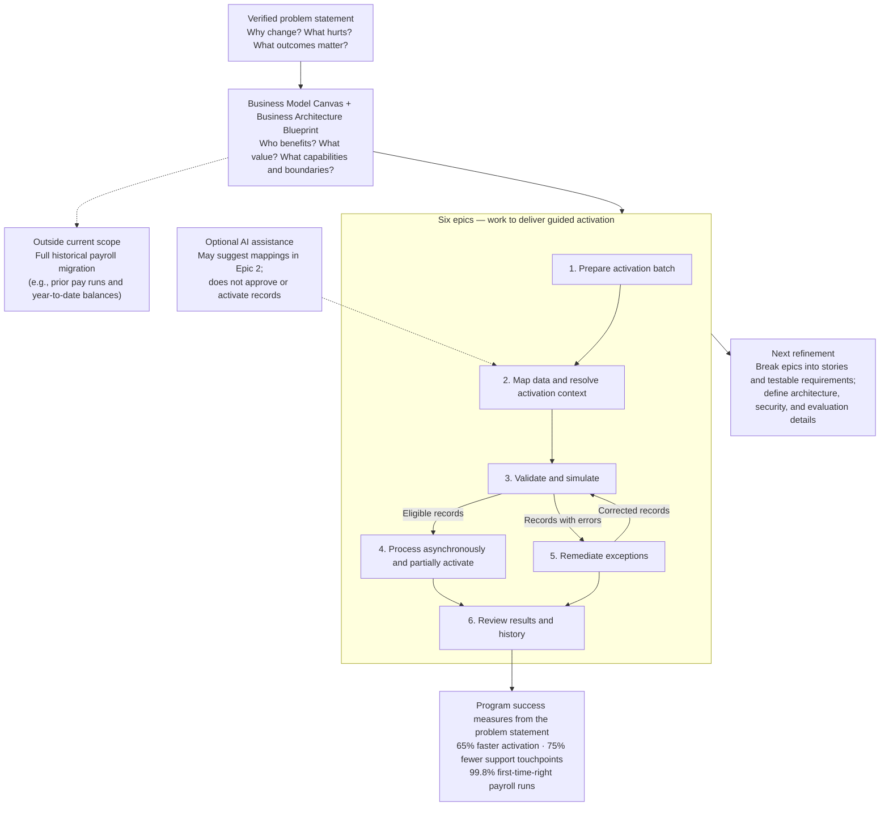

# Requirements Document Map

This diagram shows how the current project documents relate: the verified problem statement establishes the need, the business model and architecture blueprint frame the response, and the epics organize the guided-activation work.

## How to read this

- The **problem statement** is the source of the verified problem and program-level success targets.
- The **Business Model Canvas and Business Architecture Blueprint** describe the guided-activation value and its scope.
- The **epics** break that scope into outcomes. Their sequence represents the user journey; engineering dependencies may differ.
- The remediation loop sends corrected records back through validation; it does not mean restarting the full batch.
- AI is optional and limited to assistive mapping. It does not replace validation or make activation decisions.
- The current focus is **data preparation for activating employee profiles**, not migration of historical payroll records such as prior pay runs or year-to-date balances.

## Related project documents

- [Problem statement](./Problem%20statement.md)
- [Business Model Canvas and Business Architecture Blueprint](./Business%20Model%20Canvas%20to%20Business%20Architecture%20Blueprint.md)
- [Epic 1: Prepare a Guided Activation Batch](./epic-01-guided-activation-batch-setup.md)
- [Epic 2: Map Data and Resolve Activation Context](./epic-02-map-data-and-resolve-activation-context.md)
- [Epic 3: Validate and Simulate Guided Activation](./epic-03-validate-and-simulate-guided-activation.md)
- [Epic 4: Process Batches Asynchronously and Partially Activate](./epic-04-process-batches-asynchronously-and-partially-activate.md)
- [Epic 5: Remediate Activation Exceptions](./epic-05-remediate-activation-exceptions.md)
- [Epic 6: Review Activation Results and History](./epic-06-review-activation-results-and-history.md)
