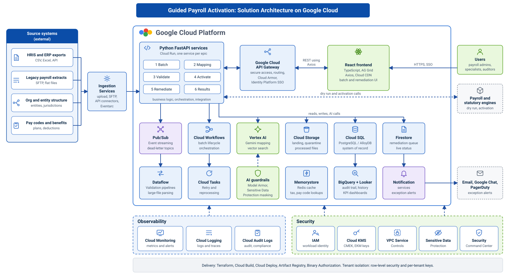
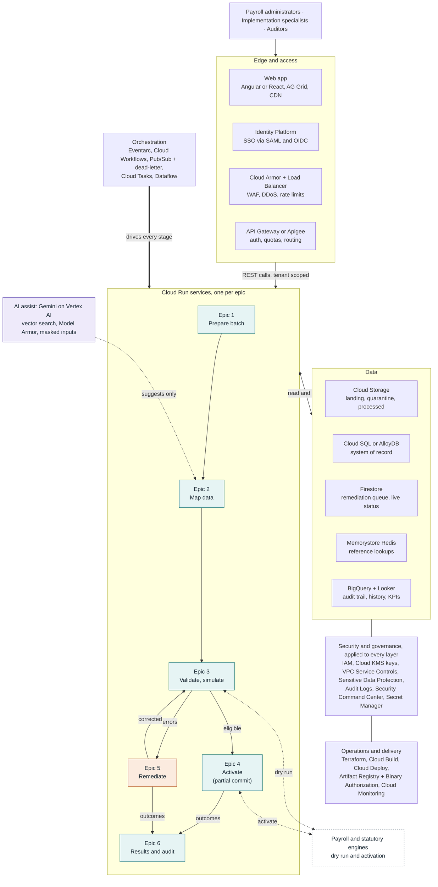
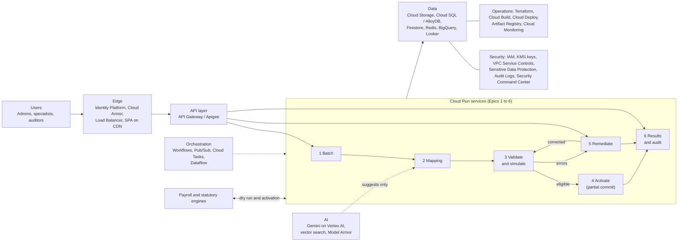
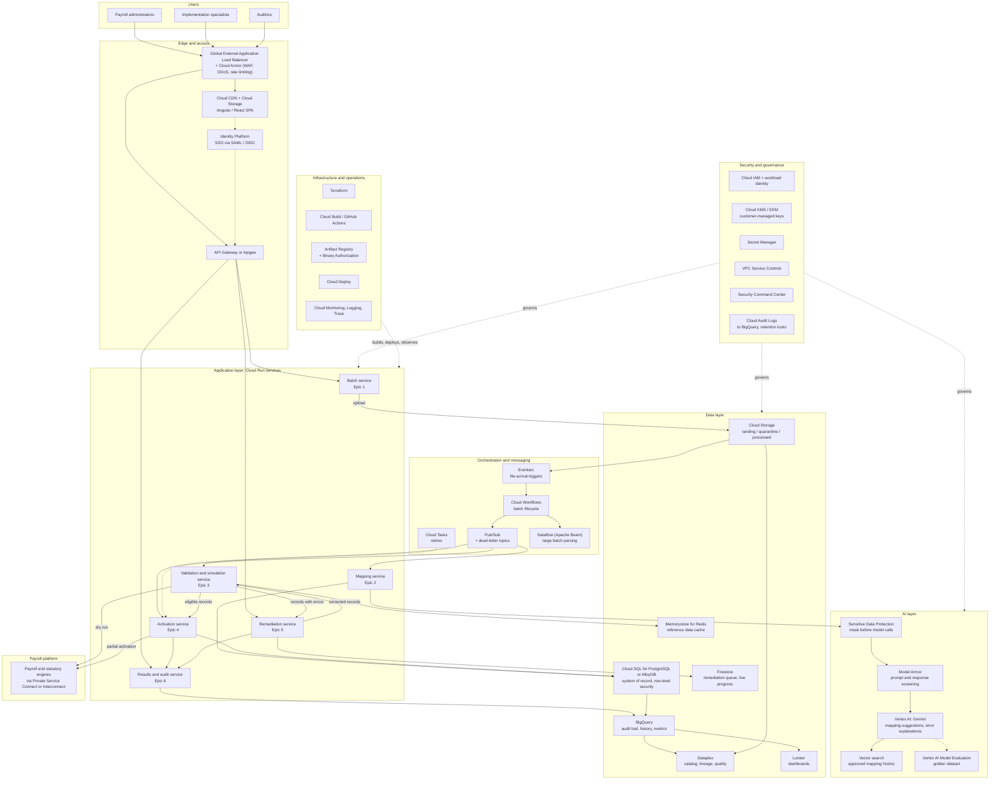

# Proposed Technology Stack and Solution Architecture (Google Cloud)

This is a proposed baseline for the solution architecture diagram. It is an AI-generated draft that needs validation by the engineering and security teams.

## Executive summary

The proposed stack is event-driven and serverless-first on Google Cloud. Cloud Run and Pub/Sub handle asynchronous batch processing, Cloud SQL for PostgreSQL holds transactional payroll data, BigQuery handles audit and analytics, and Vertex AI with Gemini provides assistive schema mapping. Security rests on VPC Service Controls, customer-managed encryption keys, tenant isolation, and Sensitive Data Protection, because the data includes tax IDs and bank details.

## Solution architecture (layered view)

The same view as a Mermaid diagram, which stays editable as text:

## Architecture overview (one view)

## Architecture diagram (detailed)

The diagram shows the layers of the solution and how the six epics flow through them.

## Frontend

- Angular or React with TypeScript, served from Cloud Storage behind Cloud CDN and the Global External Application Load Balancer. Angular suits teams that want a structured enterprise framework.
- Material UI components and a virtualized data grid such as AG Grid for cell-level error display and bulk edits across thousands of rows.
- Real-time batch progress and remediation queue updates through Firestore listeners or Server-Sent Events from Cloud Run.
- Identity Platform for sign-in, with SSO through SAML and OIDC for client identity providers.

## Backend and integration

- Cloud Run services in Java (Spring Boot), Go, or Node.js (NestJS), organized by domain: batch, mapping, validation, activation, remediation, and results and audit.
- API Gateway or Apigee as the front door. Apigee is the better choice if external partner APIs, quotas, and monetization are needed.
- Pub/Sub for events between stages, with dead-letter topics for failed records.
- Cloud Tasks for per-record or per-chunk retries, and Cloud Workflows for orchestrating the batch lifecycle.
- Dataflow (Apache Beam) for large batch parsing and chunked processing when volumes exceed what Cloud Run handles comfortably.
- Cloud Scheduler for timed jobs, and Eventarc for file-arrival triggers.
- Private connectivity to payroll and statutory engines through Private Service Connect or Cloud Interconnect where they are hosted outside Google Cloud.

## AI layer

- Vertex AI with Gemini for assistive column-to-field mapping, pay code matching, and plain-language error explanations with corrective suggestions.
- Vector search over approved historical mappings, using Vertex AI Vector Search, AlloyDB pgvector, or BigQuery vector search, to retrieve similar mappings as few-shot context.
- Structured JSON output, so suggestions are machine-checkable.
- Guardrails: AI only suggests and never approves or activates. Every suggestion carries a confidence score, a human accept or reject step, and a logged outcome. Deterministic rules remain the authority for validation.
- Model Armor and Vertex AI safety filters for prompt and response screening. Sensitive Data Protection masks tax IDs and bank details before any model call.
- Vertex AI Model Evaluation and a golden dataset to measure mapping accuracy over time.

## Data architecture

- Cloud SQL for PostgreSQL, or AlloyDB for higher throughput, as the system of record for batches, mappings, validation results, and remediation items. Row-level security provides tenant isolation.
- Cloud Storage for raw uploaded files, with separate buckets for landing, quarantine, and processed data, plus retention policies and object versioning.
- BigQuery for the audit trail, activation history, and success-metric reporting (cycle time, support touchpoints, first-time-right rate).
- Firestore for low-latency remediation queue state and live progress.
- Memorystore for Redis for caching reference data such as tax jurisdiction and pay code lookups.
- Dataplex for data catalog, lineage, and quality rules. Looker for dashboards.
- Cloud Spanner only if multi-region, globally consistent writes become a requirement.

## Infrastructure and operations

- Region choice driven by data residency requirements, with multi-zone high availability by default and a multi-region disaster recovery plan for Cloud SQL and Cloud Storage.
- Terraform for infrastructure as code, with a landing zone using a Google Cloud Organization, folders, and separate projects per environment (dev, test, staging, production).
- Cloud Build or GitHub Actions for CI, Artifact Registry for images, and Cloud Deploy for progressive delivery with Binary Authorization.
- GKE is not recommended initially. Move to it only if workloads need custom scheduling or sidecars that Cloud Run cannot support.
- Cloud Monitoring, Cloud Logging, Cloud Trace, and Error Reporting for observability, with SLOs on batch completion time and record throughput.
- Autoscaling per service, with concurrency limits and Pub/Sub flow control to protect downstream statutory engines.
- Cost controls: budgets and alerts, BigQuery slot reservations or on-demand caps, Cloud Run minimum instances at zero outside production, and Gemini model tiering (smaller model for routine mapping, larger model for ambiguous cases).

## Security posture

- Identity and access: Identity Platform for users, Cloud IAM with least privilege, workload identity for service-to-service calls, and no long-lived service account keys. Role-based access separates client administrators, implementation specialists, and auditors.
- Network: private Cloud Run ingress where possible, Cloud Armor at the edge, VPC Service Controls around data services, Private Google Access, and Cloud NAT for controlled egress.
- Data protection: encryption at rest with customer-managed keys in Cloud KMS (or Cloud EKM if clients require external key control), TLS everywhere, Sensitive Data Protection for discovery, masking, and tokenization of tax IDs and bank details, and Secret Manager for credentials.
- Tenant isolation: tenant ID enforced at the API, database (row-level security), and storage prefix levels, with per-tenant encryption keys for higher-sensitivity clients.
- Audit and compliance: Cloud Audit Logs (including data access logs) exported to BigQuery with retention locks, immutable activation history, Security Command Center Premium for posture management, and Assured Workloads if regulated regions apply. Target frameworks are SOC 2, ISO 27001, GDPR, and applicable payroll and tax regulations.
- Supply chain and application security: Binary Authorization, Artifact Analysis for vulnerability scanning, dependency and static analysis in CI, and regular penetration testing.
- AI security: prompt-injection screening on uploaded file content, data masking before model calls, no training on customer data, and logged model inputs and outputs under the same retention rules as other personal data.

## Epic to component mapping

- Epic 1, Prepare a batch: Batch service, Cloud Storage, Eventarc, Cloud SQL.
- Epic 2, Map data and resolve context: Mapping service, Vertex AI (Gemini), vector search, Sensitive Data Protection, Cloud SQL.
- Epic 3, Validate and simulate: Validation and simulation service, Memorystore, payroll and statutory engines (dry run).
- Epic 4, Process asynchronously and partially activate: Activation service, Cloud Workflows, Pub/Sub, Cloud Tasks, Dataflow.
- Epic 5, Remediate exceptions: Remediation service, Firestore, AG Grid frontend.
- Epic 6, Review results and history: Results and audit service, BigQuery, Looker, Cloud Audit Logs.

## Open decisions, in priority order

1. Confirm data residency, compliance frameworks, and whether the payroll and statutory engines are on Google Cloud, since these drive region, network, and database choices.
2. Decide the compute model for processing (Cloud Run with Pub/Sub, or Dataflow) based on expected batch size and peak concurrency.
3. Define the AI guardrail and evaluation approach for mapping before building the Epic 2 stories.
4. Choose between Cloud SQL and AlloyDB, and between API Gateway and Apigee.
